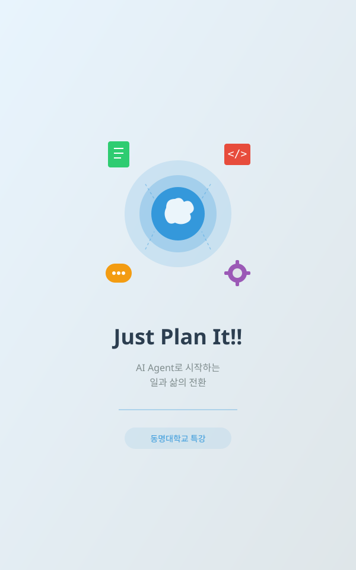
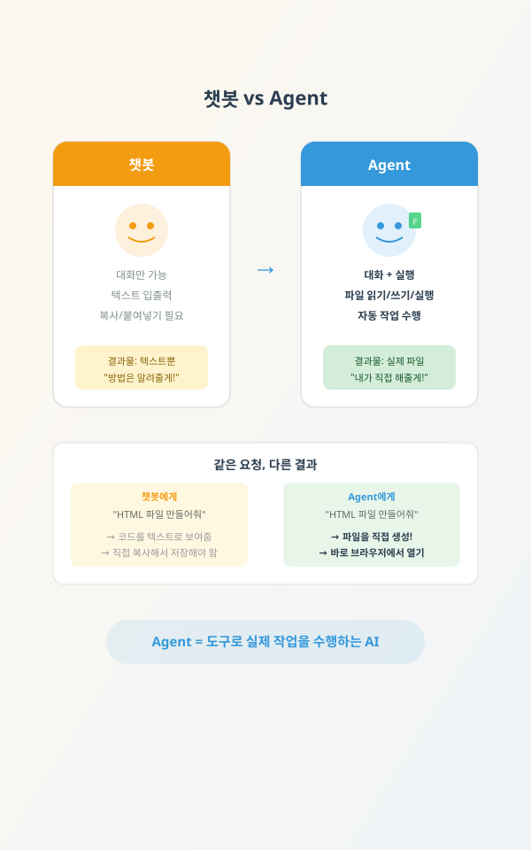
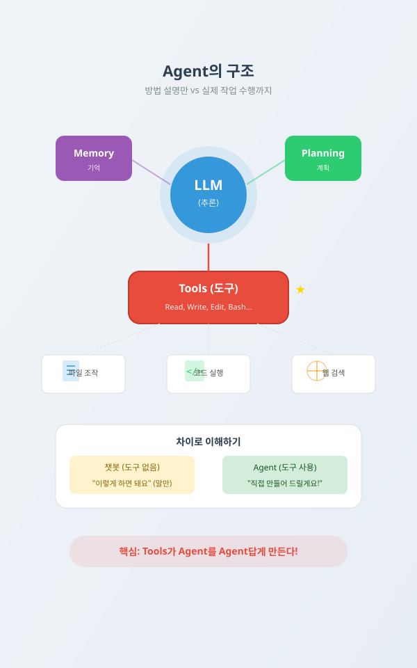

# Just Plan It!!

### AI Agent로 시작하는 일과 삶의 전환

**동명대학교 특강**

---

## 오늘의 여정

### 전체 타임라인 (2시간)

| Part | 주제 | 시간 | 핵심 내용 |
|------|------|------|-----------|
| **1** | 오프닝 | 15분 | AI Agent, 왜 지금인가? |
| **2** | 첫 체험 | 20분 | Agent 설치하고 직접 써보기 |
| **3** | 3가지 키워드 | 25분 | 선택, 계획, 문서화 |
| **4** | 실전 실습 | 35분 | 학업 도우미 + 바이브 코딩 |
| **5** | 마무리 | 15분 | AI 시대 대학생의 경쟁력 |

오늘의 핵심 메시지: <strong>Agent = 도구를 사용해 실제 작업을 수행하는 AI</strong>

---

## 챗봇 vs Agent

### ChatGPT에게 "파일 만들어줘"라고 해본 적 있나요?

| 구분 | 챗봇 (ChatGPT) | Agent |
|------|----------------|-------|
| **할 수 있는 것** | 대화, 조언, 설명 | 대화 + **파일 생성** + **코드 실행** |
| **도구 사용** | 없음 | 파일 읽기/쓰기, 터미널 명령 실행 |
| **결과물** | "이렇게 하면 돼" (텍스트) | 실제 파일이 내 컴퓨터에 생성! |

챗봇: "코드는 이거야, 복사해서 저장해" 
Agent: "파일 만들었어. 브라우저에서 열어봐!"

---

## Agent의 구조

### Agent = LLM + Memory + Planning + Tools

| 요소 | 역할 |
|------|------|
| **LLM** (추론) | 언어 이해 및 생성 |
| **Memory** (기억) | 대화 맥락 유지 |
| **Planning** (계획) | 단계별 작업 설계 |
| **Tools** (도구) | 파일 조작, 코드 실행 |

<strong>핵심 차이</strong>: 챗봇은 방법을 설명하고, Agent는 Tools로 그 작업을 직접 수행합니다 
Tools가 Agent를 Agent답게 만듭니다!

