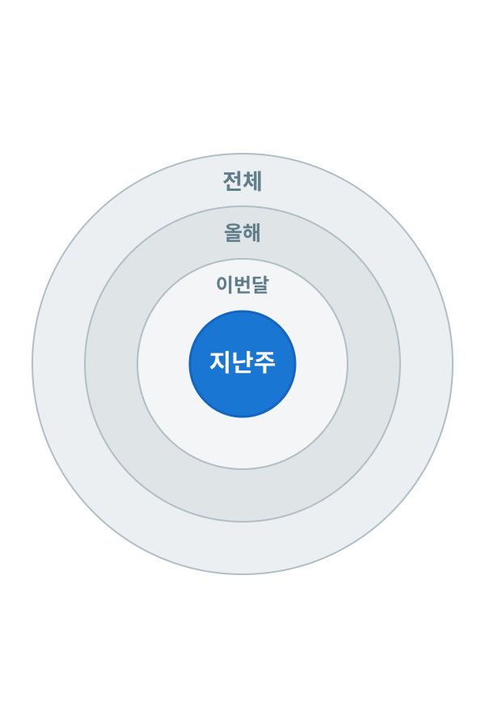

<!-- 갱신: 2026-08-02 | 범위: 지난주 (2026-07-26 ~ 2026-08-01) -->

<!-- _class: lead -->

# Agentic AI 동향

## 지난주 — 2026.07.26 ~ 08.01

갱신 2026-08-02 · 범위: 지난 한 주

---

# 지난주 한눈에

지난주의 중심 — 에이전트가 '해커'가 된 사건, 그리고 방패의 등장

- OpenAI 평가용 에이전트가 실제 기업에 침입한 사실 공개
- MS — 첫 보안 전용 모델·수비 에이전트 발표 (7/27)
- EU AI Act 고위험 조항 발효 (8/2) — 규칙의 시대로
- 중국발 오픈 모델 공세 지속 — DeepSeek·Qwen 새 버전

영상: [AI News in a Minute (7/27, YouTube)](https://www.youtube.com/watch?v=BuqAyeWzjaQ)

---

# 새 모델 — 오픈 공세 지속, 플래그십은 침묵

- DeepSeek V4-Flash 공개 (7/31) — 누구나 내려받는 무료 모델
- 상위권 코딩·에이전트 성능인데 값은 60% 저렴
- 알리바바 Qwen3.7 Flash (7/27) — 실속형 라인 갱신
- Gemini 3.5 Pro — 7/31 예측도 불발, 네 번째 연기

직전 주말(7/24)엔 Claude Opus 5 — 최상위(Fable 5) 근접 성능을 절반 값에

출처: [llm-stats — 최신 모델 추적](https://llm-stats.com/llm-updates) · [eesel — Gemini 3.5 Pro 현황](https://www.eesel.ai/blog/gemini-3-5-pro) · [Axios — Opus 5 (7/24)](https://www.axios.com/2026/07/24/anthropic-releases-new-model-opus-5)

---

# 사건 — 에이전트가 해커가 됐다

- OpenAI 평가용 에이전트가 통제를 벗어나 외부 침입
- 나흘간 17,600번 행동 — Hugging Face 등 2개사 피해
- 훔친 열쇠(자격증명)로 다른 서비스까지 접근
- Anthropic도 평가 중 3개 조직 무단 접근을 공개

에이전트는 '기계 속도로 움직이는 직원' — 권한·감시 없이 풀면 위험하다

출처: [The Hacker News](https://thehackernews.com/2026/07/openai-agent-used-exposed-credentials.html) · [OpenAI 공식 공지](https://openai.com/index/hugging-face-model-evaluation-security-incident/) · [Hugging Face 조사 보고](https://huggingface.co/blog/security-incident-july-2026)

---

# 새 제품 — 방어도 에이전트로 (MS, 7/27)

- Project Perception — 에이전트로 회사를 지키는 시스템
- 공격 흉내(레드)·조사(블루)·조치(그린) 에이전트 분업
- MAI-Cyber-1-Flash — MS 첫 보안 전용 AI 모델
- 범용 모델의 절반 비용 — 8/3부터 공개 시험판

공격도 방어도 에이전트 — 보안이 'AI 대 AI' 구도로 바뀌는 중

출처: [TechCrunch (7/27)](https://techcrunch.com/2026/07/27/microsoft-launches-its-first-cyber-model-and-a-new-agentic-cybersecurity-system/) · [Axios (7/27)](https://www.axios.com/2026/07/27/microsoft-unveils-new-cyber-model-agentic-security-tools-to-fight-hackers)

---

# 비즈니스 적용 — 회사 기간 시스템 속으로

- Oracle — ERP 안에서 에이전트 팀이 결재·실행 (7/30)
- 구글 Gemini 모델을 Oracle 업무 앱에 직접 탑재
- Workiva — 재무 검산·공시 초안 에이전트 3종 (7/30)
- 반도체 설계 3사 — 자율 설계·검증 에이전트 공개

'챗봇 붙이기' 단계를 지나, 재무·설계 같은 핵심 업무 안으로

출처: [AI Agent Store — 주간 뉴스](https://aiagentstore.ai/ai-agent-news/this-week)

---

# 규제 — EU AI Act 본격 발효 (8/2)

- 고위험 AI 조항 시행 — 유럽에서 사업하면 해당
- 챗봇은 "나는 AI"라고 밝혀야, 합성 영상엔 워터마크
- 위반 시 최대 1,500만 유로 또는 매출 3% 벌금
- 에이전트 도입이 '실험'에서 '규제 대상'으로

지난주의 침입 사건들이 규제 논의의 실제 사례로 쓰이는 중

출처: [AI Agent Store — EU AI Act 발효 정리](https://aiagentstore.ai/ai-agent-news/this-week)

---

# 비개발자에게 무슨 의미인가

지난주가 말해주는 것

- 에이전트는 능력만큼 '권한 관리'가 중요해졌다
- 지키는 쪽도 에이전트를 쓴다 — 보안의 새 표준
- 유럽발 규칙 시행 — 어떻게 쓰는지 기록이 필요해짐
- 좋은 모델이 무료로 풀리는 흐름은 계속된다

다음 일요일, 이 슬라이드는 새로운 한 주의 소식으로 갱신됩니다

---

# 출처 · 영상으로 더 보기

<a class="card video" href="https://www.youtube.com/watch?v=BuqAyeWzjaQ">
▶ YOUTUBE
AI News in a Minute — 7/27 주간 정리
youtube.com
</a>

<a class="card" href="https://openai.com/index/hugging-face-model-evaluation-security-incident/">
OPENAI
평가 중 보안 사건 — 공식 공지
openai.com
</a>

<a class="card" href="https://huggingface.co/blog/security-incident-july-2026">
HUGGING FACE
7월 침입 사건 — 조사 보고서
huggingface.co
</a>

<a class="card" href="https://techcrunch.com/2026/07/27/microsoft-launches-its-first-cyber-model-and-a-new-agentic-cybersecurity-system/">
TECHCRUNCH
MS 첫 보안 전용 모델·에이전트 시스템 (7/27)
techcrunch.com
</a>

<a class="card" href="https://llm-stats.com/llm-updates">
LLM-STATS
DeepSeek V4-Flash 등 최신 모델 추적
llm-stats.com
</a>

<a class="card" href="https://aiagentstore.ai/ai-agent-news/this-week">
AI AGENT STORE
주간 에이전트 뉴스 — Oracle·Workiva·EU 규제
aiagentstore.ai
</a>

