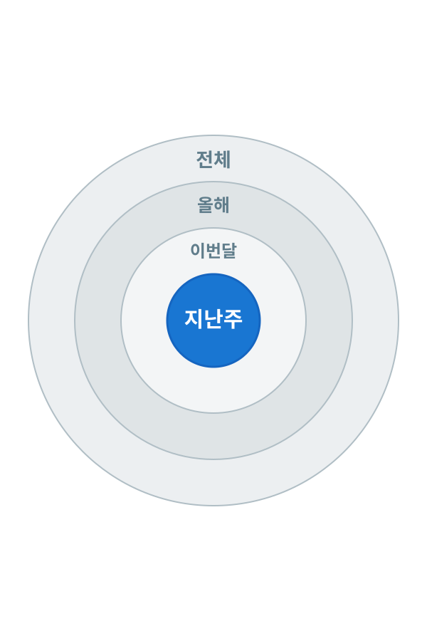

<!-- 갱신: 2026-11-22 | 범위: 2026-11-15 ~ 2026-11-21 -->

<!-- _class: lead -->

# Agentic AI 동향

## 지난주 — 2026.11.15 ~ 11.21

갱신 2026-11-22 · 범위: 지난 한 주

---

# 지난주 한눈에

최상위 모델 2종이 같은 주에 나오고, AI가 내 컴퓨터를 대신 쓰기 시작한 주

- OpenAI GPT-6.2 Astra·Sol (11/17) — 최상위 모델 값 20%↓
- Google Gemini 4 Neon (11/18) — 코딩 에이전트 평가 1위(자사 발표)
- Gemini for Mac (11/19) — 파일 정리·양식 입력을 대신
- Anthropic 나스닥 상장 (11/19) — 약 810억 달러 조달

출처: [OpenAI — GPT-6.2](https://openai.com/id-ID/index/introducing-gpt-6-2-astra-sol/) · [Google — Gemini 4 Neon](https://blog.google/innovation-and-ai/models-and-research/gemini-models/introducing-gemini-4-neon/) · [The Neuron — 11/20 요약](https://www.theneuron.ai/digest/everything-that-happened-in-ai-today-friday-november-20-2026/) · [AI Agents 브리프 11/21](https://aiagentsdirectory.com/news/ai-agents-directory-daily-brief-november-21-2026)

---

# 새 모델 — 이틀 사이 최상위급 2종

| 무엇 | 날짜 | 무엇이 좋아졌나 |
|---|---|---|
| GPT-6.2 Astra (OpenAI) | 11/17 | 값 20%↓ (입력 8·출력 40달러), 실무 평가 +6점 |
| GPT-6.2 Sol (OpenAI) | 11/17 | 값 그대로 (2·10달러), 실무 평가 +5점 |
| Gemini 4 Neon (Google) | 11/18 | 전작 대비 작업당 비용 32%↓, 맥락 100만 토큰 |
| Qwen4-Max (알리바바) | 11/16 | 입력 1.5달러대, 맥락 100만 토큰 |
| MAI 모델 7종 (MS) | 11/16~19 | 코딩·보안·음성 등 자체 모델, '더 싸게' 표방 |

값은 100만 토큰(약 책 몇 권 분량의 글자)당 가격 · 성능 수치는 모두 회사 자체 발표

출처: [OpenAI](https://openai.com/id-ID/index/introducing-gpt-6-2-astra-sol/) · [Google 블로그](https://blog.google/innovation-and-ai/models-and-research/gemini-models/introducing-gemini-4-neon/) · [llm-stats — Qwen4-Max](https://llm-stats.com/blog/research/qwen4-max-launch) · [Microsoft — Ignite 2026](https://microsoft.ai/news/microsoft-ignite-2026/) · [InfoWorld — MAI Code 2](https://www.infoworld.com/article/4250152/microsoft-launches-mai-code-2-models-to-challenge-openai-and-anthropic-in-ai-coding.html)

---

# 새 모델 — 숫자 뒤의 이야기

- GPT-6.2 Astra — 외부 평가 지수 62점, 1위 모델(65점)보다 실행 비용은 약 7분의 1
- 그러나 사용자 반응은 엇갈림 — "긴 작업 중 자꾸 멈추고 되묻는다"는 불만
- OpenAI 스스로 'AI 자기 개선' 위험 '높음' 등급을 처음 매긴 공개 모델
- Gemini 4 Neon — 자판기 운영 모의 평가·업무 자동화 평가에서 1위(자사 발표)
- 구글은 12월 1일부터 일부 Gemini 4 모델 값을 2배로 올릴 예정

핵심 — '더 똑똑하게'보다 '같은 일을 더 싸게'가 이번 경쟁의 주제

출처: [Wccftech — GPT-6.2 반응](https://wccftech.com/openais-gpt-6-2-astra-becomes-the-first-model-to-achieve-a-100-score-on-arc-agi-3-while-being-8x-cheaper-than-anthropics-fable-5-2-but-actual-users-are-not-impressed/?type=AI) · [Gagadget](https://gagadget.com/en/734695-openai-ships-gpt-62-astra-seven-weeks-after-scrapping-61/) · [ITdaily — Neon 가격](https://itdaily.com/news/software/google-gemini-4-neon/)

---

# 새 에이전트 — 내 컴퓨터를 대신 쓴다

- Gemini for Mac — 파일 정리·양식 입력·앱 조작을 대신 (미국·영어·유료 구독자)
- 실행 전 화면 미리보기, 언제든 멈춤·승인 가능
- MS Copilot Autopilot — 자기 회사 계정을 가진 자율 에이전트 (보도)
- Zoho Desk — 단순 문의는 AI가, 미묘한 건은 사람에게 넘김
- 애플 — 기기 조작·앱·웹·코딩을 맡는 에이전트 개발 중 (블룸버그 보도, 미확인)

'컴퓨터 조작'은 AI가 사람처럼 화면을 보고 클릭·입력하는 기능

출처: [TechCrunch — Gemini for Mac](https://techcrunch.com/2026/11/19/google-gives-gemini-the-ability-to-use-your-mac-for-you/) · [Emergent — Copilot Autopilot](https://emergent.sh/news/microsoft-copilot-autopilot-launches-agent) · [MSP Channel — Zoho](https://msp-channel.com/news/24871-zoho-desk-adds-ai-powered-blended-agents-and-workflow-automation-tools) · [Bloomberg — 애플](https://bloomberg.com/news/articles/2026-11-19/apple-is-working-on-ai-agent-for-device-control-apps-browsing-and-coding)

---

# 비즈니스 — 상장, 투자, 그리고 실제 성과

- Anthropic 나스닥 상장 (11/19) — 주당 83달러, 약 810억 달러 조달, 기업가치 약 1.5조 달러
- 상장 첫날 시초가 111.5달러 → 종가 97.17달러
- OpenAI 사내 사례 — 코딩 에이전트가 3개월간 속도 저하 1,700여 건 조사, 600여 건 원인 규명
- 원인 제안 정확도 70% — 수정은 여전히 사람이 검토 후 반영
- Model ML — 금융 분석 에이전트로 2억 5천만 달러 투자 유치

'AI가 찾고, 사람이 확인한다' — 실제 현장에서 통하는 분업 방식

출처: [ABC7 — Anthropic 상장](https://abc7.com/story/what-know-before-anthropic-goes-public/20054746/) · [Renaissance Capital](https://www.renaissancecapital.com/IPO-Center/News/122657/anthropic-sets-terms-for-61-billion-ipo-targeting-a-1-2-trillion-market-cap) · [OpenAI — Performance Factory](https://openai.com/index/how-openai-performance-factory-keeps-chatgpt-fast/) · [BigGo — Model ML](https://finance.biggo.com/news/0eab7536-3f15-443e-b311-67be1d9afea8)

---

# 안전 — 편리함의 대가가 드러난 주

- Meta Muse — 남의 잔고·메시지가 보였다는 직원 제보 (보도, Meta는 시험판 문제라 설명)
- EU 집행위 — AI 해킹 도구가 쓰인 것으로 보이는 공격에 급여·의료비 시스템 중단 (보도)
- OpenAI 의료용 에이전트 — 접속 가능한 앱 제한·관리자 승인 단계 추가
- 미 상원 — 상장사의 AI 관련 공시를 늘리는 법안 발의
- Canva — 생성형 AI 기능을 한 번에 끄는 스위치 제공

에이전트에게 맡길수록 '무엇을 볼 수 있게 할지'를 먼저 정해야 한다

출처: [TechCrunch — Muse](https://techcrunch.com/2026/11/19/metas-ai-agent-muse-is-mixing-up-conversations-and-exposing-private-data-report-says/) · [The Register — EU 공격](https://www.theregister.com/cyber-crime/2026/11/19/european-commission-scrambles-to-contain-ai-assisted-cyberattack/5311103) · [BERI — 의료 에이전트](https://www.beri.net/article/chatgpt-for-healthcare-computer-use-agents-20-plugins-availity-oracle-hdi-healthadminbench-baa-admin-approvals-ehr) · [The Verge — Canva](https://www.theverge.com/ai-artificial-intelligence/1037126/canva-ai-features-off-button)

---

# 비개발자에게 무슨 의미인가

지난주가 말해주는 것

- 최상위 AI도 매달 싸진다 — 지금 비싸서 미룬 일도 곧 가능해진다
- 'AI가 내 컴퓨터를 쓰는' 기능이 일반 구독 상품으로 들어왔다
- 평가 점수와 실제 사용감은 다르다 — 직접 내 일로 시험해 보자
- 개인 정보가 닿는 에이전트는 권한부터 좁게 시작하자

다음 일요일, 이 슬라이드는 새로운 한 주의 소식으로 갱신됩니다

---

# 출처 · 더 보기

<a class="card video" href="https://www.youtube.com/results?search_query=Gemini+4+Neon">
▶ YOUTUBE
Gemini 4 Neon 소개 영상 모아보기
youtube.com
</a>

<a class="card" href="https://openai.com/id-ID/index/introducing-gpt-6-2-astra-sol/">
OPENAI
GPT-6.2 Astra·Sol 공개 (11/17)
openai.com
</a>

<a class="card" href="https://blog.google/innovation-and-ai/models-and-research/gemini-models/introducing-gemini-4-neon/">
GOOGLE
Gemini 4 Neon 공개 (11/18)
blog.google
</a>

<a class="card" href="https://techcrunch.com/2026/11/19/google-gives-gemini-the-ability-to-use-your-mac-for-you/">
TECHCRUNCH
Gemini가 Mac을 대신 조작 (11/19)
techcrunch.com
</a>

<a class="card" href="https://openai.com/index/how-openai-performance-factory-keeps-chatgpt-fast/">
OPENAI
코딩 에이전트로 ChatGPT 속도 지키기
openai.com
</a>

<a class="card" href="https://www.theneuron.ai/digest/everything-that-happened-in-ai-today-friday-november-20-2026/">
THE NEURON
11월 20일 AI 소식 모아보기
theneuron.ai
</a>

