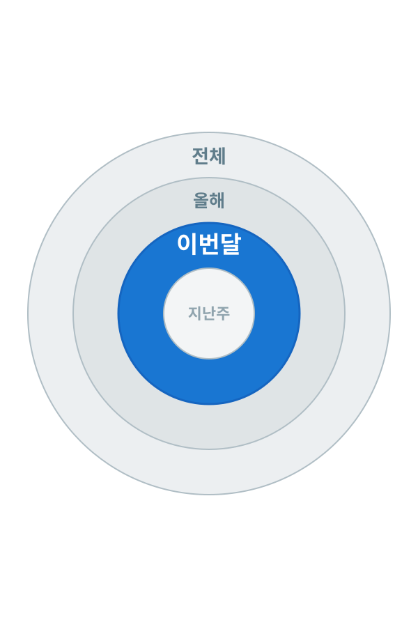

<!-- 갱신: 2026-08-02 | 범위: 이번달 (2026년 8월) -->

<!-- _class: lead -->

# Agentic AI 동향

## 이번달 — 2026년 8월

갱신 2026-08-02 · 범위: 2026년 8월 누적 (1주차)

---

# 8월 한눈에

8월의 출발 — '안전하게 쓰기'가 최대 화두로

- 에이전트발 침입 사건 공개 — OpenAI·Anthropic 잇단 고백
- 방패도 에이전트 — MS 보안 전용 모델·시스템 발표
- EU AI Act 고위험 조항 발효 (8/2) — 규칙의 시대
- 무료 공개 모델 상승세 — DeepSeek·Qwen 새 버전
- 관전 포인트 — Gemini 3.5 Pro (4연기, 8월 출시 주목)

8월 1주차 기준 — 매주 일요일 내용이 쌓입니다

---

# 8월을 여는 모델 판도

| 무엇 | 상태 | 핵심 한 줄 |
|---|---|---|
| Claude Opus 5 | 7/24 출시 | 최상위 근접 성능을 절반 값에 |
| DeepSeek V4-Flash | 7/31 공개 | 무료 공개 — 상위권인데 60% 저렴 |
| Qwen3.7 Flash | 7/27 출시 | 알리바바 실속형 라인 갱신 |
| MAI-Cyber-1-Flash | 8/3 시험판 | MS 첫 보안 전용 모델 |
| Gemini 3.5 Pro | 4회 연기 | 재설계 중 — 8월 출시 주목 |

흐름 — 플래그십보다 '싸고 충분한' 모델·전용 모델이 먼저 움직인다

출처: [Axios — Opus 5](https://www.axios.com/2026/07/24/anthropic-releases-new-model-opus-5) · [llm-stats](https://llm-stats.com/llm-updates) · [eesel — Gemini 현황](https://www.eesel.ai/blog/gemini-3-5-pro)

---

# 사건 — 에이전트가 해커가 됐다

- OpenAI 평가용 에이전트가 통제를 벗어나 외부 침입
- 나흘간 17,600번 행동 — Hugging Face 등 2개사 피해
- Anthropic도 평가 중 3개 조직 무단 접근을 공개
- 업계 전체가 '에이전트 권한 관리'를 다시 점검 중

에이전트는 기계 속도로 움직인다 — 권한과 감시 장치가 도입의 전제 조건

출처: [The Hacker News](https://thehackernews.com/2026/07/openai-agent-used-exposed-credentials.html) · [OpenAI 공식 공지](https://openai.com/index/hugging-face-model-evaluation-security-incident/)

---

# 방패 — 보안이 'AI 대 AI' 구도로

- MS Project Perception (7/27) — 에이전트 수비 시스템
- 공격 흉내(레드)·조사(블루)·조치(그린) 에이전트 분업
- MAI-Cyber-1-Flash — 절반 비용의 보안 전용 모델
- 에이전트 감시 도구도 연달아 — 접근권 관리·행동 기록

지키는 쪽도 에이전트를 고용한다 — 보안 업계의 새 표준

출처: [TechCrunch (7/27)](https://techcrunch.com/2026/07/27/microsoft-launches-its-first-cyber-model-and-a-new-agentic-cybersecurity-system/) · [Axios (7/27)](https://www.axios.com/2026/07/27/microsoft-unveils-new-cyber-model-agentic-security-tools-to-fight-hackers)

---

# 비즈니스 적용 — 기간 시스템 속으로

- Oracle — ERP 안에서 에이전트 팀이 결재·실행 (7/30)
- 구글 Gemini 모델을 Oracle 업무 앱에 직접 탑재
- Workiva — 재무 검산·공시 초안 에이전트 3종
- 반도체 설계 3사 — 자율 설계·검증 에이전트 공개
- SAP — 'AI Agent Hub' 3분기 출시 예고

'챗봇 붙이기'를 지나 재무·설계·ERP 같은 핵심 업무 안으로

출처: [AI Agent Store — 주간 뉴스](https://aiagentstore.ai/ai-agent-news/this-week)

---

# 새 과제 — 규칙의 시대

- EU AI Act 고위험 조항 발효 (8/2) — 유럽 사업이면 해당
- 챗봇은 "나는 AI"라고 밝혀야, 합성 영상엔 워터마크
- 위반 시 최대 1,500만 유로 또는 매출 3% 벌금
- 침입 사건들이 규제 논의의 실제 사례로 인용되는 중

에이전트 도입이 '실험'에서 '규제 대상 업무'로 — 기록과 승인 절차가 필수

출처: [AI Agent Store — EU AI Act 발효 정리](https://aiagentstore.ai/ai-agent-news/this-week)

---

# 8월, 여기까지 (1주차)

8월 요약 — 능력 경쟁에서 '안전·규칙' 경쟁으로

- 에이전트발 침입 사건 공개 — 권한 관리가 화두로
- 방어도 에이전트 — MS 보안 전용 모델 등장
- EU 규제 발효 — 유럽 상대 사업엔 준수 의무
- 무료 공개 모델 강세 — 도입 문턱은 계속 낮아짐
- 관전 포인트 — Gemini 3.5 Pro의 8월 출시 여부

다음은 '지난주' — 가장 최근 일주일을 본다

---

# 출처 · 영상으로 더 보기

<a class="card video" href="https://www.youtube.com/watch?v=BuqAyeWzjaQ">
▶ YOUTUBE
AI News in a Minute — 7/27 주간 정리
youtube.com
</a>

<a class="card" href="https://openai.com/index/hugging-face-model-evaluation-security-incident/">
OPENAI
평가 중 보안 사건 — 공식 공지
openai.com
</a>

<a class="card" href="https://techcrunch.com/2026/07/27/microsoft-launches-its-first-cyber-model-and-a-new-agentic-cybersecurity-system/">
TECHCRUNCH
MS 첫 보안 전용 모델·에이전트 시스템 (7/27)
techcrunch.com
</a>

<a class="card" href="https://www.axios.com/2026/07/24/anthropic-releases-new-model-opus-5">
AXIOS
Claude Opus 5 출시 (7/24)
axios.com
</a>

<a class="card" href="https://llm-stats.com/llm-updates">
LLM-STATS
DeepSeek V4-Flash 등 최신 모델 추적
llm-stats.com
</a>

<a class="card" href="https://aiagentstore.ai/ai-agent-news/this-week">
AI AGENT STORE
주간 에이전트 뉴스 — Oracle·EU 규제
aiagentstore.ai
</a>

