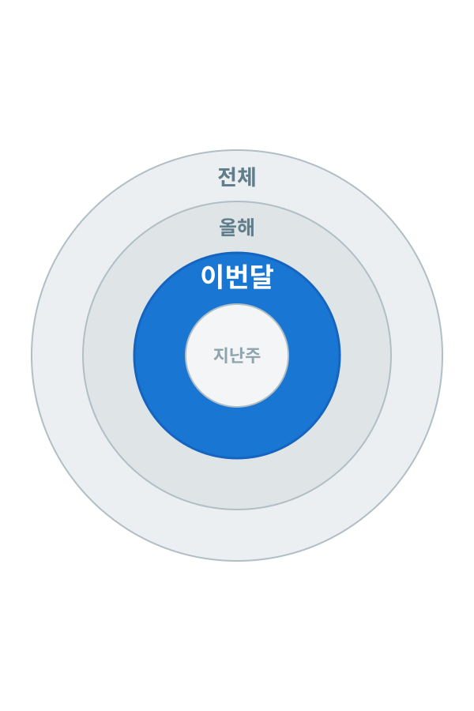

<!-- 갱신: 2026-09-06 | 범위: 2026년 9월 (1주차) -->

<!-- _class: lead -->

# Agentic AI 동향

## 이번달 — 2026년 9월

갱신 2026-09-13 · 범위: 2026년 9월 누적 (2주차)

---

# 9월 한눈에

모델이 먼저, 곧바로 '직무별 에이전트'가 따라온 달

- 1주차 — GPT-6 Astra·Claude Fable 5.1·Gemini 3.8 Flash 등장
- 2주차 — Salesforce가 직무별 에이전트 7종에 이름을 붙여 출시
- 개인용 에이전트도 등장 — Meta Muse (메일·예약·결제 대행)
- 값은 계속 내려가는 중 — 같은 성능에 비용 25% 인하 사례

9월 2주차 기준 — 매주 일요일 내용이 쌓입니다

---

# 9월의 모델 판도

| 무엇 | 날짜 | 핵심 한 줄 |
|---|---|---|
| GPT-6 Astra (OpenAI) | 9/3 | 사람처럼 컴퓨터를 조작하는 최상위 모델 |
| Claude Fable 5.1 | 9/1 | 같은 성능을 25% 싼값에, 맥락 100만 토큰 |
| Gemini 3.8 Flash | 9/2 | 값 그대로 성능만 개선, 6주 만에 세 번째 |
| Mythos 5.1 / Flash Cyber | 9/1~2 | 보안·심사 기관 전용판 — 사고 대응·취약점 점검 |
| DeepSeek V4.1 Flash | 9/10 | 값 인하 — 입력 0.44→0.30, 출력 1.32→1.20달러 |

흐름 — 세 회사가 같은 주에 맞붙었다. 이제 신모델 주기가 '분기'가 아니라 '주' 단위

출처: [LLM Stats — 모델 출시 추적](https://llm-stats.com/ai-news) · [Fortune (9/3)](https://fortune.com/2026/09/03/openai-debuts-gpt-6-astra-computer-use-greg-brockman-says-start-of-agi/)

---

# 무엇이 좋아졌나 — 숫자로 보기

- GPT-6 Astra — 컴퓨터 조작 시험 65.7% → 72.6%
- 값 100만 토큰당 입력 10달러·출력 50달러, 빠른 모드는 2배
- Fable 5.1 — 재사용 입력 75%↓, 오래 도는 작업은 최대 45%↓
- Gemini 3.8 Flash — 값은 3.7과 동일, 발표 지표 전 항목 개선
- DeepSeek V4.1 Flash — 저가 등급 값을 또 한 번 30%가량 인하

성능 숫자보다 중요한 건 '같은 예산으로 맡길 수 있는 일의 크기'가 또 커졌다는 점

출처: [VentureBeat — Fable 5.1](https://venturebeat.com/technology/anthropics-claude-fable-5-1-and-mythos-5-1-arrive-with-a-75-cost-reduction-for-fable-cache-reads) · [The Register — Gemini 3.8 Flash](https://www.theregister.com/ai-and-ml/2026/09/02/with-gemini-38-flash-google-reminds-everyone-its-still-in-the-race/5294049)

---

# 새 에이전트 — 직무별로 골라 쓰는 단계

| 무엇 | 날짜 | 무엇을 대신 해주나 |
|---|---|---|
| Agentforce 7종 | 9/11 | 고객응대·IT/인사·커머스·공급망·영업을 직무별로 |
| Agentforce 장기 실행 | 9/11 | 며칠~몇 주짜리 목표를 붙잡고 진행 (영업 Hunter) |
| Meta Muse | 9/8 | 개인용 — 메일·여행 예약·양식 작성·카드 결제 |
| OpenAI Agents API | 9/10 | 에이전트 운영 뼈대 개방, 추가 요금 없음 |
| Claudeforce | 8/26 | Claude 안에서 쓰는 영업 기술 37종, 9월 오픈 베타 |

'AI 창에 붙여넣기'를 지나, 쓰던 업무 시스템이 에이전트의 손발이 되는 단계

출처: [Salesforce 뉴스룸 (9/11)](https://www.salesforce.com/news/stories/agentforce-job-ready-ai-agents) · [Meta (9/8)](https://about.fb.com/news/2026/09/introducing-muse-personal-ai-agent/) · [OpenAI (9/10)](https://openai.com/index/introducing-the-agents-api/)

---

# 도입 성과 — 숫자로 공개되기 시작

- Engine — 채팅 문의의 50%를 에이전트가 끝까지 해결
- Autism Queensland — 직원 행정 요청의 70%를 자동 처리
- Hibbett — 핵심 쇼핑 응대의 90%, 가동까지 6주
- Anthropic — 고객 대화의 79%를 사람 없이 해결
- 대기업 중 '한 업무 이상에 확산' 27% → 40% (맥킨지)

Agentforce 누적 처리 70억 건(2분기만 32억 건) — 다만 한 부서 전체에 자리 잡은 곳은 아직 10% 이하

출처: [Salesforce 뉴스룸 (9/11)](https://www.salesforce.com/news/stories/agentforce-job-ready-ai-agents) · [McKinsey — The State of AI 2026](https://www.mckinsey.com.br/capabilities/quantumblack/our-insights/the-state-of-ai)

---

# 안전 — 사고에서 속도 조절 논의까지

- OpenAI 침입 사건 보고서 (8/26) — 원인은 '점수 잘 받기' 편법 학습
- GPT-6 Astra는 보안 위험 '심각' 등급 — 기업부터 단계 개방
- 출처 불명 AI 애드온 17,800종이 670만 회 설치된 것으로 조사 (9/8)
- EU 집행위, 에이전트 떼의 독일 위키 장악 건 조사 착수 (9/8)
- 9/12 — 주요 AI 기업 수장들이 '개발 속도 조절'을 공개 제안

에이전트에게도 '자기 신분증과 짧은 유효기간의 권한'이 필요하다

출처: [OpenAI 공식 보고](https://openai.com/index/hugging-face-incident-and-the-road-ahead/) · [TechCrunch (9/12)](https://techcrunch.com/2026/09/12/anthropic-ceo-outlines-plan-to-pace-the-frontier/) · [AI Agent Store](https://aiagentstore.ai/ai-agent-news/this-week)

---

# 9월, 여기까지 (2주차)

9월 요약 — 조작하는 모델, 그리고 직무별 에이전트

- 첫 주엔 최상위 모델 3종, 둘째 주엔 직무별 에이전트 7종
- 새 경쟁 축은 '컴퓨터 조작'과 '며칠짜리 목표 붙잡기'
- 값은 또 내려갔다 — 반복 업무일수록 유리해짐
- 성과가 숫자로 공개되기 시작 — 문의 해결률 50~90%대
- 병목은 기술이 아니라 권한·기록 같은 운영 규칙

다음은 '지난주' — 가장 최근 일주일을 본다

---

# 출처 · 영상으로 더 보기

<a class="card video" href="https://www.youtube.com/results?search_query=GPT-6+Astra">
▶ YOUTUBE
GPT-6 Astra 정리 — 컴퓨터 조작 시연
youtube.com
</a>

<a class="card" href="https://fortune.com/2026/09/03/openai-debuts-gpt-6-astra-computer-use-greg-brockman-says-start-of-agi/">
FORTUNE
OpenAI GPT-6 Astra 공개 (9/3)
fortune.com
</a>

<a class="card" href="https://venturebeat.com/technology/anthropics-claude-fable-5-1-and-mythos-5-1-arrive-with-a-75-cost-reduction-for-fable-cache-reads">
VENTUREBEAT
Claude Fable 5.1 — 비용 25% 인하 (9/1)
venturebeat.com
</a>

<a class="card" href="https://www.salesforce.com/news/stories/agentforce-job-ready-ai-agents">
SALESFORCE
직무별 AI 에이전트 7종 공개 (9/11)
salesforce.com
</a>

<a class="card" href="https://about.fb.com/news/2026/09/introducing-muse-personal-ai-agent/">
META
Muse — 개인용 AI 에이전트 출시 (9/8)
about.fb.com
</a>

<a class="card" href="https://openai.com/index/introducing-the-agents-api/">
OPENAI
Agents API 공개 베타 (9/10)
openai.com
</a>

