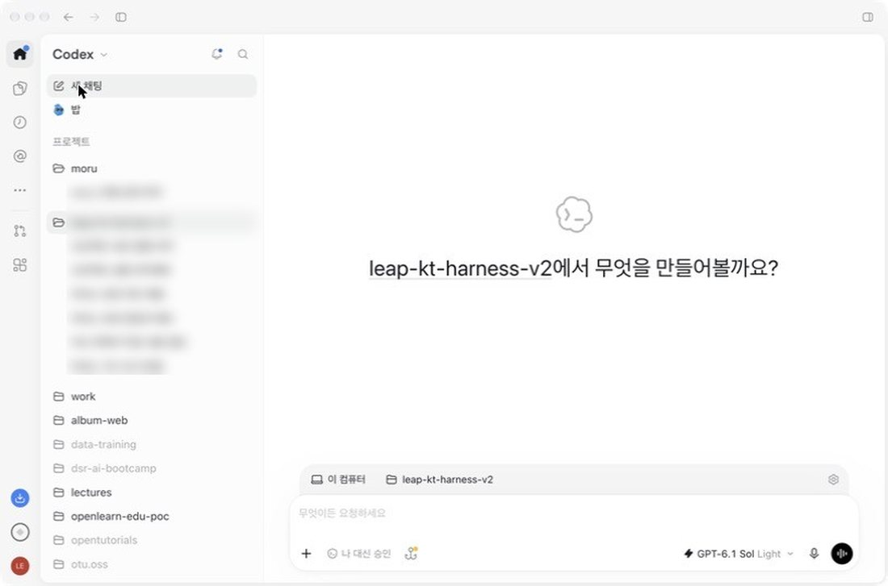
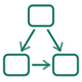

<!-- _class: lead -->

## WEEK 2 / 4

# 에이전트,
**더 잘 쓰는 방법**

120분 · 직접 해보는 시간 29분
<!--
목표: 오늘 하나만 남기면 됩니다: **내 방식 하나를 골랐다**. 세 가지 방식을 모두 익히게 하려고 하지 마세요.
지난주와 연결: 1주차 끝에서 오늘 주제를 ‘맡기는 범위를 넓힌다’로 예고했습니다. 그 내용은 다음 주에 다룹니다. 오늘은 그 전에 필요한 원리와 사용법을 다룬다고 한 문장으로 알려주세요.
첫 마디: “지난주에는 에이전트가 일을 해내는 모습을 보셨습니다. 오늘은 에이전트가 무엇인지, 어떻게 요청하면 더 좋은 결과를 얻는지를 배웁니다.”
-->

---

<!-- _footer: "2주차 · 열기 · 00:00" -->
<!-- _class: lead -->

# 2시간

1. 지난 한 주 이야기
2. 에이전트는 무엇인가
3. 세 가지 사용법
4. 하나씩 직접 해보기  ←
5. 내 방식 찾기
<!--
말할 것: 목차를 한 줄씩 읽지 마세요. 손으로 훑고 10초 안에 넘기세요.
시간 배분: 앞의 30분은 제가 말하고, 그 뒤로는 방식 하나를 듣고 바로 해보는 순서를 세 번 반복합니다. 화면에는 적지 않았습니다. 말로만 하세요.
전환: “먼저 지난 한 주 이야기를 듣겠습니다.”
-->

---

<!-- _footer: "2주차 · 열기 · 00:02" -->
<!-- _class: lead -->

# 지난 한 주,
**뭐가 잘 안 됐나요?**
<!--
진행: 5분 동안 두세 명에게 듣습니다. 잘된 일보다 잘 안 된 일을 먼저 물으세요. 잘 안 된 일을 먼저 들으면 다른 수강생도 같은 경험을 했다는 사실을 알게 되어 발언이 늘어납니다.
쓰는 법: 답을 평가하지 마세요. 들은 사례를 공유 메모에 적어 두고, 30분 뒤 ‘내 상황은 모릅니다’ 장에서 다시 언급합니다.
분류: 들은 사례는 대부분 다섯 가지 가운데 하나입니다. 작업 폴더를 고르지 않았다, 목적과 기준을 알려주지 않았다, 승인 요청을 보지 못했다, 확인 방법을 요청하지 않았다, 한 번에 너무 큰 일을 요청했다. 화면에는 없습니다. 강사만 알고 계세요.
하나 더 물을 것: “어떻게 요청할지 몰라서 아예 못 해본 일이 있나요?” 이 답은 세 번째 방식을 설명할 때 예로 씁니다.
-->

---

<!-- _footer: "2주차 · 열기 · 00:07" -->
<!-- _class: lead -->

# 잘 안 된 데에는
**이유**가 있습니다
<!--
핵심: 수강생의 능력이 부족해서 생긴 일이 아니라는 점을 여기서 분명히 말하세요.
전환: “이유를 알려면 에이전트가 어떻게 작동하는지부터 알아야 합니다.”
-->

---

<!-- _class: lead -->

## 2주차 · 에이전트란 · 00:08 – 00:33

# 에이전트는
**무엇**인가
<!--
이 구간의 목적: 세 가지를 25분 안에 전합니다. LLM이 문장을 만드는 원리, 만든 사람도 능력의 범위를 다 알지 못한다는 사실, 에이전트의 구조입니다.
주의: LLM은 처음 말할 때 ‘대규모 언어 모델’이라고 풀어서 말하고, ChatGPT 안에서 답을 만드는 모델이라고 설명하세요. 토큰, 파라미터, 트랜스포머 같은 말은 쓰지 마세요.
-->

---

<!-- _footer: "2주차 · 에이전트란 · 00:09" -->
<!-- _class: lead -->

# “대한민국의 수도는 **?**”
<!--
진행: 수강생에게 먼저 묻습니다. 채팅으로 답을 받고 다음 장으로 넘어가세요.
말할 것: “방금 여러분이 하신 일이 LLM이 하는 일입니다.”
-->

---

<!-- _footer: "2주차 · 에이전트란 · 00:11" -->
<!-- _class: lead -->

# LLM의 원리,
**다음 낱말 예측**
<!--
핵심: LLM은 앞에 쓴 문장을 읽고 다음에 올 낱말의 확률을 계산합니다. 그 확률에 따라 낱말 하나를 고르고, 고른 낱말을 문장 뒤에 더한 다음 같은 계산을 반복합니다.
말할 것: “앞에 쓴 문장이 달라지면 다음 낱말도 달라집니다. 요청을 바꾸면 결과가 달라지는 이유가 이것입니다.”
주의: ‘LLM은 문장을 미리 계획하지 않는다’고 말하지 마세요. 모델이 뒤에 올 낱말을 미리 정해 둔다는 연구 결과가 있습니다 (Anthropic, 2025, Tracing the thoughts of a large language model). ‘한 번에 낱말 하나씩 내놓는다’까지만 말하세요.
-->

---

<!-- _footer: "2주차 · 에이전트란 · 00:14" -->
<!-- _class: lead -->

# 같은 요청,
**매번 다른 답**
<!--
쓰는 법: 가능하면 직접 보여주세요. 새 채팅 두 개에 같은 요청을 보내고 결과를 나란히 놓습니다. 시연이 실패할 때를 대비해 화면 캡처를 준비해 두세요.
왜 달라지나: 이유는 두 가지입니다. 첫째, LLM은 확률이 가장 높은 낱말만 고르지 않고 확률에 따라 고릅니다. 둘째, 원하는 형식을 알려주지 않았습니다. 형식을 알려주면 차이가 줄어듭니다.
앞 장과 연결: 체크인에서 ‘요청한 것과 다른 결과’ 사례가 있었다면 여기서 다시 언급하세요.
-->

---

<!-- _footer: "2주차 · 에이전트란 · 00:16" -->
<!-- _class: lead -->

# “127 + 385 = **?**”

이 낱말을 맞히려면 덧셈을 할 수 있어야 합니다.
<!--
이 장의 역할: 지난주에 AI가 수학 난제를 풀었다고 소개했습니다. 낱말을 고르는 모델이 어떻게 수학 문제를 푸는지에 답하는 자리입니다.
말할 것: “‘사과는 영어로’ 다음 낱말을 맞히려면 번역을 할 수 있어야 합니다. 추리 소설 마지막 줄의 ‘범인은’ 다음 낱말을 맞히려면 앞의 내용을 이해해야 합니다.”
-->

---

<!-- _footer: "2주차 · 에이전트란 · 00:18" -->
<!-- _class: lead -->

# 다음 낱말을 맞히는 훈련에서
**계산 · 번역 · 추론** 능력이
함께 생겼습니다
<!--
핵심: LLM은 방대한 글에서 다음 낱말을 맞히는 훈련만 했습니다. 다음 낱말을 더 정확하게 맞히도록 훈련하는 과정에서 이런 능력이 함께 생겼습니다.
전환: “누구도 이 능력들을 하나씩 가르치지 않았습니다. 그래서 다음 일이 생깁니다.”
-->

---

<!-- _footer: "2주차 · 에이전트란 · 00:20" -->
<!-- _class: lead -->

# 만든 사람도 **어디까지 되는지**
다 알지 못합니다
<!--
이유 1: 개발자는 다음 낱말을 맞히는 훈련만 시켰습니다. 어떤 능력이 생겼는지는 일을 시켜 봐야 확인할 수 있습니다.
이유 2: 같은 모델도 요청하는 문장에 따라 결과가 크게 달라집니다. 능력이 있어도 알맞은 요청을 찾기 전에는 확인할 수 없습니다.
이유 3: 요청할 수 있는 일의 조합은 셀 수 없이 많습니다. 개발자가 출시 전에 모든 조합을 시험해 볼 수 없습니다.
주의: AI가 신비롭다는 식으로 말하지 마세요. 세 가지 이유를 차례로 말하면 구조적인 이유로 이해합니다.
-->

---

<!-- _footer: "2주차 · 에이전트란 · 00:23" -->

## 한 문장으로 정답률이 **네 배 넘게** 올랐습니다

- 산수 문제만 보여줬을 때 **17.7%**  `████`
- “단계별로 생각해 보자”를 더했을 때 **78.7%**  `███████████████████`

*정답률 100% 기준*

### 모델은 그대로였고, **요청하는 문장**만 바꿨습니다.
출처: [arxiv.org/abs/2205.11916](https://arxiv.org/abs/2205.11916)
<!--
사실: Kojima 외, Large Language Models are Zero-Shot Reasoners, 2022년 5월. MultiArith라는 산수 문제 묶음에서 text-davinci-002 모델로 측정했습니다.
핵심: 연구자들은 모델을 바꾸지 않았습니다. 요청에 한 문장을 더했을 뿐입니다. 이 방법은 모델이 공개된 뒤에 발견됐습니다.
주의: 지금의 모델에서는 이 문장의 효과가 그때만큼 크지 않습니다. ‘이 문장을 쓰라’가 아니라 ‘방법은 써 보면서 발견된다’를 전하는 장입니다.
-->

---

<!-- _footer: "2주차 · 에이전트란 · 00:26" -->
<!-- _class: lead -->

# 잘 쓰는 방법은
**지금도 발견되고 있습니다**
<!--
쓰는 법: 천천히 읽고 3초 쉬세요. 오늘 수업의 전제입니다.
말할 것: “그래서 오늘은 정답을 외우지 않습니다. 지금까지 찾아낸 방법 가운데 세 가지를 직접 해보고, 여러분에게 맞는 하나를 고릅니다.”
덧붙일 말: 오늘 배우는 세 가지도 이렇게 찾아낸 방법입니다.
주의: 세 가지가 사용법의 전부라고 말하지 마세요. 더 좋은 방법이 앞으로 발견될 수 있습니다.
-->

---

<!-- _footer: "2주차 · 에이전트란 · 00:28" -->
<!-- _class: lead -->

# 에이전트 = LLM + **도구 사용** + **반복**
<!--
핵심: 에이전트는 LLM에 두 가지 기능을 더한 프로그램입니다. 하나는 파일을 읽고 쓰고 프로그램을 실행하는 도구 사용입니다. 다른 하나는 결과를 확인하고 목표에 못 미치면 다시 하는 반복입니다.
말할 것: “파일을 읽고, 실행하고, 결과를 확인하고, 다시 합니다.”
지난주와 연결: 지난주 ‘챗봇에서 에이전트로’ 표의 내용입니다. 실습 때 Codex 화면에 작업 내용이 차례로 표시됐습니다. 그 화면이 이 반복입니다.
주의: 기술 용어를 더 늘리지 마세요. 이 한 줄이면 충분합니다.
-->

---

<!-- _footer: "2주차 · 에이전트란 · 00:30" -->
<!-- _class: lead -->

# 에이전트는 많은 분야를 알지만,
**내 상황**은 모릅니다

일의 목적 · 읽는 사람 · 좋은 결과의 기준
<!--
핵심: 에이전트는 글쓰기, 번역, 통계, 법률 같은 분야 지식을 풍부하게 갖고 있습니다. 그러나 이 일을 왜 하는지, 결과물을 누가 읽는지, 어떤 결과가 좋은 결과인지는 알지 못합니다.
앞 장과 연결: 체크인에서 들은 사례를 여기서 다시 언급하세요. 대부분은 에이전트의 한계가 아니라 내 상황을 알려주지 않아서 생긴 일입니다.
말할 것: “에이전트가 읽을 수 있는 건 여러분이 쓴 요청과 고른 폴더 안의 파일뿐입니다.”
-->

---

<!-- _footer: "2주차 · 에이전트란 · 00:32" -->
<!-- _class: lead -->

# 사용법은 곧
**내 상황을 알려주는 방법**
<!--
핵심: 오늘 배우는 세 가지는 내 상황을 에이전트에게 알려주는 세 가지 방법입니다. 누가 그 내용을 적느냐가 다릅니다.
전환: “이제 세 가지를 하나씩 직접 해보겠습니다.”
-->

---

<!-- _class: lead -->

## 2주차 · 사용법 · 00:33 – 01:26

# **세 가지** 사용법
<!--
진행: 방식 하나를 설명하고 바로 해봅니다. 이 순서를 세 번 반복합니다.
구조: 세 방식은 난이도가 아니라 요청문을 누가 적느냐로 구분합니다. 첫 번째는 내가 다 적습니다. 두 번째는 에이전트가 묻고 내가 답합니다. 세 번째는 에이전트가 요청문을 씁니다.
-->

---

<!-- _footer: "2주차 · 첫 번째 방식 · 00:34" -->
<!-- _class: lead -->

# 오늘 만들
**결과물 하나** 정하기

떠오르지 않으면 ‘다음 모임 안내문’으로 하세요.
<!--
진행: 1분 동안 정하게 하고 채팅창에 한 단어로 적게 하세요. 같은 결과물을 세 가지 방식으로 요청합니다.
좋은 과제: 이번 주에 실제로 만들어야 하는 문서가 가장 좋습니다. 안내문, 계획표, 소개 자료, 정리 문서처럼 한 장으로 끝나는 결과물을 권하세요.
주의: 회사 기밀이나 개인정보가 들어가는 결과물은 과제로 정하지 않게 하세요. 주민등록번호, 계좌번호, 고객 정보는 적지 않습니다.
왜 자기 결과물인가: 필요한 정보가 수강생의 머릿속에만 있습니다. 에이전트가 내 상황을 모른다는 사실을 실습에서 직접 확인하게 됩니다.
-->

---

<!-- _footer: "2주차 · 첫 번째 방식 · 00:36" -->
<!-- _class: lead -->

# 첫 번째,
**내가 다 적어서 요청**

프롬프트 엔지니어링
<!--
용어: 에이전트에게 보내는 요청문을 프롬프트라고 합니다. 프롬프트 엔지니어링은 넓게는 요청문을 설계하는 일 전체를 가리킵니다 (OpenAI 프롬프트 엔지니어링 안내의 정의). 오늘은 내가 직접 적는 방식이라는 좁은 뜻으로 씁니다.
진행: 다음 네 장은 요청문이 한 줄씩 늘어나는 과정입니다. 한 장에 15초씩 빠르게 넘기세요.
-->

---

<!-- _footer: "2주차 · 첫 번째 방식 · 00:37" -->
<!-- _class: lead -->

# “모임 **안내문**을
만들어줘”
<!--
말할 것: “이렇게 보내도 결과는 나옵니다. 다만 어떤 모임인지, 누가 읽는지 모르는 채로 만든 결과입니다.”
진행: 여기에 세 가지를 한 줄씩 더합니다.
-->

---

<!-- _footer: "2주차 · 첫 번째 방식 · 00:38" -->
<!-- _class: lead -->

# “**읽는 사람**은
60대 동창 스무 명이야”
<!--
이 줄의 역할: 누가 읽는지를 적는 줄입니다.
핵심: 읽는 사람을 적으면 글의 말투, 글자 크기, 설명의 자세한 정도가 달라집니다.
덧붙일 말: 목적도 여기에 함께 적습니다. 예: ‘참석 여부를 답하게 하려는 안내문이야.’
-->

---

<!-- _footer: "2주차 · 첫 번째 방식 · 00:39" -->
<!-- _class: lead -->

# “**형식**은 날짜 · 장소 · 회비,
분량은 한 장이야”
<!--
이 줄의 역할: 결과물의 형식을 적는 줄입니다.
핵심: 형식은 항목 구성과 분량입니다. 형식을 적으면 같은 요청을 다시 보내도 결과가 비슷하게 나옵니다.
앞 장과 연결: ‘같은 요청을 두 번 보내면 답이 달라집니다’ 장에서 본 차이가 여기서 줄어듭니다.
-->

---

<!-- _footer: "2주차 · 첫 번째 방식 · 00:40" -->
<!-- _class: lead -->

# “모르는 내용은
**지어내지 말고** 비워둬”
<!--
이 줄의 역할: 결과를 확인할 방법을 적는 줄입니다.
핵심: 수강생이 가장 자주 빠뜨리는 줄입니다. 에이전트는 모르는 날짜나 장소를 그럴듯한 내용으로 채울 수 있습니다. 비워 두라고 요청하면 빈칸만 확인하면 됩니다.
덧붙일 말: 파일을 읽고 만드는 결과물이라면 ‘어느 파일에서 가져온 내용인지 표시해줘’를 씁니다.
말할 것: “확인 방법을 적는 건 에이전트를 의심해서가 아닙니다. 제가 확인하기 쉽게 하려는 겁니다.”
-->

---

<!-- _footer: "2주차 · 첫 번째 방식 · 00:41" -->

## **2주차** 폴더를 만들고, 그 폴더를 고릅니다
<!--
먼저 할 일: 바탕화면에 ‘2주차’라는 빈 폴더를 하나 만들게 하세요. 그다음 새 채팅에서 이 위치를 눌러 그 폴더를 고릅니다. 지난주와 같은 순서입니다.
주의: 화면은 지난주에 찍은 캡처입니다. 폴더 이름이 ‘1주차’로 보여도 위치는 같습니다.
막히는 분: 폴더를 못 고르면 옆의 ‘이 컴퓨터’가 눌려 있는지 확인하세요.
-->

---

<!-- _footer: "2주차 · 첫 번째 방식 · 00:42" -->

## 첫 번째 실습 · **세 가지를 적어서 요청**

- **요청**: “다음 달 동창 모임 안내문을 만들어줘”
- **읽는 사람**: “읽는 사람은 60대 동창 스무 명이야”
- **형식**: “형식은 날짜 · 장소 · 회비, 분량은 한 장이야”
- **확인**: “모르는 내용은 지어내지 말고 비워둬”
<!--
진행: 8분입니다. 이 장을 띄워 두고 진행하세요. 따옴표 안은 예시입니다. 수강생은 자기가 정한 결과물에 맞게 바꿔 적습니다.
채팅창에 올리기: 네 줄을 채팅창에도 올려주세요. 한 번에 다 적어 보내도 되고 한 줄씩 보내도 됩니다.
확인: 5분이 지나면 결과가 나온 분에게 손을 들게 하세요. 결과에 빈칸이 있는지, 그 빈칸이 내가 알려주지 않은 내용인지 보게 합니다.
기록: 끝나면 얼마나 편했는지를 상 · 중 · 하로 적어 두게 하세요. 비교할 때 씁니다.
-->

---

<!-- _footer: "2주차 · 첫 번째 방식 · 00:48" -->
<!-- _class: lead -->

# 한 번에 안 되면,
**고쳐달라고** 하면 됩니다
<!--
지난주와 연결: 지난주 ‘부족한 부분을 찾아 계속 고치면 됩니다’ 장과 같은 내용입니다. 결과를 본 분은 한 번 고쳐달라고 요청하게 하세요.
예: “글씨를 더 크게 해줘”, “회비 안내를 맨 위로 올려줘”, “문장을 더 짧게 써줘”.
전환: “그런데 무엇을 적어야 할지 모르는 일도 있습니다. 그때 쓰는 방식이 두 번째입니다.”
-->

---

<!-- _footer: "2주차 · 두 번째 방식 · 00:50" -->
<!-- _class: lead -->

# 두 번째,
**질문에 답하면서 채우기**

협력적 프롬프팅
<!--
핵심: 첫 번째 방식에서는 무엇을 적을지 내가 미리 생각했습니다. 두 번째 방식에서는 에이전트가 필요한 내용을 묻고 내가 답합니다.
잘 맞는 일: 처음 해보는 중요한 일에 잘 맞습니다. 급한 일에는 맞지 않습니다.
-->

---

<!-- _footer: "2주차 · 두 번째 방식 · 00:52" -->

## 왼쪽 위 **새 채팅**을 누릅니다
<!--
왜: 앞 실습의 대화가 남아 있으면 에이전트가 그 내용을 읽습니다. 세 방식을 비교하려면 실습마다 새 채팅에서 시작해야 합니다.
확인: 새 채팅에서도 ‘2주차’ 폴더를 다시 고르게 하세요.
-->

---

<!-- _footer: "2주차 · 두 번째 방식 · 00:53" -->
<!-- _class: lead -->

# “안내문을 만들려고 해.
시작하기 전에
**나한테 질문부터** 해줘”

모르는 질문에는 ‘추천해줘’라고 답하면 됩니다.
<!--
진행: 10분입니다. ‘안내문’ 자리에 자기가 정한 결과물을 넣게 하세요.
막히는 분: 질문이 너무 많으면 ‘세 가지만 질문해줘’를 더하게 하세요. 질문에 다 답했는데 시작하지 않으면 ‘이제 만들어줘’라고 보냅니다.
주의: 질문에 ‘아무거나 해줘’라고 답하면 이 방식은 효과가 없습니다. 답을 모르는 질문에는 ‘추천해줘’라고 답하게 하세요.
기록: 끝나면 얼마나 편했는지를 상 · 중 · 하로 적어 두게 하세요.
-->

---

<!-- _footer: "2주차 · 두 번째 방식 · 01:01" -->
<!-- _class: lead -->

# 질문 속에
**내가 빠뜨린 내용**이 있습니다
<!--
먼저 물을 것: “첫 번째 실습에서 적지 않았던 내용을 에이전트가 물어본 분 계신가요?” 채팅으로 두세 개 받으세요.
핵심: 에이전트의 질문을 보면 내가 미리 생각하지 못한 내용을 알게 됩니다. 이 실습의 목적은 그 차이를 직접 확인하는 것입니다.
전환: “10분 쉬고, 돌아오면 세 번째 방식을 하겠습니다.”
-->

---

<!-- _class: lead -->

## BREAK · 01:03 – 01:13

# 쉬는 시간 10분

돌아오면 세 번째 방식을 합니다.
<!--
할 일: 두 번째 실습이 끝나지 않은 분을 이때 도와주세요.
-->

---

<!-- _footer: "2주차 · 세 번째 방식 · 01:13" -->
<!-- _class: lead -->

# 세 번째,
**프롬프트를 써달라고 하기**

메타프롬프트
<!--
핵심: 요청문 쓰기도 글쓰기이므로 에이전트가 할 수 있습니다. 어떻게 요청할지 모르는 일에 잘 맞습니다.
앞 장과 연결: 체크인에서 들은 ‘어떻게 요청할지 몰라서 못 해본 일’을 여기서 예로 드세요.
질문이 나오면: 요청문 작성을 모델에 맡기는 기능은 제품으로도 나와 있습니다 (Anthropic 프롬프트 생성기, 2024년 5월).
-->

---

<!-- _footer: "2주차 · 세 번째 방식 · 01:15" -->
<!-- _class: lead -->

# “안내문을 만들려고 해.
너한테 시킬 **프롬프트**를
먼저 써줘”

‘아직 시작하지는 마’를 꼭 더하세요.
<!--
진행: 11분입니다. 새 채팅에서 시작하고 ‘2주차’ 폴더를 다시 고르게 하세요.
주의: ‘아직 시작하지는 마’가 없으면 에이전트가 프롬프트를 쓰지 않고 바로 결과물을 만들 수 있습니다.
막히는 분: 에이전트가 쓴 프롬프트가 길어서 놀라는 분이 있습니다. 전부 꼼꼼히 읽지 않아도 된다고 미리 말해주세요.
-->

---

<!-- _footer: "2주차 · 세 번째 방식 · 01:19" -->
<!-- _class: lead -->

# 에이전트가 쓴 프롬프트에서
**틀린 곳만 고쳐서** 보냅니다
<!--
진행: 에이전트는 모르는 내용을 빈칸이나 추측으로 적습니다. 그 부분만 찾아 고치게 하세요. 예: “날짜는 12월 13일로 고치고, 이 프롬프트대로 만들어줘.”
꼭 말할 것: “이 프롬프트는 메모장에 저장해 두세요.”
왜 저장하나: 저장한 프롬프트는 다음에 같은 종류의 일을 할 때 다시 씁니다. 이번 주 과제에도 씁니다.
기록: 끝나면 얼마나 편했는지를 상 · 중 · 하로 적어 두게 하세요.
-->

---

<!-- _footer: "2주차 · 비교 · 01:26" -->
<!-- _class: lead -->

# 셋 중에
**어느 방식이 편했나요?**
<!--
진행: 채팅창에 숫자 하나만 적게 하세요. 그다음 세 명에게 이유를 듣습니다.
핵심: 결과의 품질이 아니라 얼마나 편했는지로 고릅니다. 같은 결과물을 세 번 만들었으므로 뒤로 갈수록 결과가 좋아지는 것이 당연합니다.
주의: 어느 방식이 가장 좋다고 말하지 마세요. 수강생이 고른 방식을 평가하지도 마세요.
-->

---

<!-- _footer: "2주차 · 비교 · 01:29" -->

## 방식마다 다른 **잘 맞는 일**

| 방식 | 잘 맞는 일 |
|---|---|
| 내가 다 적어서 요청 | 자주 반복하는 일 |
| 질문에 답하면서 채우기 | 처음 해보는 중요한 일 |
| 프롬프트를 써달라고 하기 | 어떻게 요청할지 모르는 일 |
<!--
진행: 세 줄을 한 줄씩 짚으며 읽으세요. 왼쪽 먼저, 오른쪽 나중.
핵심: 세 방식에는 우열이 없습니다. 일에 따라 맞는 방식이 다릅니다.
말할 것: “그래도 지금은 편했던 방식 하나만 쓰셔도 충분합니다.”
-->

---

<!-- _footer: "2주차 · 비교 · 01:33" -->
<!-- _class: lead -->

# 에이전트의 질문과 프롬프트는
**다음번의 내 프롬프트**가 됩니다
<!--
핵심: 세 방식은 서로 이어집니다. 두 번째 방식에서 에이전트가 한 질문은 다음에 내가 직접 적을 내용이 됩니다. 세 번째 방식에서 에이전트가 쓴 프롬프트는 저장해 두었다가 그대로 다시 씁니다.
말할 것: “하나를 계속 쓰다 보면 나머지도 함께 쓰게 됩니다. 그래서 하나만 골라도 됩니다.”
-->

---

<!-- _class: lead -->

## 2주차 · 내 방식 · 01:35 – 01:52

# **내 방식** 찾기
<!--
이 구간의 목적: 사용법은 오늘 배운 세 가지 말고도 많고, 지금도 새로 발견됩니다. 새 방법을 만났을 때 어떤 순서로 판단할지를 전합니다.
-->

---

<!-- _footer: "2주차 · 내 방식 · 01:36" -->
<!-- _class: lead -->

# 사용법은 많고,
**계속 늘어납니다**
<!--
앞 장과 연결: ‘잘 쓰는 방법은 지금도 발견되고 있습니다’ 장과 같은 이야기입니다.
말할 것: “그래서 전부 배우려고 하면 끝이 없습니다. 순서가 필요합니다.”
-->

---

<!-- _footer: "2주차 · 내 방식 · 01:38" -->
<!-- _class: lead -->

# 먼저, **내 일**에 적용
<!--
핵심: 직접 해본 경험이 없으면 다른 사람의 방법이 나에게 맞는지 판단할 기준이 없습니다.
말할 것: “강의를 더 찾아 듣는 것보다, 오늘 고른 방식을 이번 주에 세 번 쓰는 편이 낫습니다.”
-->

---

<!-- _footer: "2주차 · 내 방식 · 01:41" -->
<!-- _class: lead -->

# 그다음, 같은 결과물을 만든
**다른 사람의 방법** 찾기
<!--
핵심: 순서가 중요합니다. 찾아보기부터 하면 자료만 읽고 직접 해보지 않게 됩니다.
찾는 곳: 세 곳이 있습니다. 에이전트에게 직접 물을 수 있고, 모델을 만든 회사의 안내 문서가 있고, 사용자들이 직접 해보고 남긴 기록이 있습니다.
질문이 나오면: OpenAI 도움말의 프롬프트 작성 안내를 알려주세요 (help.openai.com/en/articles/6654000).
주의: 특정 커뮤니티나 유료 강의를 추천하지 마세요.
-->

---

<!-- _footer: "2주차 · 내 방식 · 01:44" -->
<!-- _class: lead -->

# “이 결과물을 만드는
**다른 방법 세 가지**를
알려줘”
<!--
쓰는 법: 가능하면 직접 보여주세요. 실습에서 쓴 채팅에 이 문장을 보내고 에이전트가 제안하는 방법을 함께 봅니다. 3분입니다.
말할 것: “방법을 찾는 일도 에이전트에게 요청할 수 있습니다.”
-->

---

<!-- _footer: "2주차 · 내 방식 · 01:47" -->
<!-- _class: lead -->

# 한 번에 **하나만** 바꾸기
<!--
핵심: 한 번에 여러 가지를 바꾸면 무엇 때문에 결과가 달라졌는지 알 수 없습니다.
말할 것: “새 방법이 더 나으면 그 방법을 쓰고, 맞지 않으면 원래 쓰던 방식으로 돌아오시면 됩니다.”
-->

---

<!-- _footer: "2주차 · 내 방식 · 01:49" -->
<!-- _class: lead -->

# 방금, **내 방식 하나**를 고르셨습니다

잘 쓰는 방법은 지금도 발견되고 있습니다.
<!--
쓰는 법: 윗줄을 천천히 읽고 3초 쉬세요. 오늘 2시간의 결과가 이 한 줄입니다.
말할 것: “새 방법을 만나면 오늘의 순서대로 하시면 됩니다. 먼저 내 일에 써보고, 그다음에 다른 사람의 방법을 찾아봅니다.”
-->

---

<!-- _footer: "2주차 · 마무리 · 01:52" -->
<!-- _class: lead -->

# 이번 주에 하실 일

오늘 고른 방식을 내 일에 세 번 써보세요.
<!--
과제: 오늘 고른 방식으로 내 일 세 가지를 요청하기. 세 번째 실습에서 저장한 프롬프트를 한 번 더 쓰기. 채팅창에 글로 올려주세요.
다음 주 준비: 잘 안 된 일 한 가지를 기억해 오게 하세요. 다음 주 체크인에서 다룹니다.
주의: 과제를 무겁게 주지 마세요. 세 번 써보는 것이 전부입니다.
-->

---

<!-- _class: lead -->

## WEEK 2 / 4 · 끝

# 에이전트를 더 잘 쓰는
**내 방식**을
찾아가세요

잘 쓰는 방법은 지금도 발견되고 있습니다.

다음 주: 맡기는 범위를 넓힌다
<!--
마지막 말: “오늘 들은 설명을 모두 기억하지 않으셔도 됩니다. 오늘 고른 방식 하나만 이번 주에 세 번 써보세요.”
다음 주: 어떤 일까지 맡길 수 있는지, 결과를 어떻게 확인하는지를 다룹니다.
-->
