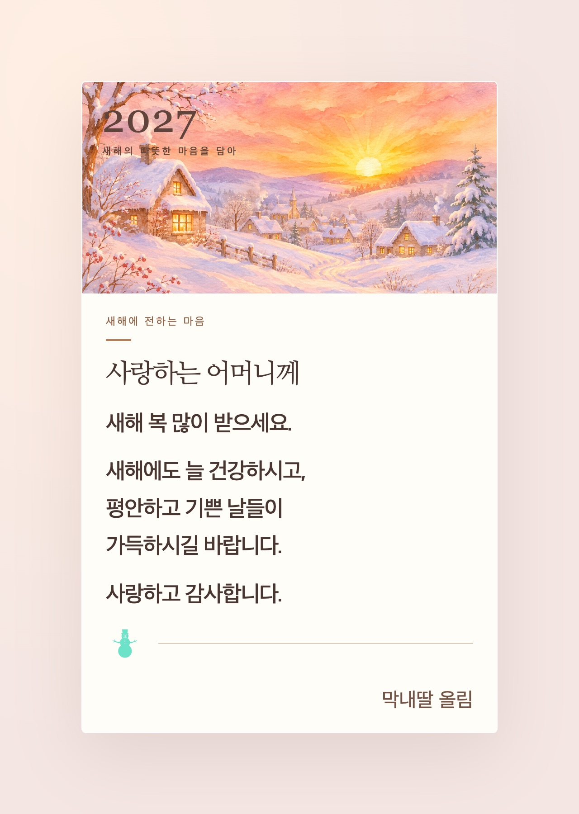
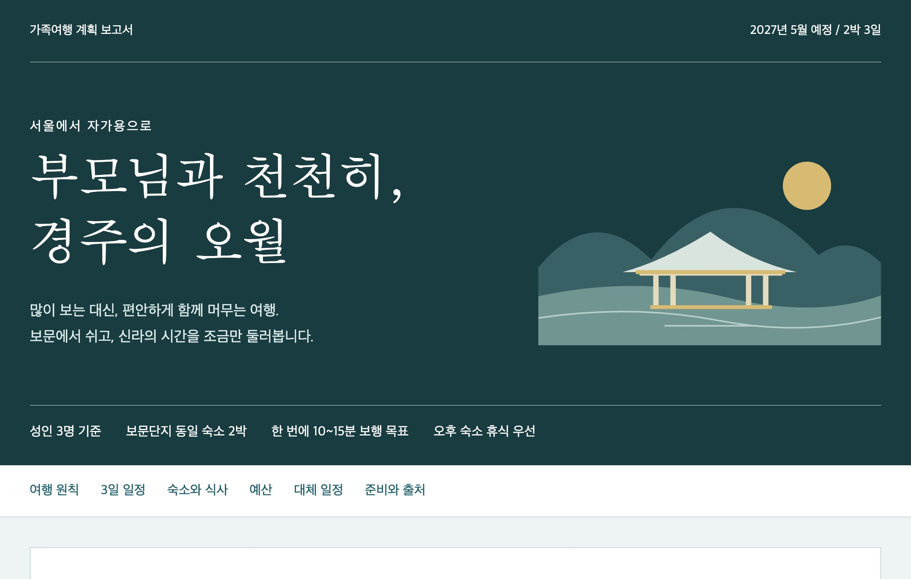
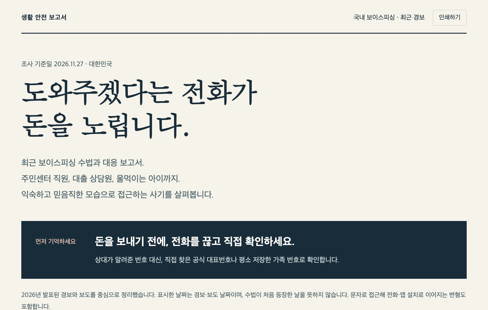
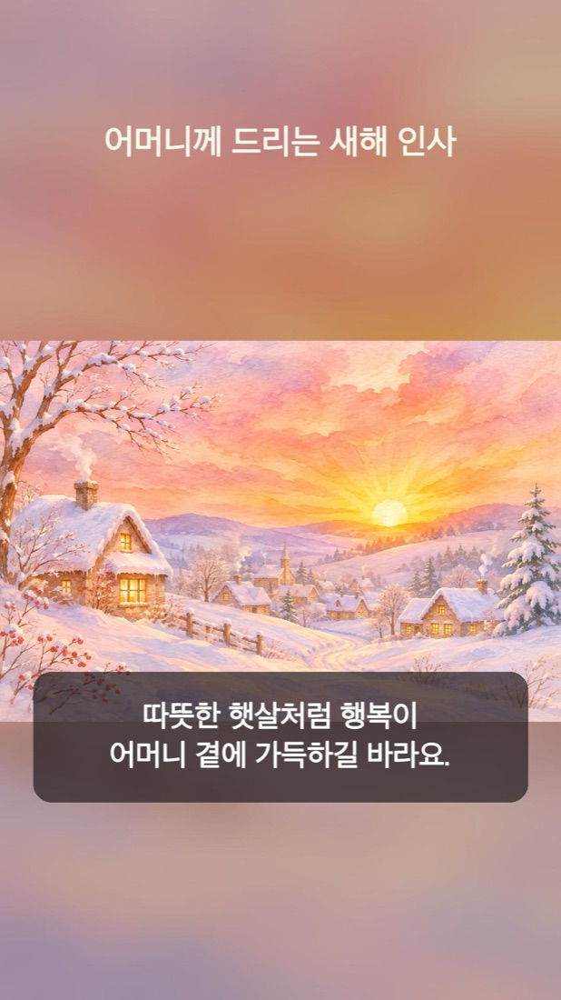
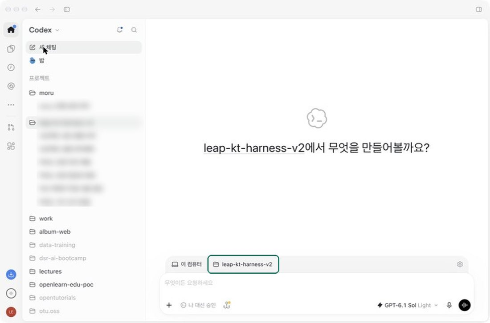
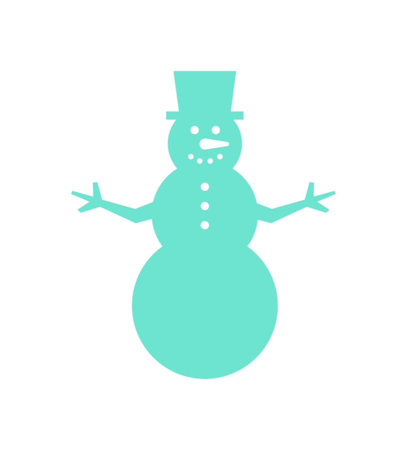
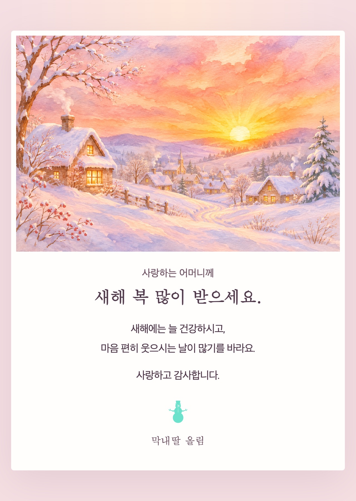
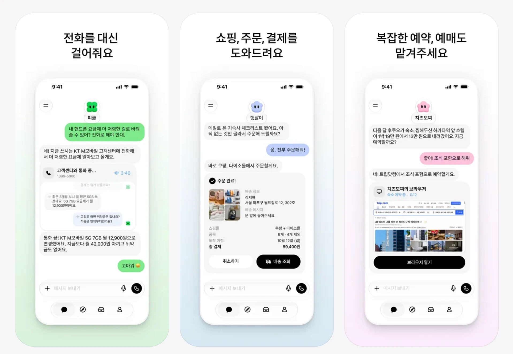

<!-- _class: lead -->

## WEEK 2 / 4

# 에이전트
**잘 쓰는 방법**

120분 · 실습 89분
<!--
목표: 오늘 하나만 남기면 됩니다: **에이전트에게 맡길 수 있는 일의 범위를 넓혔다**. 설명은 12분이고, 실습 구간은 89분입니다.
구성: 실습은 연하장, 내 프롬프트, 계획 보고서, 관심 주제 보고서, 블로그 글, 쇼츠의 순서입니다. 연하장이 가장 길고, 쉬는 시간 앞에 끝납니다.
첫 마디: “지난주에는 웹페이지 하나를 만들어 보셨습니다. 오늘은 그림, 보고서, 글, 영상까지 직접 만들어 봅니다.”
-->

---

<!-- _footer: "2주차 · 열기 · 00:00" -->
<!-- _class: lead -->

# 2시간

1. 에이전트는 무엇인가
2. 연하장을 만들어서 서로 보내기  ←
3. 고친 내용을 프롬프트로 남기기  ←
4. 계획 보고서와 관심 주제 보고서  ←
5. 블로그 글과 쇼츠 영상  ←
<!--
말할 것: 목차를 한 줄씩 읽지 마세요. 손으로 훑고 1분 안에 넘기세요.
시간 배분: 앞의 12분은 강사가 설명하고, 그 뒤로는 만들 것을 화면으로 보고 바로 해보는 순서를 반복합니다.
전환: “오늘 수업이 끝날 때 어떤 것을 만들어 가시는지 먼저 보여 드리겠습니다.”
-->

---

<!-- _footer: "2주차 · 열기 · 00:01" -->
<!-- _class: lead -->

# 지난 한 주,
**무엇을 해보셨나요?**
<!--
진행: 1분입니다. 지난주 과제를 해본 분에게 수업 채팅창에 한 줄로 적게 하세요. 답을 평가하지 않습니다.
잘 안 된 일: 잘 안 된 일이 나오면 적어 두었다가, 오늘 실습에서 같은 상황이 나올 때 다시 언급하세요.
-->

---

<!-- _footer: "2주차 · 열기 · 00:02" -->

## 오늘 직접 **만드는 것**

| 연하장 | 계획 보고서 | 관심 주제 보고서 | 쇼츠 영상 |
|:---:|:---:|:---:|:---:|
|  |  |  |  |
<!--
진행: 1분입니다. 왼쪽부터 손으로 짚으면서 이름만 읽어 주세요. 화면에 없는 블로그 글까지, 오늘 만드는 것은 모두 다섯 가지입니다.
사실: 화면의 그림은 모두 Codex에 실제로 요청해서 받은 결과입니다 (2026년 11월 27일). 각각 뒤의 실습 구간에서 크게 다시 보여 줍니다.
말할 것: “오늘 수업이 끝나면 이 결과물이 여러분의 컴퓨터에 남습니다.”
실습지: 수강생용 실습지(worksheet.html)의 주소를 수업 채팅창에 올려주세요. 요청 문장이 모두 적혀 있고, 칸에 입력한 내용은 그 기기의 브라우저에 저장됩니다.
전환: “만들기 전에, 에이전트가 무엇인지 12분만 설명하겠습니다.”
-->

---

<!-- _class: lead -->

## 2주차 · 에이전트란 · 00:03 – 00:15

# 에이전트는
**무엇**인가
<!--
이 구간의 목적: 12분 안에 세 가지를 전합니다. 에이전트의 구조, LLM이 문장을 만드는 원리, 요청에 내 상황을 적으면 결과가 달라진다는 사실입니다.
주의: LLM은 처음 말할 때 ‘대규모 언어 모델’이라고 풀어서 말하고, ChatGPT 안에서 답을 만드는 모델이라고 설명하세요. 토큰, 파라미터, 트랜스포머 같은 말은 쓰지 마세요.
-->

---

<!-- _footer: "2주차 · 에이전트란 · 00:03" -->
<!-- _class: lead -->

# 에이전트 = LLM + **도구 사용** + **반복**

챗봇은 대화 상대 · 에이전트는 일꾼
<!--
첫 마디: “챗봇이 대화 상대라면 에이전트는 일꾼입니다. 그 일꾼을 한 줄로 적으면 이렇습니다.”
지난주와 연결: 아랫줄은 지난주의 ‘챗봇에서 에이전트로’ 표를 한 줄로 줄인 것입니다. 챗봇은 하는 방법을 글로 알려 주고, 에이전트는 내 컴퓨터에서 직접 해 놓습니다. 공식의 ‘도구 사용’과 ‘반복’이 대화 상대와 일꾼을 가르는 부분입니다.
핵심: 에이전트는 LLM에 두 가지 기능을 더한 프로그램입니다. 하나는 파일을 읽고 쓰고 프로그램을 실행하는 도구 사용입니다. 다른 하나는 결과를 확인하고 목표에 못 미치면 다시 하는 반복입니다.
오늘과 연결: 오늘 실습에서 에이전트가 쓰는 도구가 늘어납니다. 그림판, 그림 생성 기능, 사이트 기능, 웹 검색, 예약 기능, 글 읽어 주기 기능, 영상 편집 도구입니다. 요청 문장을 보여 주는 장표마다 맨 아래에 ‘쓰는 도구’ 줄이 있습니다. 그 줄을 읽어 주세요.
용어: LLM은 화면에 처음 나오는 말입니다. 여기서는 “ChatGPT 안에서 답을 만드는 부분”이라고 말로 풀어 주세요. 풀이는 ‘다음 낱말 예측’ 장표의 아랫줄에 적혀 있습니다.
주의: 기술 용어를 더 늘리지 마세요. 이 한 줄이면 충분합니다.
-->

---

<!-- _footer: "2주차 · 에이전트란 · 00:05" -->
<!-- _class: lead -->

# 대한민국의 수도는 **＿＿＿**

빈칸에 들어갈 낱말을 채팅창에 적어 주세요.
<!--
진행: 수강생에게 먼저 묻습니다. 수업 채팅창으로 답을 받고 다음 장으로 넘어가세요. 1분입니다.
왜 묻는가: 질문에 답하게 하는 것이 아니라, 끊긴 문장의 다음 낱말을 채우게 하는 것입니다. 수강생이 ‘서울’을 적으면 그 일이 다음 장표의 ‘다음 낱말 예측’입니다.
말할 것: “방금 여러분이 하신 일이 LLM이 하는 일입니다.”
-->

---

<!-- _footer: "2주차 · 에이전트란 · 00:06" -->
<!-- _class: lead -->

# LLM의 원리,
**다음 낱말 예측**

LLM: ChatGPT 안에서 답을 만드는 대규모 언어 모델
<!--
핵심: LLM은 앞에 쓴 문장을 읽고 다음에 올 낱말의 확률을 계산합니다. 그 확률에 따라 낱말 하나를 고르고, 고른 낱말을 문장 뒤에 더한 다음 같은 계산을 반복합니다.
말할 것: “앞에 쓴 문장이 달라지면 다음 낱말도 달라집니다. 요청을 바꾸면 결과가 달라지는 이유가 이것입니다.”
주의: ‘LLM은 문장을 미리 계획하지 않는다’고 말하지 마세요. 한 모델이 운율을 맞춘 시를 쓸 때 줄 끝에 올 낱말을 미리 골라 둔다는 연구 결과가 있습니다 (Anthropic, 2025, Tracing the thoughts of a large language model). ‘한 번에 낱말 하나씩 내놓는다’까지만 말하세요.
-->

---

<!-- _footer: "2주차 · 에이전트란 · 00:08" -->
<!-- _class: lead -->

# 에이전트는 많은 분야를 알지만,
**내 상황**은 모릅니다

일의 목적 · 읽는 사람 · 원하는 형식
<!--
핵심: 에이전트는 글쓰기, 번역, 통계, 법률 같은 분야 지식을 풍부하게 갖고 있습니다. 그러나 이 일을 왜 하는지, 결과물을 누가 읽는지, 어떤 형식을 원하는지는 알지 못합니다.
말할 것: “에이전트가 내 상황을 알 수 있는 곳은 여러분이 쓴 요청과 고른 폴더 안의 파일입니다.”
오늘과 연결: 연하장, 계획 보고서, 블로그 글의 요청 문장에는 내 상황이 한두 줄씩 들어 있습니다. 받는 사람은 40년 된 친구, 부모님은 70대, 준비할 수 있는 돈은 3천만 원 같은 줄입니다. 수강생은 이 줄을 자기 상황으로 바꿔 적습니다.
-->

---

<!-- _footer: "2주차 · 에이전트란 · 00:10" -->

## 내 상황을 적기 **전과 후**

| 요청만 적은 카드 | 내 상황을 더한 카드 |
|:---:|:---:|
|  |  |
<!--
사실: 요청만 적은 카드와 내 상황을 더한 카드는 Codex에 실제로 요청해서 받은 결과입니다 (2026년 11월 26일). 왼쪽은 ‘연말 인사 카드를 웹페이지로 만들어줘’만 보낸 결과입니다. 오른쪽은 같은 요청에 목적, 받는 사람, 형식을 더해서 보낸 결과입니다. 오른쪽 카드는 앱에 들어 있는 Codex 실행 파일로 받았습니다. 왼쪽 카드를 앱과 실행 파일 가운데 어느 쪽으로 받았는지는 기록으로 다시 확인하지 못했습니다.
핵심: 왼쪽 카드는 ‘소중한 당신께’라고 적힌 봉투를 눌러야 인사말이 열립니다. 오른쪽 카드는 누르지 않아도 어머니께 드리는 인사말이 큰 글씨로 보이고, 건강과 김치 이야기가 들어 있습니다.
말할 것: “왼쪽 카드가 더 화려합니다. 그런데 받는 사람이 눌러 보지 않아도 읽을 수 있는 카드는 오른쪽입니다.”
그림과 문장: 화면의 오른쪽 카드는 받는 사람을 어머니로 적어서 받은 결과이고, 그림은 바꾸지 않았습니다. 다음 장표의 문장은 받는 사람을 친구로 바꾼 것입니다. 수강생이 물으면 그대로 답하세요.
주의: 예시를 만든 컴퓨터는 수강생의 환경과 다릅니다. 수강생의 결과는 모양과 걸리는 시간이 다를 수 있습니다.
-->

---

<!-- _footer: "2주차 · 에이전트란 · 00:11" -->

## 오른쪽 카드에 **더한 문장**

- **목적**: “올해도 내 푸념 들어 줘서 고맙다고 전하려는 거야”
- **읽는 사람**: “40년 된 친구야. 두쫀쿠 사려고 같이 두 시간 줄 섰는데 우리 앞에서 품절됐어”
- **형식**: “휴대폰으로 볼 거야. 둘 다 노안이니까 글씨는 아주 크게 해줘”
<!--
사실: 2026년 11월 28일 리허설에서 ‘연말 인사 카드를 웹페이지로 만들어줘’ 뒤에 붙여 보낸 문장입니다. 마지막에 ‘내가 말하지 않은 추억은 지어내지 마’도 함께 보냈습니다. 에이전트가 인사말을 보여 주기까지 18초, “응, 만들어줘.”라고 답한 뒤 카드가 나오기까지 51초가 걸렸습니다. 카드에는 푸념과 두쫀쿠 이야기가 그대로 들어갔습니다.
예시라는 점: 40년 된 친구와 두쫀쿠 이야기는 실습을 위해 정한 예시입니다. 강사 본인의 이야기처럼 말하지 마세요.
두쫀쿠: 두바이 쫀득 쿠키를 줄인 말입니다. 올해 줄을 서서 사는 과자로 유행했습니다. 모르는 수강생에게는 “줄을 서도 못 사는 과자”라고 한마디로 풀어 주세요.
말할 것: “에이전트는 이 세 가지를 스스로 알 수 없습니다. 여러분이 적어야 합니다.”
-->

---

<!-- _footer: "2주차 · 에이전트란 · 00:12" -->
<!-- _class: lead -->

# “맨 아래에
**‘두쫀쿠 동지가’**라고 넣어줘”

결과에서 고칠 곳을 본 대로 말하면 됩니다.
<!--
지난주와 연결: 지난주 ‘부족한 부분을 찾아 계속 고치면 됩니다’ 장과 같은 내용입니다. 오늘 만드는 모든 결과물에 똑같이 씁니다.
리허설: 2026년 11월 28일에 앞 장표의 문장으로 카드를 받은 뒤 이 문장을 보냈습니다. 12초 만에 고쳐졌고, 작은 수정에는 계획을 다시 묻지 않았습니다.
예: “글씨를 더 크게 해줘”, “배경을 더 밝게 해줘”, “마지막 줄을 빼줘”.
한 번에 안 될 때: 오늘 실습에서 결과가 마음에 들지 않으면 처음부터 다시 요청하지 말고, 고칠 곳을 한 가지씩 말하게 하세요.
전환: “마지막으로, 오늘 에이전트가 새로 쓰는 도구를 보겠습니다.”
-->

---

<!-- _footer: "2주차 · 에이전트란 · 00:13" -->
<!-- _class: lead -->

# **도구**가 늘면
맡기는 일도 늘어납니다
<!--
핵심: 에이전트는 LLM이 도구를 써서 일합니다. 지난주의 과제에서 에이전트는 내 컴퓨터 안의 파일과 폴더를 다뤘습니다. 오늘은 에이전트가 쓰는 도구가 늘어납니다.
오늘 쓰는 도구: 그림판, 그림 생성 기능, 사이트 기능, 웹 검색, 예약 기능, 글 읽어 주기 기능, 영상 편집 도구입니다. 요청 문장을 보여 주는 장표마다 맨 아래에 ‘쓰는 도구’ 줄이 있습니다. 그 줄을 읽어 주세요.
오늘의 핵심: 그 가운데 그림판을 조작하는 기능이 오늘의 핵심입니다. 이름과 원리는 여기서 설명하지 않고, 수강생이 직접 해 본 바로 뒤에 설명합니다.
전환: “그러면 에이전트를 왜 내 컴퓨터에 설치해서 쓸까요?”
-->

---

<!-- _footer: "2주차 · 에이전트란 · 00:14" -->

## 내 컴퓨터에 설치한 에이전트의 **이점**

- **옮기는 수고 없음**: 챗봇처럼 파일을 올리고 답을 복사해 오지 않음
- **내 앱을 그대로 사용**: 웹 · 앱 에이전트가 못 쓰는 내 컴퓨터의 앱을 조작
- **없는 도구는 직접 제작**: 필요한 프로그램을 작성해서 내 컴퓨터에서 실행
- **일할수록 쌓이는 자산**: 결과물과 프롬프트가 내 폴더의 파일로 남음
- **내가 정하는 범위**: 계정 연결 대신, 일할 폴더와 조작할 앱을 지정

비교 대상: 챗봇 · 웹과 앱의 에이전트
<!--
진행: 1분입니다. 왼쪽의 굵은 글씨만 읽으세요. 줄마다 오늘 어느 실습에서 확인하는지 한마디씩 덧붙입니다.
비교 대상: 챗봇은 ChatGPT의 대화처럼 답을 글로 돌려주는 것입니다. 웹과 앱의 에이전트는 회사의 서버에서 브라우저나 전화로 일을 대신 처리하는 서비스입니다. 수업 끝에 소개하는 피클이 그 예입니다.
옮기는 수고 없음: 챗봇에는 글을 붙여 넣거나 파일을 올리고, 답을 다시 복사해서 문서에 옮깁니다. 내 컴퓨터의 에이전트는 폴더의 파일을 직접 읽고 그 폴더에 결과를 씁니다. 오늘 만드는 연하장과 보고서는 한 번도 복사해서 옮기지 않습니다.
내 앱을 그대로 사용: 웹과 앱의 에이전트는 회사의 서버에 있는 브라우저로 일하므로, 내 컴퓨터에 설치된 앱은 쓰지 못합니다. 오늘 에이전트는 그림판을 열어서 그림을 그리고, 컴퓨터의 글 읽어 주기 기능으로 음성을 만듭니다.
없는 도구는 직접 제작: 영상을 만드는 기능은 Codex에 따로 없습니다. 리허설에서 에이전트는 프로그램을 직접 작성하고 내 컴퓨터에서 실행해서 영상을 만들었습니다. 준비된 기능 밖의 일도 맡길 수 있다는 뜻입니다.
일할수록 쌓이는 자산: 결과물과 프롬프트가 내 폴더에 파일로 남습니다. 채팅을 찾지 않아도 되고, 새 채팅에서 파일 이름만 말하면 다시 씁니다. 쉬는 시간 뒤의 ‘내 프롬프트’ 구간에서 직접 해봅니다.
내가 정하는 범위: 앱 에이전트는 메일과 쇼핑 계정을 연결해서 일합니다. 내 컴퓨터의 에이전트는 일할 폴더를 내가 고르고, 조작할 앱을 허용 창에서 내가 정합니다.
균형: 웹과 앱의 에이전트가 더 나은 점도 있습니다. 휴대폰만 있으면 되고, 설치가 쉽고, 전화를 겁니다. 서로 대신하는 것이 아니라 맡기는 일이 다릅니다.
주의: 내 컴퓨터에서 일한다고 해서 내용이 밖으로 나가지 않는 것은 아닙니다. 요청과 파일의 내용은 답을 만드는 LLM으로 전송됩니다.
전환: “설명은 여기까지입니다. 이제 직접 만듭니다.”
-->

---

<!-- _class: lead -->

## 2주차 · 연하장 · 00:15 – 00:52

# 연하장을 만들어서
**서로 보내기**

첫 번째 실습
<!--
이 구간의 순서: 에이전트가 그림판으로 눈사람을 그리고, 말로 설명한 그림을 생성합니다. 그다음 지금까지 만든 그림으로 연하장 웹페이지를 만들고, 고칠 곳을 고친 뒤 인터넷에 올립니다. 수강생은 그 인터넷 주소를 서로 보냅니다. 37분입니다.
핵심 단계: 그림판으로 그리기는 오늘의 핵심인 Computer Use를 경험하는 단계입니다. 수강생의 컴퓨터에서 되지 않으면 강사의 화면으로 과정을 보여 주세요. 그 수강생은 그림 생성부터 이어서 하면 되고, 그림판 그림이 없어도 뒤 단계는 그대로 진행됩니다.
대상 환경: 수강생은 대부분 Windows를 씁니다. 리허설은 Mac에서 했습니다. 그림판으로 그리기는 Windows에서 강의 전에 반드시 한 번 실행해 보세요.
한 채팅에서 계속: 이 구간은 채팅 하나에서 이어서 합니다. 뒤 단계의 요청이 ‘지금까지 만든 그림’처럼 앞에서 만든 것을 가리키기 때문입니다.
-->

---

<!-- _footer: "2주차 · 연하장 · 00:15" -->
<!-- _class: lead -->

# 주소 하나로 보내는
**연하장**

[실습지 · 연하장](worksheet.html#card)
<!--
쓰임: 인터넷 주소를 문자나 메신저로 보내면, 받는 사람이 휴대폰에서 눌러서 바로 엽니다. 파일을 내려받거나 앱을 설치할 필요가 없습니다.
진행: 1분입니다. 올해 연하장을 보내고 싶은 사람을 한 명 떠올리게 하세요. 받는 사람은 이름 대신 호칭으로 정합니다. 예를 들면 어머니, 큰언니, 은사님입니다.
실습지: 화면 아래의 링크를 누르면 실습지의 연하장 절이 새 탭에서 열립니다. 실습 구간이 시작되는 장표마다 그 구간의 절로 가는 링크가 있습니다.
-->

---

<!-- _footer: "2주차 · 연하장 · 00:16" -->

## **2주차** 폴더를 만들고, 그 폴더를 고릅니다
<!--
먼저 할 일: 바탕화면에 ‘2주차’라는 빈 폴더를 하나 만들게 하세요. 그다음 새 채팅에서 이 위치를 눌러 그 폴더를 고릅니다. 지난주와 같은 순서입니다.
폴더 신뢰: 폴더를 처음 고르면 ‘이 폴더를 신뢰할까요?’라는 창이 뜹니다. ‘폴더 신뢰’를 누르게 하세요. 이 창은 폴더마다 한 번만 뜹니다.
한 채팅에서 계속: 연하장 실습은 채팅 하나에서 이어서 합니다. 뒤 단계의 요청이 앞 단계에서 만든 그림을 가리키기 때문입니다.
주의: 화면은 지난주에 찍은 캡처입니다. 폴더 이름이 ‘1주차’로 보여도 위치는 같습니다.
막히는 분: 폴더를 못 고르면 옆의 ‘이 컴퓨터’가 눌려 있는지 확인하세요.
-->

---

<!-- _footer: "2주차 · 연하장 · 00:18" -->

## 에이전트가 다른 앱을 조작해서 **그린 그림**
<!--
사실: Codex가 Mac의 Freeform 앱을 직접 열고 조작해서 그린 뒤 폴더에 저장한 그림입니다 (2026년 11월 27일).
말할 것: “지난주에는 에이전트가 파일을 만들었습니다. 오늘은 에이전트가 다른 앱을 열어서 직접 조작합니다. 먼저 해 보고, 어떻게 한 것인지는 그 뒤에 설명하겠습니다.”
시작하기 전에: 에이전트가 화면을 보면서 조작하므로, 메신저와 메일처럼 남에게 보이면 안 되는 창은 닫아 두게 하세요.
그리는 동안: 에이전트가 그리는 동안 수강생이 마우스와 키보드를 쓰면 어떻게 되는지는 확인하지 못했습니다. 끝날 때까지 손을 대지 않게 하세요.
주의: Freeform에는 눈사람 도형이 들어 있어서, Codex가 그 도형을 꺼내 꾸몄습니다. 그림판에는 그런 도형이 없으므로 수강생의 눈사람은 모양이 다르게 나옵니다.
-->

---

<!-- _footer: "2주차 · 연하장 · 00:19" -->

## 첫 번째 실습 · **그림판으로 그리기**

- **요청**: “그림판을 열어서 눈사람을 그려줘. 다 그리면 그림을 이 폴더에 저장해줘”
- **허용 창**: 허용을 묻는 창에서 ‘이 대화 허용’ 누르기
- **결과**: 2주차 폴더에 저장된 눈사람 그림
- **쓰는 도구**: 그림판 · 에이전트가 마우스와 키보드를 조작
<!--
진행: 6분입니다. 이 장을 띄워 두고 진행하세요. 요청 문장을 수업 채팅창에도 올려주세요. 에이전트가 그리는 동안에는 기다리게 하세요.
쓰는 도구: Codex의 Computer Use라는 기능입니다. 리허설에서는 이 기능으로 Freeform을 열고 그림을 그린 뒤 파일로 내보냈습니다. 이름과 원리는 다음 장표에서 설명하므로, 여기서는 “에이전트가 그림판을 사람처럼 조작합니다”까지만 말하세요.
허용 창: 요청을 보내면 채팅 안에 ‘ChatGPT가 (앱 이름)을(를) 사용하도록 허용할까요?’라는 창이 한 번 뜹니다. 선택지는 ‘항상 허용’, ‘거부’, ‘이 대화 허용’입니다. ‘이 대화 허용’을 누르게 하세요.
리허설: Mac에서 “Freeform 앱을 열어서 눈사람을 그려줘. 다 그리면 그림을 이 폴더에 저장해줘”를 보냈습니다. 앱 기록에서 이 요청의 턴 전체는 5분 15초였습니다. 그 가운데 2분 22초는 허용 창이 떠 있던 시간이고, 허용한 뒤로는 2분 54초가 걸렸습니다. 에이전트는 Freeform에서 그림을 PDF로 내보낸 뒤, 그 파일을 PNG로 변환해서 함께 저장했습니다.
확인하지 못한 것: 화면의 문장은 리허설 문장의 ‘Freeform 앱을’을 ‘그림판을’로 바꾼 것입니다. 이 문장 그대로는 보낸 적이 없습니다. Windows의 그림판에서는 실행해 보지 못했습니다. 걸리는 시간과 그림의 모양이 다를 수 있습니다.
요금제: 다른 앱을 조작하는 기능이 수강생의 요금제에서도 되는지 확인하지 못했습니다. 강의 전에 수강생과 같은 요금제의 계정으로 확인하세요.
막히는 분: 허용 창을 놓치면 진행이 멈춘 것처럼 보입니다. 채팅을 아래로 내려 창이 떠 있는지 보게 하세요. 그림판 조작이 끝내 되지 않으면 강사의 화면으로 과정을 보게 하세요.
전환: “방금 여러분의 화면에서 일어난 일에는 이름이 있습니다.”
-->

---

<!-- _footer: "2주차 · 연하장 · 00:25" -->
<!-- _class: lead -->

# **Computer Use**
에이전트의 컴퓨터 조작

화면 보기 → 마우스와 키보드 조작 → 바뀐 화면 다시 보기
<!--
진행: 1분입니다. 그림판 실습이 끝난 직후에 설명합니다. 수강생이 방금 본 장면을 가리키면서 말하세요.
핵심: 오늘 수업의 핵심은 Computer Use를 직접 경험하는 것이고, 방금 그 경험을 했습니다. Computer Use는 에이전트가 사람처럼 화면을 보면서 마우스와 키보드를 조작해 내 컴퓨터의 앱을 쓰는 기능입니다. ‘컴퓨터 유스’라고 읽고, 우리말로는 ‘컴퓨터 조작’이라고 풀어 주세요.
원리: 에이전트가 화면을 보고, 마우스와 키보드를 조작하고, 바뀐 화면을 다시 봅니다. 설명 구간의 공식 ‘에이전트 = LLM + 도구 사용 + 반복’에서 ‘도구 사용’과 ‘반복’이 눈에 보인 장면입니다.
방금 본 것과 연결: “그림판이 저절로 열리고, 마우스가 움직이고, 그림이 저장됐습니다. 에이전트가 화면을 보면서 한 일입니다.”
지난주와 다른 점: 지난주에는 에이전트가 파일과 폴더를 다뤘습니다. Computer Use에서는 그림판처럼 사람이 쓰려고 만든 앱을 에이전트가 직접 엽니다.
허용: 실습에서 누른 ‘이 대화 허용’이 에이전트에게 그 앱을 조작하게 한 것입니다. 리허설에서는 이 버튼을 누른 뒤에 조작이 시작됐습니다.
사실: 리허설에서는 Mac의 Freeform 앱으로 확인했습니다 (2026년 11월 27일). Windows의 그림판에서는 확인하지 못했습니다. 강의 전에 Windows에서 반드시 한 번 실행해 보세요.
전환: “이번에는 앱을 조작하지 않고, 말로 설명해서 그림을 받습니다.”
-->

---

<!-- _footer: "2주차 · 연하장 · 00:26" -->

## 말로 설명해서 받은 **그림**
<!--
사실: 다음 장의 요청을 Codex에 보내서 받은 그림입니다 (2026년 11월 27일). 36초가 걸렸고, 그림은 채팅 안에 바로 표시됐습니다.
말할 것: “방금은 에이전트가 앱으로 그렸습니다. 이번에는 말로 설명하면 그림을 만들어 줍니다.”
-->

---

<!-- _footer: "2주차 · 연하장 · 00:27" -->

## 말로 설명해서 **그림 받기**

- **요청**: “새해 연하장에 넣을 그림을 그려줘”
- **모습**: “눈 내린 마을 위로 해가 떠오르는 모습이고”
- **느낌**: “따뜻한 수채화 느낌으로 해줘”
- **쓰는 도구**: Codex의 그림 생성 기능

줄을 바꾸지 말고 이어서 적은 뒤 한 번에 보냅니다.
<!--
진행: 4분입니다. 모습과 느낌은 수강생이 원하는 대로 바꿔 적게 하세요. 예: 소나무와 학, 한복을 입은 가족, 바닷가의 해돋이.
쓰는 도구: Codex 안에 들어 있는 그림 생성 기능입니다. 앞 단계와 달리 다른 앱을 열지 않습니다. 별도의 프로그램을 설치하거나 다른 서비스에 가입하지 않았습니다.
리허설: 화면의 문장을 이어서 앱에 한 번에 보냈습니다. 36초 만에 그림이 채팅 안에 표시됐습니다.
그림의 위치: 생성한 그림은 2주차 폴더에 저장되지 않고 Codex가 따로 보관합니다. 같은 채팅에서 ‘눈 내린 마을 그림’처럼 말로 가리키면 다음 단계에서 쓸 수 있습니다.
시간이 남으면: “같은 모습을 색연필 느낌으로 한 장 더 그려줘”처럼 느낌만 바꿔서 한 번 더 요청하게 하세요. 이 문장은 리허설에서 보내지 않았습니다.
주의: 실제 사람의 얼굴이나 이름을 넣어 달라고 하지 않게 하세요.
-->

---

<!-- _footer: "2주차 · 연하장 · 00:31" -->

## 그림으로 만든 **연하장**
<!--
사실: 다음 두 장의 요청을 Codex에 차례로 보내서 받은 연하장입니다 (2026년 11월 27일, 앱에 들어 있는 Codex 실행 파일). 위쪽은 말로 설명해서 받은 그림이고, 인사말 아래의 작은 눈사람은 에이전트가 앱을 조작해서 그린 그림입니다.
말할 것: “방금 만든 그림이 이렇게 연하장에 들어갑니다.”
그림과 문장: 화면의 연하장은 받는 사람을 어머니로 해서 받은 결과이고, 그림은 바꾸지 않았습니다. 다음 장표의 문장은 받는 사람을 친구로 바꾼 것입니다.
-->

---

<!-- _footer: "2주차 · 연하장 · 00:32" -->

## 그림으로 **연하장 만들기**

- **요청**: “지금까지 만든 그림을 넣어서 새해 연하장을 웹페이지로 만들어줘”
- **받는 사람**: “받는 사람은 40년 된 친구야”
- **쓰는 도구**: 웹페이지 파일 작성

받는 사람은 이름 대신 호칭으로 적습니다.
<!--
진행: 4분입니다. 받는 사람은 수강생이 정한 호칭으로 바꿔 적게 하세요.
지금까지 만든 그림: 그림을 이름으로 부르지 않고 순서로 가리키는 말입니다. 그림의 모습을 바꾼 수강생도, 그림판 단계를 건너뛴 수강생도 같은 문장을 보냅니다.
쓰는 도구: 에이전트가 웹페이지 파일을 직접 작성합니다. 이 단계에서는 인터넷에 올리지 않습니다.
리허설: 화면의 문장을 이어서 앱에 들어 있는 Codex 실행 파일에 한 번에 보냈습니다 (2026년 11월 28일). 눈사람 그림과 눈 내린 마을 그림은 폴더에 파일로 넣어 두었습니다. 구성을 보여 주기까지 24초, “응, 만들어줘.”라고 답한 뒤 연하장이 나오기까지 1분 9초가 걸렸습니다. 에이전트는 이 요청만으로는 인터넷에 올리려고 하지 않았습니다.
확인하지 못한 것: 앱의 채팅에서는 생성한 그림이 폴더가 아니라 Codex가 따로 보관하는 곳에 있습니다. 그 상태에서 ‘지금까지 만든 그림’이 눈사람 그림과 생성한 그림을 모두 가리키는지는 앱에서 확인하지 못했습니다.
확인을 물을 때: 에이전트가 인사말과 구성을 먼저 보여 주고 확인을 구할 수 있습니다. 인사말을 읽어 보고 “응, 만들어줘”라고 답하게 하세요.
-->

---

<!-- _footer: "2주차 · 연하장 · 00:36" -->
<!-- _class: lead -->

# 연하장에서
**고칠 곳** 말하기

예: “맨 아래에 ‘두쫀쿠 동지가’라고 넣어줘”
<!--
진행: 2분입니다. 만들어진 연하장을 보고 고칠 곳 한 가지를 말로 요청하게 하세요. 앞에서 본 ‘다시 요청하기’를 실제로 해보는 자리입니다.
리허설: 연하장이 나온 뒤에 아랫줄의 문장을 보냈습니다. 11초 만에 맨 아래에 ‘두쫀쿠 동지가’가 들어갔습니다.
확인할 것: 휴대폰으로 받을 연하장이므로, 창의 폭을 좁혀서 잘리는 곳이 없는지 보게 하세요. 리허설의 연하장은 휴대폰 폭(375픽셀)에서 잘리는 곳이 없었습니다. 잘리는 곳이 있으면 그대로 말해서 고치게 합니다.
올리기 전에 고치는 이유: 인터넷에 올린 뒤에 고친 내용이 같은 주소에 반영되는지는 확인하지 못했습니다. 그래서 고칠 곳은 올리기 전에 고칩니다.
-->

---

<!-- _footer: "2주차 · 연하장 · 00:38" -->
<!-- _class: lead -->

# 에이전트가 웹페이지를
**인터넷에 올립니다**
<!--
핵심: 지금까지 연하장은 내 컴퓨터 안의 파일이었습니다. Codex의 사이트 기능은 그 파일을 인터넷에 올리고 다른 사람이 열 수 있는 인터넷 주소를 만듭니다. 앱 왼쪽에 ‘사이트’ 메뉴가 있습니다.
공개의 뜻: 인터넷에 올린 연하장은 인터넷 주소를 아는 사람이면 누구나 열 수 있습니다. 올리기 전에 연하장에 전화번호, 집 주소, 주민등록번호, 실제 이름이 없는지 보게 하세요.
말할 것: “다음 요청을 보내면 연하장이 인터넷에 올라갑니다. 올리기 전에 한 번 더 읽어 보세요.”
-->

---

<!-- _footer: "2주차 · 연하장 · 00:39" -->

## 연하장을 **인터넷에 올리기**

- **요청**: “다른 사람에게 보낼 수 있게 인터넷 주소로 만들어줘”
- **결과**: chatgpt.site로 끝나는 인터넷 주소
- **쓰는 도구**: Codex의 사이트 기능

인터넷 주소를 아는 사람은 누구나 연하장을 볼 수 있습니다.
<!--
진행: 5분입니다. 연하장을 만든 채팅에 이어서 보냅니다.
쓰는 도구: Codex의 사이트 기능입니다. 앱 리허설에서는 올린 뒤 앱 오른쪽의 브라우저에 연하장을 열어서 보여 주었습니다.
리허설: 실행 파일: 화면의 문장을 앱에 들어 있는 Codex 실행 파일에 보냈습니다. 48초 동안 에이전트가 사이트를 만들어 올리려고 했고, 이 방식의 제한에 막혀 주소는 발급되지 않았습니다.
리허설: 앱: 앱에서는 받는 사람을 어머니로 해서, 연하장 만들기와 인터넷 주소를 한 문장으로 함께 요청했습니다 (2026년 11월 27일). “처음에 그린 그림을 넣어서 새해 연하장을 웹페이지로 만들어줘. 받는 사람은 어머니야. 다른 사람에게 보낼 수 있게 인터넷 주소로 만들어줘”입니다. 구성을 보여 주기까지 16초, “응, 만들어서 공개해줘.”라고 답한 뒤 공개까지 3분 32초가 걸렸습니다. chatgpt.site로 끝나는 주소가 생겼고, 앱에 ‘누구나 볼 수 있음’이라고 표시됐습니다.
확인하지 못한 것: 화면의 문장만 따로 보내서 주소를 받는 것은 앱에서 확인하지 못했습니다. 공개한 연하장을 내리는 방법도 확인하지 못했습니다. 강의 전에 앱에서 확인하세요.
승인: 앱에서 공개하는 동안 에이전트가 보안 제한 밖에서 실행하겠다는 승인을 여러 번 요청했습니다. 리허설한 계정은 이 요청을 자동으로 승인하도록 설정돼 있어서 창이 뜨지 않았습니다. 수강생의 화면에서는 승인을 묻는 창이 뜰 수 있습니다.
공개를 물을 때: 에이전트가 공개해도 되는지 물으면, 연하장을 한 번 더 읽어 보고 “응, 공개해줘”라고 답하게 하세요.
요금제: 웹페이지를 인터넷에 올리는 기능이 수강생의 요금제에서도 되는지 확인하지 못했습니다. 주소가 나오지 않는 수강생은 만들어진 웹페이지 파일을 열어 확인하게 하세요.
-->

---

<!-- _footer: "2주차 · 연하장 · 00:44" -->
<!-- _class: lead -->

# 연하장 주소를
**서로 보내기**

주소를 복사해서 수업 채팅창에 올립니다.
<!--
진행: 5분입니다. 만들어진 연하장의 주소를 복사해 수업 채팅창에 올리게 하세요. 그다음 다른 수강생이 올린 주소를 하나 골라 열어 보게 합니다.
주소 복사: 에이전트의 답에 ‘새해 연하장 열기’라고 적힌 누를 수 있는 글자가 나오고, 오른쪽에 연하장이 열립니다. 주소를 복사하는 정확한 위치는 리허설에서 눌러 보지 않았습니다. 강의 전에 확인해 두세요.
에이전트가 보내기: 에이전트가 메일이나 메신저로 직접 보내는 방법은 리허설에서 확인하지 않았습니다. 시간이 남는 수강생이 해보겠다고 하면 막지는 말되, 받는 사람을 자기 자신으로 하게 하세요.
실제로 보내기: 가족에게 실제로 보내는 일은 수업이 끝난 뒤에 하도록 안내하세요. 주소를 문자나 메신저에 붙여 넣으면 됩니다.
-->

---

<!-- _footer: "2주차 · 연하장 · 00:49" -->
<!-- _class: lead -->

# 받은 연하장
**열어 보기**
<!--
진행: 2분입니다. 수업 채팅창의 주소를 휴대폰으로 열어 보게 하세요. 수업 채팅창을 휴대폰에서 볼 수 없는 수강생은 컴퓨터의 브라우저로 엽니다.
확인: 연하장이 열린 분에게 손을 들게 하세요. 눈사람 그림, 눈 내린 마을 그림, 받는 사람이 들어 있는지 보게 합니다.
말할 것: “방금 여러분은 그림을 그리고, 웹페이지를 만들고, 인터넷에 올렸습니다. 코드는 한 줄도 쓰지 않았습니다.”
-->

---

<!-- _footer: "2주차 · 연하장 · 00:51" -->

## 연하장에서 **익힌 방법**

- **방법**: 앞에서 만든 것을 가리켜 이어 가기
- **오늘의 예**: “지금까지 만든 그림을 넣어서”
- **내 일에 쓰기**: 모임 안내 · 개업 인사 · 감사 카드
<!--
진행: 1분입니다. 같은 방법으로 만들고 싶은 것을 수업 채팅창에 한 가지씩 적게 하세요.
핵심: 한 채팅 안에서는 앞에서 만든 것을 다시 설명하지 않고 가리키면 됩니다. 에이전트가 아는 것은 내가 쓴 요청, 고른 폴더 안의 파일, 그리고 이 채팅에서 나눈 대화입니다.
새 채팅과의 차이: 새 채팅을 열면 앞의 대화는 이어지지 않습니다. 쉬는 시간 뒤의 실습은 새 채팅에서 시작하므로, 연하장 이야기를 모르는 상태에서 시작합니다.
내 일에 쓰기: 화면의 예는 제안입니다. 리허설에서 만들어 본 것은 연하장뿐입니다.
-->

---

<!-- _class: lead -->

## BREAK · 00:52 – 01:02

# 쉬는 시간 10분

돌아오면 내 프롬프트를 만듭니다.
<!--
할 일: 연하장이 끝나지 않은 분을 이때 도와주세요.
-->

---

<!-- _class: lead -->

## 2주차 · 내 프롬프트 · 01:02 – 01:12

# 고친 내용을
**프롬프트로 남기기**

연하장 실습에 이어서
<!--
이 구간의 순서: 연하장을 만들면서 고친 내용을 프롬프트로 정리하고, 읽어 보고 다듬고, 파일로 저장합니다. 새 채팅에서 다시 쓰는 것은 강사의 화면으로 보여 줍니다. 10분입니다.
말할 것: “새 실습이 아니라 방금 만든 연하장을 이어서 씁니다. 연하장을 만든 채팅으로 돌아가세요.”
-->

---

<!-- _footer: "2주차 · 내 프롬프트 · 01:02" -->
<!-- _class: lead -->

# 각자의 **기준**에 맞춰
결과물을 완성합니다

[실습지 · 내 프롬프트](worksheet.html#prompt)
<!--
진행: 1분입니다. 연하장을 만들면서 고쳐 달라고 한 것을 수업 채팅창에 한 줄로 적게 하세요.
말할 것: “같은 연하장인데도 고쳐 달라고 한 곳은 사람마다 달랐습니다. 그것이 각자의 기준입니다.”
핵심: 결과를 보고 고쳐 달라고 한 것은 그 사람이 생각하는 ‘잘 만든 연하장’의 기준입니다. 기준은 처음부터 다 말할 수 있는 것이 아니라, 결과를 보면서 드러납니다.
오늘의 예: 화면의 예에서는 ‘맨 아래에 두쫀쿠 동지가를 넣는다’가 기준입니다. 받는 사람을 호칭으로 적는 것, 에이전트가 보여 준 인사말을 읽고 승인한 것도 기준에 들어갑니다.
-->

---

<!-- _footer: "2주차 · 내 프롬프트 · 01:03" -->
<!-- _class: lead -->

# 같은 요청을
**다음에도** 하게 됩니다
<!--
진행: 1분입니다.
핵심: 연하장을 받을 사람은 한 명이 아닙니다. 다음 사람의 연하장을 만들 때도 같은 그림, 같은 인사말, 같은 고칠 곳을 다시 말하게 됩니다.
리허설: 연하장 한 장을 만드는 데 요청을 네 번 보냈습니다. 만들기, 확인에 답하기, 고칠 곳 말하기, 인터넷에 올리기입니다.
말할 것: “방금 여러 번 주고받은 일을 다음에는 한 번에 끝내는 방법이 있습니다.”
-->

---

<!-- _footer: "2주차 · 내 프롬프트 · 01:04" -->

## 고친 내용을 **프롬프트로 정리**

- **무엇을**: “지금 결과물을 완성하기 위해 작업한 내용을 정리해서”
- **왜**: “다음에는 한 번에 같은 연하장이 나오도록 프롬프트로 써줘”
- **바꿀 곳**: “받는 사람만 바꿔 쓸 수 있게 해줘”
- **쓰는 도구**: 없음 · LLM이 직접 작성

연하장을 만든 채팅에서 이어서 보냅니다.
<!--
진행: 2분입니다. 왼쪽 목록에서 연하장을 만든 채팅을 눌러서 돌아가게 하세요. 새 채팅에서 보내면 정리할 내용이 없습니다.
용어: 프롬프트는 다음에 다시 쓰려고 정리해 둔 요청입니다. 화면에 처음 나오는 말이므로 한 번 풀어서 말해 주세요.
리허설: 연하장을 만들고, 고치고, 인터넷 주소를 요청한 채팅에 화면의 문장을 이어서 보냈습니다 (2026년 11월 28일, 앱에 들어 있는 Codex 실행 파일). 33초 만에 프롬프트가 나왔습니다.
작업 뒤에 받는 이유: 작업을 하기 전에 프롬프트를 써 달라고 할 수도 있습니다. 작업 뒤에 받으면 내가 고친 내용이 그 안에 들어갑니다.
확인하지 못한 것: 리허설에서는 그림 파일을 폴더에 넣어 두었고, 프롬프트는 그 파일의 이름을 가리켰습니다. 앱에서는 생성한 그림이 폴더에 없습니다. 그 경우에 프롬프트가 그림을 어떻게 가리키는지, 새 채팅에서 그 그림을 다시 쓸 수 있는지는 확인하지 못했습니다.
-->

---

<!-- _footer: "2주차 · 내 프롬프트 · 01:06" -->

## 프롬프트에 들어간 **내 기준**

- **바꿀 곳**: “받는 사람: [받는 사람]”
- **고친 것**: “연하장 맨 마지막에는 다음 서명을 … 두쫀쿠 동지가”
- **승인한 것**: “추가 확인 없이 제작과 검증까지 진행해줘”
- **올린 것**: “공개 인터넷 주소로도 게시해줘. 공개 게시까지 승인한 요청이야”
<!--
사실: 리허설에서 에이전트가 쓴 프롬프트의 일부입니다 (2026년 11월 28일). 전체는 쉰 줄쯤 됩니다. 가운데 줄임표는 ‘정확하게 넣어줘’라는 말을 줄인 것입니다.
진행: 1분입니다. 수강생에게 자기 프롬프트에서 ‘내가 고쳐 달라고 한 것’을 찾아보게 하세요.
핵심: 내가 한 번 말한 것은 모두 프롬프트에 남았습니다. 고친 것뿐 아니라, 에이전트가 보여 준 인사말에 ‘응, 만들어줘’라고 답한 것도 ‘추가 확인 없이 진행해줘’로 들어갔습니다. 인터넷 주소를 요청한 것은 ‘공개 게시까지 승인한 요청’으로 적혔습니다.
전환: “그런데 매번 하고 싶지는 않은 일도 함께 들어가 있습니다.”
-->

---

<!-- _footer: "2주차 · 내 프롬프트 · 01:07" -->

## 쓸 때마다 **프롬프트 다듬기**

- **저장하기 전**: “인터넷에 올리는 내용은 빼줘”
- **다음에 쓸 때**: 결과를 보고 원하는 대로 더 조정
- **조정한 뒤**: “방금 고친 내용을 ‘연하장 프롬프트’ 파일에도 반영해줘”
- **쓰는 도구**: LLM이 직접 작성 · 파일 작성

고친 내용을 반영할수록 다음 결과가 내 기준에 가까워집니다.
<!--
진행: 1분입니다. 지금 수강생이 할 일은 첫 줄입니다. 프롬프트를 끝까지 읽어 보고, 매번 하지 않을 일이 있으면 빼 달라고 요청하게 하세요. 아래 두 줄은 저장한 프롬프트를 다음에 쓸 때 할 일입니다.
저장하기 전: 리허설에서 에이전트가 쓴 프롬프트에는 인터넷 주소로 게시하라는 줄이 들어 있었습니다. 빼지 않으면 프롬프트를 쓸 때마다 연하장이 인터넷에 올라갑니다. 화면의 문장을 보내자 17초 만에 프롬프트가 다시 나왔고, 게시에 관한 줄이 없어졌습니다.
빼지 않았을 때: 앞서 한 리허설에서는 게시하는 줄을 빼지 않고 저장했습니다. 그 프롬프트로 새 채팅에서 연하장을 만들자, 에이전트가 요청하지 않았는데도 인터넷에 올리려고 했습니다.
다음에 쓸 때: 프롬프트로 만든 결과가 한 번에 마음에 들지 않을 수 있습니다. 그때는 평소처럼 고칠 곳을 말해서 조정합니다. 조정이 끝나면 그 내용을 프롬프트 파일에도 반영해 달라고 요청합니다. 그래야 다음에는 같은 조정을 다시 하지 않습니다.
리허설: 저장한 프롬프트로 만든 연하장에 “인사말 글씨를 더 크게 해줘.”라고 보낸 뒤 화면의 셋째 줄을 보냈습니다 (2026년 11월 28일). 21초 만에 ‘연하장 프롬프트’ 파일의 글씨에 관한 줄이 구체적인 크기로 바뀌었습니다.
핵심: 프롬프트는 한 번 쓰고 끝나는 문서가 아닙니다. 저장하기 전에 읽어서 빼고, 쓸 때마다 고친 내용을 반영합니다.
-->

---

<!-- _footer: "2주차 · 내 프롬프트 · 01:08" -->

## 프롬프트를 **파일로 저장**

- **요청**: “그 프롬프트를 ‘연하장 프롬프트’라는 파일로 이 폴더에 저장해줘”
- **결과**: 2주차 폴더의 ‘연하장 프롬프트’ 파일
- **쓰는 도구**: 파일 작성
<!--
진행: 1분입니다.
리허설: 화면의 문장을 보내자 21초 만에 ‘연하장 프롬프트.txt’라는 파일이 폴더에 생겼습니다.
파일로 두는 이유: 채팅에만 있는 프롬프트는 그 채팅을 찾아야 다시 쓸 수 있습니다. 파일로 두면 새 채팅에서 파일 이름만 말하면 됩니다.
-->

---

<!-- _footer: "2주차 · 내 프롬프트 · 01:09" -->

## 새 채팅에서 **한 문장**으로

| 처음 만든 연하장 | 프롬프트로 만든 연하장 |
|:---:|:---:|
|  |  |

“‘연하장 프롬프트’ 파일대로 연하장을 만들어줘. 받는 사람은 대학 친구야”
<!--
진행: 2분입니다. 강사의 화면으로 보여 주세요. 새 채팅을 열고 2주차 폴더를 고른 뒤 아랫줄의 문장을 보냅니다.
리허설: 새 채팅에서 아랫줄의 문장 하나를 보냈습니다. 47초 만에 대학 친구에게 보내는 연하장이 나왔습니다. 에이전트는 구성을 다시 묻지 않았고, 인터넷에 올리려는 시도도 하지 않았습니다.
비교: 처음 연하장은 구성 확인 24초, 제작 1분 9초, 고치기 11초로 요청을 세 번 보냈습니다. 프롬프트로는 요청 한 번, 47초였습니다. 맨 아래의 ‘두쫀쿠 동지가’도 말하지 않았는데 들어갔습니다.
이어서 보여 줄 것: 시간이 되면 시연을 한 걸음 더 이어 가세요. 나온 연하장에 “인사말 글씨를 더 크게 해줘.”라고 보내고, 고쳐진 뒤에 “방금 고친 내용을 ‘연하장 프롬프트’ 파일에도 반영해줘.”라고 보냅니다. 리허설에서는 각각 20초와 21초가 걸렸고, 프롬프트 파일에 글씨 크기에 관한 줄이 새로 들어갔습니다.
그림과 문장: 화면의 연하장은 받는 사람을 어머니와 아버지로 해서 받은 결과이고, 그림은 바꾸지 않았습니다. 아랫줄의 문장으로도 실제로 요청해서 같은 방식의 결과를 받았습니다.
말할 것: “받는 사람만 말했습니다. 나머지는 프롬프트가 기억하고 있습니다.”
수강생이 해볼 때: 시간이 남는 수강생은 직접 해봐도 됩니다. 나머지는 과제로 합니다.
-->

---

<!-- _footer: "2주차 · 내 프롬프트 · 01:11" -->
<!-- _class: lead -->

# 프롬프트가 쌓이면
**노하우**가 됩니다
이것이 **스킬**입니다

나의 노하우 · 우리 회사의 노하우
<!--
진행: 1분입니다.
핵심: 프롬프트에는 무엇을 만드는지와 함께 어떤 기준으로 만드는지가 적혀 있습니다. 일을 할 때마다 프롬프트를 하나씩 남기면, 그 사람이 일을 잘하는 방법이 파일로 쌓입니다.
회사에서: 같은 프롬프트 파일을 여러 사람이 쓰면, 누가 요청해도 같은 기준의 결과물이 나옵니다. 잘하는 사람의 기준이 다른 사람에게 전해집니다.
순서: 기준을 세우고, 결과를 보면서 고치고, 고친 내용을 프롬프트로 정리하고, 저장해서 다시 씁니다. 다시 쓰다가 고칠 곳이 생기면 프롬프트를 고칩니다.
스킬: 스킬은 일을 하는 방법을 정리해서 다시 쓸 수 있게 해 둔 것입니다. 오늘 만든 ‘연하장 프롬프트’ 파일이 가장 단순한 스킬입니다. Codex에도 ‘스킬’이라는 이름의 기능이 있습니다.
4주차와 연결: 4주차에는 이렇게 만든 프롬프트를 에이전트가 필요할 때 스스로 꺼내 쓰게 하는 방법을 다룹니다. 4주차의 주제가 반복 작업의 스킬화입니다.
전환: “이제부터 만드는 보고서와 글에도 같은 방법을 쓸 수 있습니다.”
-->

---

<!-- _class: lead -->

## 2주차 · 계획 보고서 · 01:12 – 01:25

# 여러 날의 계획을
**보고서**로 만들기

두 번째 실습
<!--
이 구간의 순서: 여행, 공부, 사업 가운데 하나를 골라 계획 보고서를 만들고, 조건이 반영됐는지 확인한 뒤 고칩니다. 13분입니다.
말할 것: “연하장은 여기까지입니다. 여기서부터 두 번째 실습입니다. 새 채팅을 엽니다.”
-->

---

<!-- _footer: "2주차 · 계획 보고서 · 01:12" -->
<!-- _class: lead -->

# 여러 날의 계획을
**보고서 한 편**으로

[실습지 · 계획 보고서](worksheet.html#plan)
<!--
쓰임: 여행, 공부, 사업처럼 여러 날에 걸친 일을 계획할 때 씁니다. 일정, 준비물, 예산을 한 문서에서 볼 수 있습니다.
진행: 1분입니다. 새 채팅을 열고 2주차 폴더를 다시 고르게 하세요. 새 채팅을 열 때마다 폴더를 확인합니다.
말할 것: “연하장은 한 화면이었습니다. 이번에는 여러 쪽짜리 문서를 맡깁니다.”
-->

---

<!-- _footer: "2주차 · 계획 보고서 · 01:13" -->

## 부모님과 가는 **경주 2박 3일** 계획 보고서
<!--
사실: 두 장 뒤의 요청을 Codex에 보내서 받은 보고서입니다 (2026년 11월 27일, 앱에 들어 있는 Codex 실행 파일). 서울에서 자가용으로 가는 일정, 휴게소 정차, 짧은 관람, 숙소 휴식, 예상 예산이 들어 있고 인쇄 단추가 있습니다.
예시라는 점: 70대 부모님과 경주 여행은 실습을 위해 정한 예시입니다.
-->

---

<!-- _footer: "2주차 · 계획 보고서 · 01:14" -->
<!-- _class: lead -->

# **공식 사이트**를 찾아보고
보고서를 씁니다
<!--
핵심: 에이전트는 아는 내용만으로 쓰지 않고, 웹을 검색해서 확인한 뒤에 보고서를 씁니다.
리허설: 여행 보고서의 리허설에서 에이전트는 웹을 세 번 검색했습니다. 앞서 한 리허설에서는 경주시의 관광 안내, 국립경주박물관, 숙소의 공식 사이트를 검색했습니다.
주의: 검색을 했더라도 가격, 영업시간, 일정 같은 정보는 틀릴 수 있습니다.
-->

---

<!-- _footer: "2주차 · 계획 보고서 · 01:15" -->

## 두 번째 실습 · **계획 보고서**

- **상황**: “5월에 부모님을 모시고 2박 3일로 경주 여행을 가려고 해”
- **조건**: “부모님은 70대라 많이 걷기 어려워”
- **요청**: “여행 계획을 보고서로 만들어줘. 웹페이지로 만들어줘”
- **공개**: “인터넷에 올리지는 마”
- **쓰는 도구**: 웹 검색 · 웹페이지 파일 작성

여행, 공부, 사업 가운데 하나를 골라 내 상황으로 바꿔 적습니다.
<!--
진행: 7분입니다. 공부 계획과 사업 계획의 문장은 실습지에 있습니다. 어느 것을 고르든 ‘인터넷에 올리지는 마’는 그대로 적게 하세요.
리허설: 여행: 화면의 문장을 이어서 앱에 들어 있는 Codex 실행 파일에 한 번에 보냈습니다. 구성을 보여 주기까지 28초, “응, 그대로 만들어줘. 서울에서 자가용으로 가.”라고 답한 뒤 보고서가 나오기까지 2분 48초가 걸렸습니다. 에이전트는 인터넷에 게시하지 않았다고 답했고, 사이트를 만들려는 시도도 하지 않았습니다.
공개 줄을 넣은 이유: ‘인터넷에 올리지는 마’ 없이 보낸 리허설에서는 에이전트가 여행 보고서와 공부 계획 보고서를 인터넷에 올리려고 사이트를 만들었고, 실행 파일 방식의 제한에 막혀 올리지 못했습니다. 보고서에는 가족의 건강과 돈에 관한 내용이 들어갑니다.
리허설: 공부와 사업: 공부 계획과 사업 계획의 문장도 앱에 들어 있는 Codex 실행 파일에 보냈습니다. 공부 계획은 구성까지 27초, 보고서까지 2분 38초가 걸렸고, 사업 계획은 구성까지 32초, 보고서까지 5분 27초가 걸렸습니다. 두 번 모두 에이전트가 사이트를 만들려는 시도를 하지 않았습니다.
앱에서 확인하지 못한 것: 이 실습은 앱 화면에서 실행해 보지 못했습니다. 보고서가 어디에 열리는지, 승인을 묻는 창이 뜨는지는 강의 전에 앱에서 확인하세요.
계획을 물을 때: 에이전트가 구성을 먼저 보여 주고 확인을 구할 수 있습니다. 읽어 보고 “응, 만들어줘”라고 답하게 하세요. 에이전트가 출발지처럼 빠진 내용을 물으면, 그 내용도 함께 답하게 합니다.
내 상황: 상황과 조건의 줄이 앞에서 본 ‘내 상황’입니다. 조건을 빼고 보내는 경우는 리허설하지 않았습니다. 조건을 적지 않으면 에이전트가 그 사정을 반영할 수 없습니다.
-->

---

<!-- _footer: "2주차 · 계획 보고서 · 01:22" -->
<!-- _class: lead -->

# 조건이 들어갔는지 보고
**고칠 곳** 말하기
<!--
진행: 2분입니다. 보고서에서 내가 적은 조건이 반영된 곳을 한 군데 찾게 하세요. 그다음 고칠 곳 한 가지를 말로 요청하게 합니다.
확인할 곳: 여행 보고서의 리허설에서는 휴게소 정차, 짧은 관람, 숙소 휴식이 일정에 들어갔습니다. ‘많이 걷기 어려워’라는 조건이 반영된 곳입니다.
예: “둘째 날 일정을 더 느긋하게 바꿔줘”, “예산 표를 맨 위로 올려줘”, “글씨를 더 크게 해줘”. 이 문장들은 리허설에서 보내지 않았습니다.
주의: 보고서에 적힌 가격, 영업시간, 시험 일정 같은 정보는 틀릴 수 있습니다. 보고서의 내용대로 예약하거나 결제하기 전에 출처를 눌러 확인하라고 알려주세요.
-->

---

<!-- _footer: "2주차 · 계획 보고서 · 01:24" -->

## 계획 보고서에서 **익힌 방법**

- **방법**: 조건을 적어서 계획 바꾸기
- **오늘의 예**: “부모님은 70대라 많이 걷기 어려워”
- **내 일에 쓰기**: 이사 · 집수리 · 가족 행사
<!--
진행: 1분입니다. 내 보고서에 적은 조건을 수업 채팅창에 한 줄로 적게 하세요.
핵심: 이론에서 본 ‘내 상황’을 계획에 적용한 것입니다. 조건이 구체적일수록 계획이 내 것에 가까워집니다.
전환: “이번에는 내가 궁금한 주제의 최근 소식을 찾아서 정리하게 합니다.”
-->

---

<!-- _class: lead -->

## 2주차 · 주제 보고서 · 01:25 – 01:37

# 궁금한 주제를 찾아서
**보고서**로 만들기

세 번째 실습
<!--
이 구간의 순서: 궁금한 주제의 최근 소식을 에이전트가 찾아서 보고서로 정리하고, 출처를 눌러서 확인합니다. 매일 예약은 강사의 화면으로 보여 줍니다. 12분입니다.
말할 것: “계획 보고서는 여기까지입니다. 세 번째 실습입니다. 새 채팅을 엽니다.”
-->

---

<!-- _footer: "2주차 · 주제 보고서 · 01:25" -->
<!-- _class: lead -->

# 궁금한 주제의
**요즘 소식**을 한 번에

[실습지 · 관심 주제 보고서](worksheet.html#topic)
<!--
쓰임: 여러 곳에 흩어진 최근 소식을 에이전트가 찾아서 한 문서로 정리합니다. 직접 검색해서 하나씩 읽는 일을 맡기는 것입니다.
진행: 1분입니다. 새 채팅을 열고 2주차 폴더를 다시 고르게 하세요.
말할 것: “방금은 내 계획을 보고서로 만들었습니다. 이번에는 궁금한 주제의 최근 소식을 찾아서 보고서로 만듭니다.”
-->

---

<!-- _footer: "2주차 · 주제 보고서 · 01:26" -->

## 요즘 소식을 찾아서 정리한 **보고서**
<!--
사실: 다음 장의 요청을 Codex에 보내서 받은 보고서입니다 (2026년 11월 27일, 앱에 들어 있는 Codex 실행 파일). 최근 수법 네 가지와 대응 방법, 출처 여섯 곳이 들어 있습니다.
주의: 계획 보고서를 만들 때도 에이전트는 웹을 검색했습니다. 계획 보고서는 검색 없이 만들었다고 말하지 마세요.
-->

---

<!-- _footer: "2주차 · 주제 보고서 · 01:27" -->

## 세 번째 실습 · **관심 주제 보고서**

- **찾기**: “요즘 새로 나온 보이스피싱 수법을 찾아서”
- **정리**: “읽기 쉬운 보고서로 정리해줘”
- **형식**: “웹페이지로 만들고 출처도 함께 적어줘”
- **공개**: “인터넷에 올리지는 마”
- **쓰는 도구**: 웹 검색 · 웹페이지 파일 작성

‘보이스피싱 수법’ 자리에 내 관심 주제를 넣습니다.
<!--
진행: 5분입니다. 주제는 수강생이 고릅니다. 예를 들면 겨울철 난방비 줄이는 방법, 국내 겨울 여행지, 내가 하는 일의 업계 소식이 있습니다.
쓰는 도구: 웹 검색입니다. 리허설에서 에이전트는 웹을 다섯 번 검색했고, 찾은 내용으로 웹페이지 파일을 작성했습니다.
리허설: 화면의 문장을 이어서 앱에 들어 있는 Codex 실행 파일에 한 번에 보냈습니다. 찾은 수법과 구성을 보여 주기까지 38초, “응, 만들어줘.”라고 답한 뒤 보고서가 나오기까지 2분 57초가 걸렸습니다. 에이전트는 인터넷에 게시하지 않았다고 답했습니다. 이 실습은 앱 화면에서 실행해 보지 못했습니다.
출처: ‘출처도 함께 적어줘’를 빼지 않게 하세요. 출처가 있어야 수강생이 내용을 확인할 수 있습니다.
주의: 건강과 돈에 관한 주제는 보고서의 내용을 그대로 따르지 말고 출처를 확인하라고 알려주세요.
-->

---

<!-- _footer: "2주차 · 주제 보고서 · 01:32" -->
<!-- _class: lead -->

# 출처를 **눌러서**
확인하기
<!--
진행: 2분입니다. 보고서의 출처 가운데 하나를 눌러서, 보고서에 적힌 내용이 그 페이지에 있는지 보게 하세요.
핵심: 에이전트가 찾아서 정리한 내용도 틀릴 수 있습니다. 출처가 있으면 사람이 확인할 수 있습니다.
리허설: 리허설의 보고서에는 출처가 여섯 곳 있었습니다. 출처를 하나씩 열어서 내용을 대조해 보지는 않았습니다.
출처가 없을 때: 출처가 빠진 보고서를 받은 수강생은 “출처를 함께 적어줘”라고 다시 요청하게 하세요. 이 문장은 리허설에서 보내지 않았습니다.
-->

---

<!-- _footer: "2주차 · 주제 보고서 · 01:34" -->

## 같은 일을 **매일** 하게 하기

- **예약**: “매일 아침 8시에 보이스피싱의 새 수법을 찾아서 보고서로 정리해 주도록 예약해줘”
- **공개**: “인터넷에 올리지는 마”
- **지우기**: “방금 만든 예약을 지워줘”
- **쓰는 도구**: Codex의 예약 기능

강사의 화면으로 봅니다. 직접 만든 예약은 수업이 끝나기 전에 지웁니다.
<!--
진행: 2분입니다. 강사의 화면으로 예약을 만들고, 내용을 읽어 보고, 지우는 데까지 보여 주세요.
쓰는 도구: Codex의 예약 기능입니다. 에이전트가 예약을 등록하고 지웁니다. 앱 왼쪽에 ‘예약’ 메뉴가 있습니다.
리허설: 화면의 문장은 아직 보내지 않았습니다. 앱에서는 주제가 다른 문장을 보냈습니다. “매일 아침 8시에 AI 에이전트의 새 소식을 찾아서 웹페이지 보고서로 정리해 주도록 예약해줘”를 보내자 31초 만에 ‘매일 아침 AI 에이전트 뉴스, 매일 오전 8:00’이라는 예약이 생겼고, “아까 만든 매일 아침 8시 예약을 지워줘”를 보내자 13초 만에 지워졌습니다.
예약의 내용: 에이전트는 한 문장을 받아 긴 작업 지시문을 스스로 써서 저장합니다. 앱 리허설에서는 그 지시문에 보고서를 인터넷에 공개하라는 내용까지 들어 있었습니다. 그래서 화면의 문장에 ‘인터넷에 올리지는 마’를 넣었습니다. 예약 항목을 눌러 내용을 읽어 보여 주세요.
프롬프트와의 관계: 예약은 정해 둔 요청을 정한 시각마다 실행하는 것입니다. 앞에서 저장한 프롬프트처럼, 예약에 든 내용도 실행하기 전에 사람이 읽어야 합니다.
직접 해본 수강생: 직접 예약을 만든 수강생이 있으면 수업이 끝나기 전에 지우게 하세요. 지우지 않으면 내일부터 매일 실행됩니다.
확인하지 못한 것: 예약이 실제로 다음 날 아침에 실행되는지, 컴퓨터가 꺼져 있을 때 어떻게 되는지, 수강생의 요금제에서 예약 기능이 되는지는 확인하지 못했습니다.
-->

---

<!-- _footer: "2주차 · 주제 보고서 · 01:36" -->

## 주제 보고서에서 **익힌 방법**

- **방법**: 출처를 요구하고 눌러서 확인하기
- **오늘의 예**: “출처도 함께 적어줘”
- **내 일에 쓰기**: 지원 제도 소식 · 업계 소식 · 취미
<!--
진행: 1분입니다. 예약을 만든 수강생에게 지웠는지 물어보세요.
핵심: 찾아서 정리하는 일은 에이전트에게 맡기고, 맞는지 확인하는 일은 사람이 합니다.
-->

---

<!-- _class: lead -->

## 2주차 · 블로그 글 · 01:37 – 01:46

# 내 이야기를
**글**로 쓰기

네 번째 실습
<!--
이 구간의 순서: 내 경험을 블로그에 올릴 글로 쓰고, 내가 겪은 장면을 덧붙여서 다시 씁니다. 9분입니다.
말할 것: “보고서는 여기까지입니다. 네 번째 실습입니다. 새 채팅을 엽니다.”
-->

---

<!-- _footer: "2주차 · 블로그 글 · 01:37" -->
<!-- _class: lead -->

# 내 경험으로
**블로그 글** 쓰기

[실습지 · 블로그 글](worksheet.html#blog)
<!--
쓰임: 다녀온 곳, 해본 일, 읽은 책을 다른 사람이 읽을 글로 만듭니다. 블로그가 없는 수강생은 모임의 단체 대화방에 올릴 글로 생각하게 하세요.
진행: 1분입니다. 새 채팅을 열고 2주차 폴더를 다시 고르게 하세요.
말할 것: “보고서는 찾은 정보를 정리한 글이었습니다. 이번에는 내 이야기를 글로 씁니다.”
-->

---

<!-- _footer: "2주차 · 블로그 글 · 01:38" -->

## 네 번째 실습 · **블로그 글**

- **경험**: “지난 주말에 가족과 김장한 이야기를 블로그에 올릴 글로 써줘”
- **형식**: “제목과 본문을 나누고, 사진을 넣을 자리도 표시해줘”
- **쓰는 도구**: 없음 · LLM이 글을 직접 작성

‘가족과 김장한 이야기’ 자리에 내 경험을 넣습니다.
<!--
진행: 4분입니다. 새 채팅에서 시작합니다. 경험은 수강생의 것으로 바꿔 적게 하세요. 예: 지난달에 다녀온 여행, 최근에 읽은 책, 텃밭에서 기른 채소.
쓰는 도구: 이 실습에서는 에이전트가 도구를 쓰지 않았습니다. LLM이 글을 직접 썼습니다. 앞의 실습과 비교해서 말해 주세요.
리허설: 화면의 문장을 이어서 앱에 들어 있는 Codex 실행 파일에 한 번에 보냈습니다. 21초 만에 제목과 본문이 나뉘고 사진을 넣을 자리가 세 군데 표시된 글이 에이전트의 답으로 나왔습니다. 파일로 저장되지는 않았습니다. 이 실습은 앱 화면에서 실행해 보지 못했습니다.
내 글로 만들기: 리허설의 글에는 김장하는 날의 구체적인 장면이 없었습니다. 요청에 적지 않았기 때문입니다. “배추는 마흔 포기였고, 손주가 양념을 버무렸어”처럼 실제 장면을 덧붙여 다시 요청하게 하세요.
블로그에 올리기: 에이전트가 블로그에 직접 올리는 방법은 리허설에서 확인하지 않았습니다. 오늘은 글을 복사해서 자기 블로그에 붙여 넣는 데까지 안내하세요.
주의: 에이전트가 쓴 글에는 수강생이 겪지 않은 일이 들어갈 수 있습니다. 올리기 전에 읽어 보게 하세요.
-->

---

<!-- _footer: "2주차 · 블로그 글 · 01:42" -->

## 내가 겪은 **장면 덧붙이기**

- **장면**: “배추는 마흔 포기였고, 손주가 양념을 버무렸어”
- **요청**: “이 장면을 넣어서 다시 써줘”
- **바뀐 제목**: 배추 마흔 포기에 담은 가족의 정, 손주와 함께한 김장
<!--
진행: 3분입니다. 첫 글을 읽어 보고, 실제로 있었던 장면을 한두 줄 덧붙여 다시 요청하게 하세요.
리허설: 첫 글이 나온 채팅에 화면의 문장을 이어서 보냈습니다. 19초 만에 글이 바뀌었습니다. 첫 글의 제목은 ‘가족과 함께 담근 김치, 함께 쌓은 주말의 추억’이었고, 바뀐 글에는 배추 마흔 포기와 손주가 양념을 버무리는 장면이 본문과 사진 자리에 들어갔습니다.
예시라는 점: 김장과 손주 이야기는 실습을 위해 정한 예시입니다.
이론과 연결: 첫 글에 장면이 없는 이유는 요청에 적지 않았기 때문입니다. LLM은 앞에 쓴 글에 이어질 낱말을 고르므로, 적지 않은 장면은 그럴듯한 말로 채웁니다.
주의: 에이전트가 쓴 글에는 수강생이 겪지 않은 일이 들어갈 수 있습니다. 올리기 전에 읽어 보게 하세요. 블로그는 누구나 보는 곳이므로 가족의 이름과 얼굴이 나온 사진은 한 번 더 생각하게 하세요.
블로그에 올리기: 에이전트가 블로그에 직접 올리는 방법은 리허설에서 확인하지 않았습니다. 오늘은 글을 복사해서 자기 블로그에 붙여 넣는 데까지 안내하세요.
-->

---

<!-- _footer: "2주차 · 블로그 글 · 01:45" -->

## 블로그 글에서 **익힌 방법**

- **방법**: 내가 겪은 장면 덧붙이기
- **오늘의 예**: “배추는 마흔 포기였고, 손주가 양념을 버무렸어”
- **내 일에 쓰기**: 모임 후기 · 가게 소개 · 단체 대화방 공지
<!--
진행: 1분입니다. 덧붙인 장면을 수업 채팅창에 한 줄로 적게 하세요.
핵심: 이 실습에서 에이전트는 도구를 쓰지 않았습니다. LLM이 글을 직접 썼습니다. 글을 내 글로 만드는 것은 내가 덧붙인 장면입니다.
-->

---

<!-- _class: lead -->

## 2주차 · 쇼츠 · 01:46 – 01:54

# 그림과 음성으로
**쇼츠 영상** 만들기

다섯 번째 실습
<!--
이 구간의 순서: 새해 인사말을 음성으로 만들고, 연하장 그림과 합쳐서 세로 영상을 만듭니다. 영상은 강사의 화면으로 보여 줍니다. 8분입니다.
말할 것: “마지막 실습입니다. 이번에는 새 채팅이 아니라 연하장을 만든 채팅으로 돌아갑니다.”
-->

---

<!-- _footer: "2주차 · 쇼츠 · 01:46" -->

## 그림과 음성으로 만든 **쇼츠 영상**
<!--
사실: Codex가 만든 영상의 한 장면입니다 (2026년 11월 27일). 앞에서 생성한 그림에 음성과 자막을 합친 20초짜리 세로 영상입니다.
말할 것: “마지막은 영상입니다. 먼저 목소리를 만들고, 그림과 합칩니다.”
그림과 문장: 화면의 장면에는 ‘어머니께 드리는 새해 인사’라고 적혀 있습니다. 받는 사람을 어머니로 해서 만든 영상이고, 그림은 바꾸지 않았습니다.
확인하지 못한 것: 리허설은 Mac에서 했고, 그 컴퓨터에는 영상을 만드는 도구가 이미 설치돼 있었습니다. Windows에서는 음성과 영상 모두 확인하지 못했습니다. 강의 전에 반드시 실행해 보세요.
-->

---

<!-- _footer: "2주차 · 쇼츠 · 01:47" -->
<!-- _class: lead -->

# **프로그램을 직접 작성해서**
그림과 음성을 합칩니다

[실습지 · 쇼츠](worksheet.html#shorts)
<!--
핵심: 영상을 만드는 기능이 Codex에 따로 들어 있지는 않았습니다. 리허설에서 에이전트는 화면과 자막을 그리는 짧은 프로그램을 직접 작성했고, 그 프로그램을 실행해서 영상을 만들었습니다.
말할 것: “에이전트는 필요한 도구가 없으면 직접 만들어서 씁니다.”
리허설: 에이전트가 작성한 프로그램은 파이썬과 그림을 다루는 라이브러리(Pillow)로 화면을 그리고, 영상 편집 도구(ffmpeg)로 그림과 음성을 합쳤습니다. 파이썬, Pillow, ffmpeg는 모두 리허설한 Mac에 설치돼 있었고, Windows에는 기본으로 들어 있지 않습니다.
설치를 물을 때: 수강생의 화면에서 에이전트가 프로그램을 설치하겠다고 물으면 허용하지 않게 하세요. 그 수강생에게는 강사의 영상을 보여 줍니다.
-->

---

<!-- _footer: "2주차 · 쇼츠 · 01:48" -->

## 다섯 번째 실습 · **인사말 음성**

- **글**: “친구에게 보내는 새해 인사말을 20초 분량으로 써서”
- **음성**: “사람 목소리로 읽은 음성 파일로 만들어줘”
- **쓰는 도구**: 컴퓨터의 글 읽어 주기 기능

연하장을 만든 채팅에서 이어서 보냅니다.
<!--
진행: 4분입니다. 연하장을 만든 채팅으로 돌아가서 보내게 하세요. 왼쪽 목록에서 그 채팅을 누르면 됩니다.
쓰는 도구: 컴퓨터에 들어 있는 글 읽어 주기 기능입니다. 리허설에서 에이전트는 Mac의 글 읽어 주기 명령(say)을 한국어 목소리로 실행해서 음성 파일을 만들었습니다. Windows에서 에이전트가 어떤 기능을 쓰는지는 확인하지 못했습니다.
리허설: 화면의 문장을 이어서 앱에 한 번에 보냈습니다. 1분 8초 만에 20.6초 길이의 음성 파일이 생겼고, 채팅 안에서 바로 들을 수 있었습니다. 실제 사람의 녹음이 아니라 한국어 합성 음성입니다.
리허설에서 본 것: 글 읽어 주기 명령이 처음에는 보안 제한에 막혀서 소리가 없는 빈 파일이 만들어졌습니다. 에이전트가 이를 확인하고 보안 제한 밖에서 실행하겠다는 승인을 요청했고, 리허설한 계정에서는 그 요청이 자동으로 승인됐습니다. 수강생의 화면에서는 승인을 묻는 창이 뜰 수 있습니다. 창이 뜨면 내용을 읽고 누르게 하세요.
확인하지 못한 것: 화면의 문장은 리허설 문장의 ‘어머니께 드리는’을 ‘친구에게 보내는’으로 바꾼 것입니다. 이 문장 그대로는 보낸 적이 없습니다.
안 될 때: Windows에서 음성이 만들어지지 않으면 이 실습은 강사의 화면으로 보여 주고 넘어가세요.
-->

---

<!-- _footer: "2주차 · 쇼츠 · 01:52" -->

## 그림과 음성으로 **영상** 만들기

- **합치기**: “방금 만든 음성과 연하장 그림을 합쳐서”
- **형식**: “휴대폰 세로 화면에 맞는 쇼츠 영상으로 만들어줘”
- **자막**: “인사말은 자막으로 넣어줘”
- **쓰는 도구**: 영상 편집 도구 · 에이전트가 직접 작성한 프로그램

강사의 화면으로 봅니다.
<!--
진행: 1분입니다. 강사의 화면으로 보여 주세요. 시간이 남는 수강생은 직접 해봐도 됩니다.
쓰는 도구: 리허설에서 에이전트는 화면과 자막을 그리는 짧은 프로그램을 직접 작성했고, 그 프로그램은 파이썬과 그림을 다루는 라이브러리(Pillow)로 화면을 그리고, 영상 편집 도구(ffmpeg)로 그림과 음성을 합쳤습니다. 파이썬, Pillow, ffmpeg는 모두 리허설한 Mac에 설치돼 있었고, Windows에는 기본으로 들어 있지 않습니다.
리허설: 화면의 문장을 이어서 앱에 한 번에 보냈습니다. 구성을 보여 주기까지 16초, “응, 만들어줘.”라고 답한 뒤 1분 4초 만에 20.6초 길이의 세로 영상이 생겼습니다. 채팅 안에서 바로 재생됐습니다.
그림이 여러 장일 때: 리허설의 채팅에는 연하장 그림이 한 장뿐이었습니다. 수강생의 채팅에는 눈사람 그림도 있으므로, 에이전트가 어느 그림을 쓸지 물을 수 있습니다. 그러면 “말로 설명해서 받은 그림으로 해줘”라고 답하게 하세요. 이 답은 리허설에서 보내지 않았습니다.
확인하지 못한 것: Windows에서는 실행해 보지 못했습니다. 영상을 만드는 도구가 없으면 에이전트가 설치를 권하거나 다른 방법을 찾을 수 있고, 실패할 수도 있습니다.
안 될 때: 영상이 만들어지지 않는 수강생에게는 강사의 영상을 보여 주세요. 음성 파일까지 만들었으면 이 실습은 한 것으로 봅니다.
-->

---

<!-- _footer: "2주차 · 쇼츠 · 01:53" -->

## 쇼츠에서 **익힌 방법**

- **방법**: 만든 것을 재료로 다시 쓰기
- **오늘의 예**: “방금 만든 음성과 연하장 그림을 합쳐서”
- **내 일에 쓰기**: 가게 홍보 영상 · 생일 축하 영상 · 모임 안내 영상
<!--
진행: 1분입니다. 음성이나 영상이 만들어진 수강생에게 손을 들게 하세요.
핵심: 연하장에 쓴 그림이 영상의 재료가 됐습니다. 한 번 만든 것은 다른 결과물의 재료로 다시 쓸 수 있습니다.
-->

---

<!-- _class: lead -->

## 2주차 · 피클 · 01:54 – 01:57

# 휴대폰 에이전트
**피클** 소개

실습은 여기까지
<!--
이 구간의 순서: 휴대폰에 설치하는 에이전트 피클을 3분 동안 소개합니다. 설치와 사용은 과제입니다.
말할 것: “실습은 모두 끝났습니다. 과제로 써 볼 앱을 하나 소개합니다.”
-->

---

<!-- _footer: "2주차 · 피클 · 01:54" -->

## **피클**, 휴대폰에 설치하는 AI 에이전트
<!--
화면: 피클을 만든 회사가 공개한 소개 화면입니다. 왼쪽부터 전화 대행, 쇼핑과 주문, 예약과 예매입니다. 회사가 만든 예시이고, 직접 써서 받은 결과가 아닙니다. 화면 속의 이름과 주소도 예시입니다.
진행: 피클 장표 다섯 장을 3분 안에 넘깁니다. 수업에서는 소개와 설치 안내만 하고, 설치와 사용은 과제입니다.
무엇인가: 피클(Pickle)은 휴대폰 앱으로 쓰는 개인 AI 에이전트입니다. 답만 하지 않고 전화를 걸거나 웹사이트를 조작해서 일을 끝냅니다. 앱의 이름은 ‘피클: 나만의 AI 에이전트’이고 만든 회사는 Pickle, Inc.입니다.
혼동 주의: 구독 공유 서비스 ‘피클플러스’와는 다른 회사, 다른 앱입니다.
확인한 범위: 피클에 관한 내용은 2026년 11월 28일에 기사와 사용 안내 글로 확인했습니다. 직접 설치해서 써 보지는 못했습니다. 강의 전에 강사의 휴대폰에 설치해서 확인하세요.
말할 것: “오늘은 컴퓨터에 설치한 에이전트를 썼습니다. 요즘 화제인 휴대폰 에이전트도 하나 소개합니다. 앞에서 이점을 비교할 때 말한 앱 에이전트가 이것입니다.”
-->

---

<!-- _footer: "2주차 · 피클 · 01:54" -->

## 피클이 **하는 일**

- **전화**: 식당 · 병원 · 고객센터에 한국어로 대신 전화
- **예약과 주문**: 기차표 예매 · 식당 대기 등록 · 장보기
- **서류**: 정부24 서류 발급 · 한글 문서 작성
- **정리**: 메일과 일정 정리 · 정해진 시각에 반복

사이트나 회사가 막아서 되지 않는 일도 있습니다.
<!--
된 일: 사용 안내 글과 기사에 실린 사례입니다. 올리브영 장바구니 결제, 쿠팡 재주문, 정부24 주민등록등본 발급, 치과 예약 변경, 환불 요청 전화, 유치원 열다섯 곳에 전화해서 정보 모으기가 있습니다.
안 된 일: 코레일과 사람인은 피클의 접속을 막았고, 통신 3사는 AI 에이전트가 건 전화에 응대하지 않기로 했습니다. 헬스장에 가격을 물으려고 건 전화는 상대가 스팸으로 여겨 끊었다는 기사가 있습니다.
사람이 하는 단계: 본인인증, 결제 비밀번호, 간편결제의 최종 승인은 사람이 직접 합니다.
-->

---

<!-- _footer: "2주차 · 피클 · 01:55" -->

## 사람들이 **열광하는 지점**

- **말 한마디**: “해 줘”라고 하면 시작
- **전화**: 내가 하기 싫은 전화를 대신 처리
- **한국 서비스**: 국내 사이트와 앱에서 동작
- **무료**: 하루 사용량 한도 안에서 무료

11월 국내 앱스토어 생산성 무료 앱 1위
<!--
근거: 2026년 11월 10일 기준 국내 애플 앱스토어 생산성 무료 앱 다운로드 1위라는 기사가 있습니다. 출시 한 달쯤에 월간 이용자가 20만 명을 넘었다는 보도도 있습니다.
무료의 범위: 한국 계정은 무료이고, 하루 사용량 한도가 매일 새벽 4시에 초기화됩니다. 한도를 다시 채우는 티켓은 유료입니다. 가격은 결제 화면에서 확인하게 하세요.
오늘과 연결: “오늘 Codex에게 그림판을 맡긴 것처럼, 피클에게는 전화와 예약을 맡깁니다. 일하는 곳이 다릅니다.”
-->

---

<!-- _footer: "2주차 · 피클 · 01:55" -->

## 피클 **설치와 가입**

- **기기**: 아이폰 · 안드로이드 (PC용 없음)
- **설치**: 앱스토어나 구글 플레이에서 ‘피클’ 검색
- **가입**: 애플 · 구글 · 카카오 계정 또는 휴대폰 번호
- **링크**: [앱스토어](https://apps.apple.com/kr/app/id6795790129) · [구글 플레이](https://play.google.com/store/apps/details?id=com.pickle.client) · [pickle.com/ko](https://pickle.com/ko)

초대 링크가 없으면 대기 명단에 등록될 수 있습니다.
<!--
아이콘: 앱 장터에서 이 초록색 아이콘을 찾게 하세요. 이름이 비슷한 ‘피클플러스’는 다른 앱입니다. 아이콘은 2026년 11월 28일에 애플 앱스토어의 앱 정보에서 받았습니다.
링크: 화면의 링크를 누르면 앱 장터와 공식 사이트가 열립니다. 같은 링크가 실습지에 있으므로, 수강생은 휴대폰에서 실습지를 열어 누르면 됩니다.
순서: 앱을 설치하고, 가입한 뒤, 피클의 이름과 모습과 목소리를 정합니다. 그다음 채팅창에 평소 말투로 부탁합니다.
아이폰: 아이폰은 iOS 17 이상이 필요하다는 안내가 있습니다.
대기 명단: 초대 링크 없이 가입하면 바로 쓰지 못하고 대기 명단에 들어갈 수 있다는 안내가 있습니다. 이 과정은 직접 확인하지 못했습니다. 강의 전에 확인하고, 대기가 걸리면 수강생에게 미리 알리세요.
확인한 것: 세 주소가 열리고 앱의 이름이 ‘피클: 나만의 AI 에이전트’인 것은 2026년 11월 28일에 확인했습니다.
-->

---

<!-- _footer: "2주차 · 피클 · 01:56" -->

## 피클을 쓰기 전에 **정할 것**

- **전화**: 걸기 전에 항상 먼저 허락받게 하기
- **결제와 예약**: 내가 승인하기 전에는 진행하지 않게 하기
- **계정 연결**: 메일 · 쇼핑 계정은 며칠 써 본 뒤에 연결
- **가족**: 가족에게 전화를 맡길 때는 미리 알리기

요청하지 않은 전화를 건 사례가 보도됐습니다.
<!--
왜 정하는가: 2026년 10월에 피클이 이용자의 요청 없이 식당과 호텔에 전화를 건 일이 보도됐습니다. 연결한 메일과 연락처에서 자녀의 이름과 생일을 알아냈다는 이용자의 글도 있습니다.
정하는 방법: 첫 대화에 위의 내용을 규칙으로 적어 보내라는 것이 사용 안내 글의 권고입니다. 이 방법은 직접 해 보지 못했습니다. 규칙을 보냈는데도 장바구니에서 주문 단추를 누른 사례가 안내 글에 있습니다.
회사의 조치: 피클은 11월 20일 업데이트에서 허락 없이 처리하는 범위를 단계로 나누고, 결제와 외부 전화 직전에 승인을 받게 했다고 보도됐습니다.
회사의 이력: 같은 회사가 2026년 1월에 발표한 AR 안경은 시연 영상이 CG라는 지적을 받았습니다. 계정을 연결할지는 수강생이 이 점을 알고 스스로 정하게 하세요.
다음 주와 연결: “어디까지 맡기고 어디서 승인할지는 다음 주의 주제입니다.”
-->

---

<!-- _class: lead -->

## 2주차 · 마무리 · 01:57 – 02:00

# 오늘 한 일
**돌아보기**
<!--
이 구간의 순서: 오늘 만든 것과 쓴 도구, 익힌 방법, 수업 뒤에 남는 것, 과제의 순서입니다. 3분입니다.
-->

---

<!-- _footer: "2주차 · 마무리 · 01:57" -->

## 오늘 만든 것과 **쓴 도구**

- **연하장**: 그림판 · 그림 생성 기능 · 사이트 기능
- **계획 보고서**: 웹 검색 · 파일 작성
- **주제 보고서**: 웹 검색 · 파일 작성 · 예약 기능
- **블로그 글**: 없음 · LLM이 직접 작성
- **쇼츠**: 글 읽어 주기 기능 · 영상 편집 도구
<!--
진행: 1분입니다. 줄을 읽지 말고, 만든 것을 수업 채팅창에 한 가지씩 적게 하세요. 같은 표가 실습지에 있습니다.
핵심: 오른쪽에 적힌 것이 오늘 에이전트가 쓴 도구입니다. ‘에이전트 = LLM + 도구 사용 + 반복’에서 도구가 늘어난 만큼 맡길 수 있는 일이 늘어납니다.
예약 확인: 예약을 만든 수강생에게 지웠는지 한 번 더 물어보세요.
-->

---

<!-- _footer: "2주차 · 마무리 · 01:58" -->

## 오늘 익힌 **방법**

- **설명**: 내 상황 적기 · 고칠 곳 말하기
- **연하장**: 앞에서 만든 것을 가리켜 이어 가기
- **내 프롬프트**: 고친 내용을 프롬프트로 남기기
- **보고서**: 조건을 적어서 계획 바꾸기 · 출처를 눌러서 확인하기
- **블로그 글**: 내가 겪은 장면 덧붙이기
- **쇼츠**: 만든 것을 재료로 다시 쓰기
<!--
진행: 1분입니다. 줄을 읽지 말고 질문 하나를 던지고 넘어가세요.
확인 질문: “요청한 것과 다른 결과가 나왔습니다. 무엇부터 확인하시겠습니까?” 답은 다음 주 수업을 시작할 때 듣겠다고 하세요. 기대하는 답은 ‘내 상황을 적었는지’입니다.
핵심: 제목의 ‘잘 쓰는 방법’이 이 장에 모여 있습니다. 이 방법들을 프롬프트로 남기면 다음에는 말하지 않아도 됩니다. 실습지에도 같은 내용이 있습니다.
-->

---

<!-- _footer: "2주차 · 마무리 · 01:59" -->

## 수업 뒤에 **남는 것**

- **인터넷**: 공개된 연하장
- **Codex**: 지우지 않은 예약
- **2주차 폴더**: 그림 · 웹페이지 · 음성 · 영상

예약을 만든 분은 지금 지웁니다.
<!--
진행: 이 장표와 과제 장표를 합쳐서 1분입니다. 예약을 만든 수강생에게 지웠는지 한 번 더 물어보세요.
공개된 연하장: 공개한 연하장을 내리는 방법은 리허설에서 확인하지 못했습니다. 강의 전에 앱에서 확인한 뒤 이 자리에서 안내하세요.
폴더의 파일: 2주차 폴더의 파일은 지워도 됩니다. 폴더에는 에이전트가 작성한 프로그램 파일도 남아 있습니다.
-->

---

<!-- _footer: "2주차 · 마무리 · 01:59" -->
<!-- _class: lead -->

# 이번 주에 하실 일

오늘 만든 것 하나를 프롬프트로 남기고, 피클에 한 가지를 맡겨 보세요.
<!--
과제: 과제는 오늘 만든 것 가운데 하나를 골라 프롬프트로 남기고, 새 채팅에서 그 프롬프트로 다시 만들어 보는 것입니다. 연하장이라면 받는 사람을 바꿔서 한 장 더 만듭니다.
피클 과제: 휴대폰에 피클을 설치하고 한 가지를 맡겨 봅니다. 처음에는 계정을 연결하지 않고 할 수 있는 일을 권하세요. 예를 들면 가게의 영업시간을 전화로 물어보게 하는 일입니다. 전화는 허락한 뒤에 걸게 합니다.
덧붙일 말: 오늘 만든 연하장을 가족 한 사람에게 실제로 보내 보라고 권하세요.
시간: 과제 안내는 30초 안에 끝냅니다. 질문은 수업 채팅창에 남기게 하고 다음 주에 답합니다.
다음 주 준비: 잘 안 된 일 한 가지를 기억해 오게 하세요. 다음 주 수업을 시작할 때 다룹니다.
-->

---

<!-- _class: lead -->

## WEEK 2 / 4 · 끝

# 오늘 익힌 방법을
**매일 반복하는 작업**에
써 보세요

에이전트에게 맡길 수 있는 일의 범위를 넓히셨습니다.

다음 주: 맡길 범위와 결과 확인 방법
<!--
마지막 말: “오늘 쓴 문장을 외우지 않으셔도 됩니다. 실습지에 모두 있습니다. 이번 주에 하나만 실제로 필요한 내용으로 바꿔서 다시 만들어 보세요.”
매일 반복하는 작업: 수강생에게 매일이나 매주 되풀이하는 일 한 가지를 떠올리게 하세요. 그 일을 한 번 맡겨서 고치고, 고친 내용을 프롬프트로 남기면 다음부터는 한 문장으로 끝납니다.
다음 주: 어떤 일까지 맡길 수 있는지, 결과를 어떻게 확인하는지를 다룹니다.
-->
