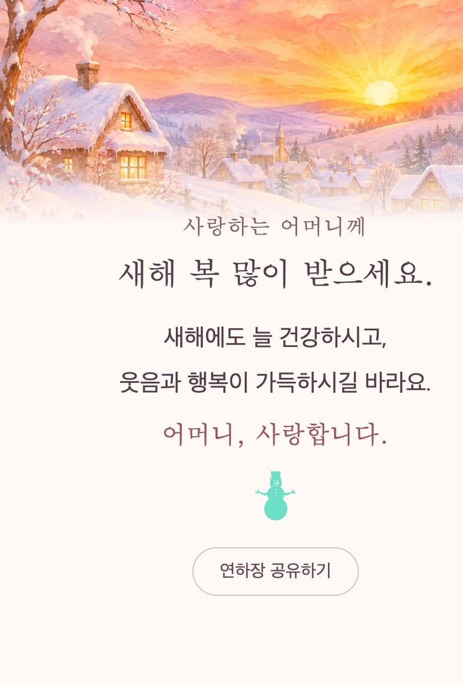
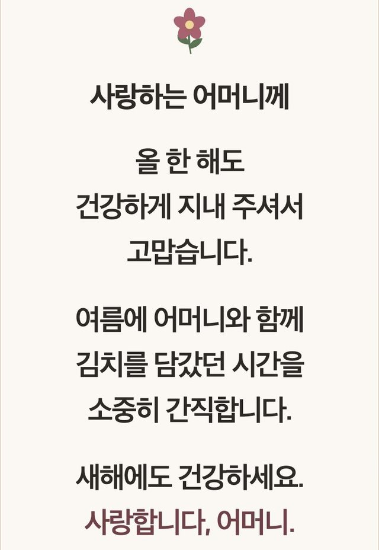
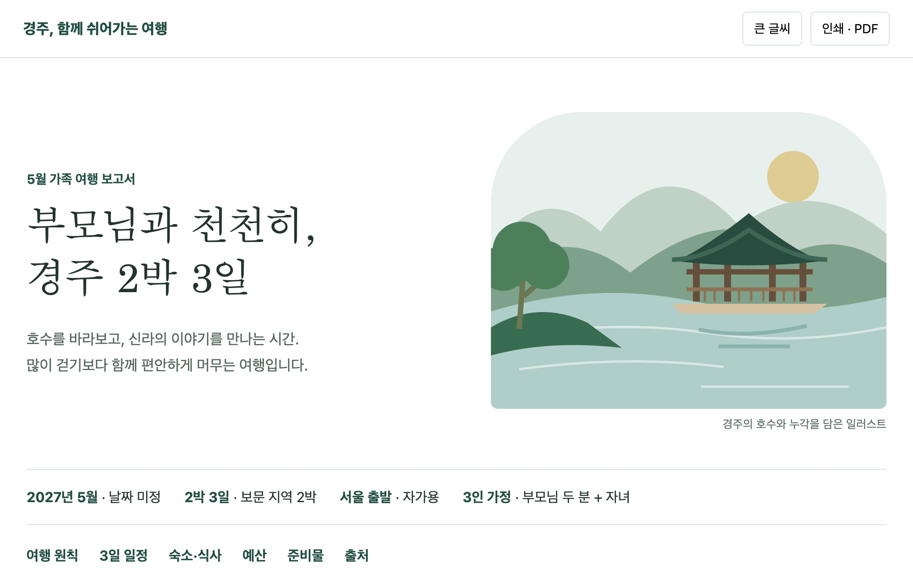
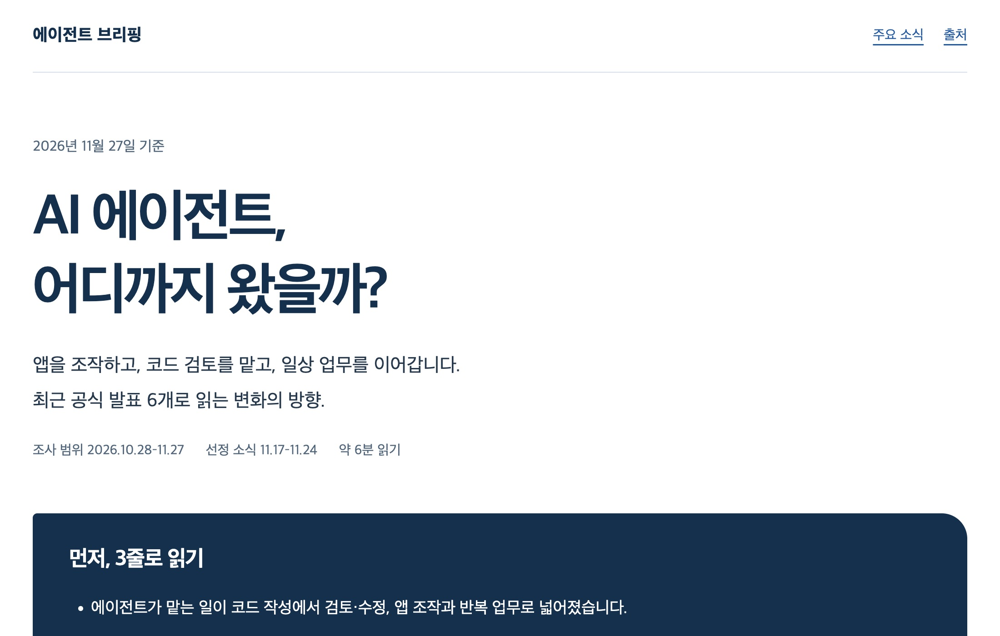

<!-- _class: lead -->

## WEEK 2 / 4

# 에이전트
**잘 쓰는 방법**

120분 · 직접 해보는 시간 89분
<!--
목표: 오늘 하나만 남기면 됩니다: **에이전트에게 맡길 수 있는 일의 범위를 넓혔다**. 설명은 12분이고, 나머지 시간에는 수강생이 직접 만듭니다.
구성: 실습은 연하장, 계획 보고서, 관심 주제 보고서, 블로그 글, 쇼츠의 순서입니다. 연하장이 가장 길고, 쉬는 시간 앞에 끝납니다.
첫 마디: “지난주에는 웹페이지 하나를 만들어 보셨습니다. 오늘은 그림, 보고서, 글, 영상까지 직접 만들어 봅니다.”
-->

---

<!-- _footer: "2주차 · 열기 · 00:00" -->
<!-- _class: lead -->

# 2시간

1. 에이전트는 무엇인가
2. 연하장 만들어서 서로 보내기  ←
3. 계획 보고서와 관심 주제 보고서  ←
4. 블로그 글과 쇼츠 영상  ←
<!--
말할 것: 목차를 한 줄씩 읽지 마세요. 손으로 훑고 1분 안에 넘기세요.
시간 배분: 앞의 12분은 제가 말하고, 그 뒤로는 만들 것을 화면으로 보고 바로 해보는 순서를 반복합니다.
전환: “오늘 수업이 끝날 때 어떤 것을 만들어 가시는지 먼저 보여 드리겠습니다.”
-->

---

<!-- _footer: "2주차 · 열기 · 00:01" -->

## 오늘 직접 만드는 **연하장**
<!--
진행: 2분입니다. 이 화면을 보여 주고, 오늘 만드는 것을 말로 알려주세요. 연하장, 계획 보고서, 관심 주제 보고서, 블로그 글, 쇼츠 영상입니다.
사실: 화면의 연하장은 Codex에 실제로 요청해서 받은 결과입니다 (2026년 11월 27일). 눈사람 그림과 눈 내린 마을 그림도 Codex가 만든 것입니다.
실습지: 수강생용 실습지(worksheet.html)의 주소를 채팅창에 올려주세요. 요청 문장이 모두 적혀 있고, 칸에 입력한 내용은 그 기기의 브라우저에 저장됩니다.
전환: “만들기 전에, 에이전트가 무엇인지 12분만 설명하겠습니다.”
-->

---

<!-- _class: lead -->

## 2주차 · 에이전트란 · 00:03 – 00:15

# 에이전트는
**무엇**인가
<!--
이 구간의 목적: 12분 안에 세 가지를 전합니다. 에이전트의 구조, LLM이 문장을 만드는 원리, 요청에 내 상황을 적으면 결과가 달라진다는 사실입니다.
주의: LLM은 처음 말할 때 ‘대규모 언어 모델’이라고 풀어서 말하고, ChatGPT 안에서 답을 만드는 모델이라고 설명하세요. 토큰, 파라미터, 트랜스포머 같은 말은 쓰지 마세요.
-->

---

<!-- _footer: "2주차 · 에이전트란 · 00:03" -->
<!-- _class: lead -->

# 에이전트 = LLM +
**도구 사용** + **반복**

LLM: ChatGPT 안에서 답을 만드는 대규모 언어 모델
<!--
첫 마디: “지난주에 본 에이전트를 한 줄로 적으면 이렇습니다.”
핵심: 에이전트는 LLM에 두 가지 기능을 더한 프로그램입니다. 하나는 파일을 읽고 쓰고 프로그램을 실행하는 도구 사용입니다. 다른 하나는 결과를 확인하고 목표에 못 미치면 다시 하는 반복입니다.
오늘과 연결: 오늘 실습에서 에이전트가 쓰는 도구가 늘어납니다. 다른 앱 조작, 그림 생성, 웹 검색, 음성과 영상 제작입니다.
용어: LLM은 화면에 처음 나오는 말입니다. ‘대규모 언어 모델’이라고 풀어서 말하고 아랫줄을 한 번 읽어주세요.
주의: 기술 용어를 더 늘리지 마세요. 이 한 줄이면 충분합니다.
-->

---

<!-- _footer: "2주차 · 에이전트란 · 00:05" -->
<!-- _class: lead -->

# “대한민국의 수도는 **?**”
<!--
진행: 수강생에게 먼저 묻습니다. 채팅으로 답을 받고 다음 장으로 넘어가세요. 1분입니다.
말할 것: “방금 여러분이 하신 일이 LLM이 하는 일입니다.”
-->

---

<!-- _footer: "2주차 · 에이전트란 · 00:06" -->
<!-- _class: lead -->

# LLM의 원리,
**다음 낱말 예측**
<!--
핵심: LLM은 앞에 쓴 문장을 읽고 다음에 올 낱말의 확률을 계산합니다. 그 확률에 따라 낱말 하나를 고르고, 고른 낱말을 문장 뒤에 더한 다음 같은 계산을 반복합니다.
말할 것: “앞에 쓴 문장이 달라지면 다음 낱말도 달라집니다. 요청을 바꾸면 결과가 달라지는 이유가 이것입니다.”
주의: ‘LLM은 문장을 미리 계획하지 않는다’고 말하지 마세요. 모델이 뒤에 올 낱말을 미리 정해 둔다는 연구 결과가 있습니다 (Anthropic, 2025, Tracing the thoughts of a large language model). ‘한 번에 낱말 하나씩 내놓는다’까지만 말하세요.
-->

---

<!-- _footer: "2주차 · 에이전트란 · 00:09" -->
<!-- _class: lead -->

# 에이전트는 많은 분야를 알지만,
**내 상황**은 모릅니다

일의 목적 · 읽는 사람 · 원하는 형식
<!--
핵심: 에이전트는 글쓰기, 번역, 통계, 법률 같은 분야 지식을 풍부하게 갖고 있습니다. 그러나 이 일을 왜 하는지, 결과물을 누가 읽는지, 어떤 형식을 원하는지는 알지 못합니다.
말할 것: “에이전트가 내 상황을 알 수 있는 곳은 여러분이 쓴 요청과 고른 폴더 안의 파일입니다.”
오늘과 연결: 오늘의 요청 문장에는 모두 내 상황이 한두 줄씩 들어 있습니다. 받는 사람은 어머니, 부모님은 70대, 준비할 수 있는 돈은 3천만 원 같은 줄입니다. 수강생은 이 줄을 자기 상황으로 바꿔 적습니다.
-->

---

<!-- _footer: "2주차 · 에이전트란 · 00:11" -->

## 내 상황을 적기 **전과 후**

| 요청만 적은 카드 | 내 상황을 더한 카드 |
|:---:|:---:|
|  |  |
<!--
사실: 요청만 적은 카드와 내 상황을 더한 카드는 ChatGPT 데스크탑 앱의 Codex에 실제로 요청해서 받은 결과입니다 (2026년 11월 26일). 왼쪽은 ‘연말 인사 카드를 웹페이지로 만들어줘’만 보낸 결과입니다. 오른쪽은 같은 요청에 목적, 받는 사람, 형식을 더해서 보낸 결과입니다.
더한 문장: “올해 건강하게 지내 주셔서 고맙다는 마음을 전하려는 거야. 받는 사람은 여든둘 되신 어머니야. 여름에 같이 김치를 담갔어. 형식은 휴대폰 한 화면이야. 누르지 않아도 인사말이 보이게, 글씨는 아주 크게 해줘. 내가 말하지 않은 추억은 지어내지 마.”
핵심: 왼쪽 카드는 ‘소중한 당신께’라고 적힌 봉투를 눌러야 인사말이 열립니다. 오른쪽 카드는 누르지 않아도 어머니께 드리는 인사말이 큰 글씨로 보이고, 건강과 김치 이야기가 들어 있습니다.
말할 것: “왼쪽 카드가 더 화려합니다. 그런데 여든둘 되신 어머니께 보낼 수 있는 카드는 오른쪽입니다.”
주의: 예시를 만든 컴퓨터는 수강생의 환경과 다릅니다. 수강생의 결과는 모양과 걸리는 시간이 다를 수 있습니다.
-->

---

<!-- _footer: "2주차 · 에이전트란 · 00:13" -->
<!-- _class: lead -->

# “맨 아래에
**‘막내딸 올림’**이라고 넣어줘”

결과에서 고칠 곳을 본 대로 말하면 됩니다.
<!--
지난주와 연결: 지난주 ‘부족한 부분을 찾아 계속 고치면 됩니다’ 장과 같은 내용입니다. 오늘 만드는 모든 결과물에 똑같이 씁니다.
리허설: 2026년 11월 26일에 카드를 만든 뒤 이 문장을 보냈습니다. 12초와 22초 만에 고쳐졌고, 작은 수정에는 계획을 다시 묻지 않았습니다.
예: “글씨를 더 크게 해줘”, “배경을 더 밝게 해줘”, “마지막 줄을 빼줘”.
한 번에 안 될 때: 오늘 실습에서 결과가 마음에 들지 않으면 처음부터 다시 요청하지 말고, 고칠 곳을 한 가지씩 말하게 하세요.
전환: “설명은 여기까지입니다. 이제 직접 만듭니다.”
-->

---

<!-- _class: lead -->

## 2주차 · 연하장 · 00:15 – 00:53

# 연하장을 만들어서
**서로 보내기**
<!--
이 구간의 순서: 에이전트가 그림판으로 그림을 그리고, 그림을 한 장 더 생성하고, 두 그림으로 연하장 웹페이지를 만들어 인터넷 주소를 받고, 그 주소를 서로 보냅니다. 38분입니다.
꼭 하는 단계: 그림판으로 그리기와 연하장 페이지 만들기입니다. 시간이 모자라면 그림 생성은 한 번만 하고 넘어가게 하세요.
대상 환경: 수강생은 대부분 Windows를 씁니다. 리허설은 Mac에서 했습니다. 그림판으로 그리기는 Windows에서 강의 전에 반드시 한 번 실행해 보세요.
안 될 때: 그림판 조작이 되지 않는 수강생은 그 단계를 건너뛰고 그림 생성부터 하게 하세요. 연하장은 생성한 그림만으로도 만들 수 있습니다.
-->

---

<!-- _footer: "2주차 · 연하장 · 00:15" -->

## **2주차** 폴더를 만들고, 그 폴더를 고릅니다
<!--
먼저 할 일: 바탕화면에 ‘2주차’라는 빈 폴더를 하나 만들게 하세요. 그다음 새 채팅에서 이 위치를 눌러 그 폴더를 고릅니다. 지난주와 같은 순서입니다.
폴더 신뢰: 폴더를 처음 고르면 ‘이 폴더를 신뢰할까요?’라는 창이 뜹니다. ‘폴더 신뢰’를 누르게 하세요. 이 창은 폴더마다 한 번만 뜹니다.
한 채팅에서 계속: 연하장 실습은 채팅 하나에서 이어서 합니다. 뒤 단계의 요청이 앞 단계에서 만든 그림을 가리키기 때문입니다.
주의: 화면은 지난주에 찍은 캡처입니다. 폴더 이름이 ‘1주차’로 보여도 위치는 같습니다.
막히는 분: 폴더를 못 고르면 옆의 ‘이 컴퓨터’가 눌려 있는지 확인하세요.
-->

---

<!-- _footer: "2주차 · 연하장 · 00:17" -->

## 에이전트가 다른 앱을 조작해서 **그린 그림**
<!--
사실: Codex가 Mac의 Freeform 앱을 직접 열고 조작해서 그린 뒤 폴더에 저장한 그림입니다 (2026년 11월 27일). 사람이 마우스를 움직이지 않았습니다.
말할 것: “지난주에는 에이전트가 파일을 만들었습니다. 오늘은 에이전트가 다른 앱을 열어서 직접 조작합니다.”
주의: Freeform에는 눈사람 도형이 들어 있어서, Codex가 그 도형을 꺼내 꾸몄습니다. 그림판에는 그런 도형이 없으므로 수강생의 눈사람은 모양이 다르게 나옵니다.
-->

---

<!-- _footer: "2주차 · 연하장 · 00:18" -->

## 첫 번째 실습 · **그림판으로 그리기**

- **요청**: “그림판을 열어서 눈사람을 그려줘. 다 그리면 그림을 이 폴더에 저장해줘”
- **허용 창**: 허용을 묻는 창에서 ‘이 대화 허용’
- **결과**: 2주차 폴더에 저장된 눈사람 그림
<!--
진행: 8분입니다. 이 장을 띄워 두고 진행하세요. 요청 문장을 채팅창에도 올려주세요. 에이전트가 그리는 동안에는 기다리게 하세요.
허용 창: 요청을 보내면 채팅 안에 ‘ChatGPT가 (앱 이름)을(를) 사용하도록 허용할까요?’라는 창이 한 번 뜹니다. 선택지는 ‘항상 허용’, ‘거부’, ‘이 대화 허용’입니다. ‘이 대화 허용’을 누르게 하세요.
리허설: Mac에서 “Freeform 앱을 열어서 눈사람을 그려줘. 다 그리면 그림을 이 폴더에 저장해줘”를 보냈습니다. 허용한 뒤 2분 39초 만에 그림이 PNG와 PDF로 저장됐습니다.
확인하지 못한 것: 화면의 문장은 앱 이름만 그림판으로 바꾼 것입니다. Windows의 그림판에서는 실행해 보지 못했습니다. 걸리는 시간과 그림의 모양이 다를 수 있습니다.
요금제: 다른 앱을 조작하는 기능이 수강생의 요금제에서도 되는지 확인하지 못했습니다. 강의 전에 수강생과 같은 요금제의 계정으로 확인하세요.
막히는 분: 허용 창을 놓치면 진행이 멈춘 것처럼 보입니다. 채팅을 아래로 내려 창이 떠 있는지 보게 하세요. 그림판 조작이 끝내 되지 않으면 다음 단계로 넘어가게 하세요.
-->

---

<!-- _footer: "2주차 · 연하장 · 00:26" -->

## 말로 설명해서 받은 **그림**
<!--
사실: 다음 장의 요청을 Codex에 보내서 받은 그림입니다 (2026년 11월 27일). 34초가 걸렸고, 그림은 채팅 안에 바로 표시됐습니다.
말할 것: “방금은 에이전트가 앱으로 그렸습니다. 이번에는 말로 설명하면 그림을 만들어 줍니다.”
-->

---

<!-- _footer: "2주차 · 연하장 · 00:27" -->

## 말로 설명해서 **그림 받기**

- **요청**: “새해 연하장에 넣을 그림을 그려줘”
- **모습**: “눈 내린 마을 위로 해가 떠오르는 모습이고”
- **느낌**: “따뜻한 수채화 느낌으로 해줘”

줄을 바꾸지 말고 이어서 적은 뒤 한 번에 보냅니다.
<!--
진행: 5분입니다. 모습과 느낌은 수강생이 원하는 대로 바꿔 적게 하세요. 예: 소나무와 학, 한복을 입은 가족, 바닷가의 해돋이.
리허설: 화면의 문장을 이어서 앱에 한 번에 보냈습니다. 34초 만에 그림이 채팅 안에 표시됐습니다.
그림의 위치: 생성한 그림은 2주차 폴더에 저장되지 않고 Codex가 따로 보관합니다. 같은 채팅에서 ‘눈 내린 마을 그림’처럼 말로 가리키면 다음 단계에서 쓸 수 있습니다.
시간이 남으면: “같은 모습을 색연필 느낌으로 한 장 더 그려줘”처럼 느낌만 바꿔서 한 번 더 요청하게 하세요. 이 문장은 리허설에서 보내지 않았습니다.
주의: 실제 사람의 얼굴이나 이름을 넣어 달라고 하지 않게 하세요.
-->

---

<!-- _footer: "2주차 · 연하장 · 00:32" -->

## 그림으로 만든 **연하장 페이지**
<!--
사실: 다음 장의 요청을 Codex에 보내서 받은 연하장입니다 (2026년 11월 27일).
말할 것: “방금 만든 눈사람 그림과 눈 내린 마을 그림이 연하장에 들어갑니다.”
-->

---

<!-- _footer: "2주차 · 연하장 · 00:33" -->

## 연하장을 **인터넷 주소**로 만들기

- **요청**: “눈사람 그림과 눈 내린 마을 그림을 넣어서 새해 연하장을 웹페이지로 만들어줘”
- **받는 사람**: “받는 사람은 어머니야”
- **주소**: “다른 사람에게 보낼 수 있게 인터넷 주소로 만들어줘”

주소를 아는 사람은 누구나 볼 수 있습니다. 전화번호와 주소는 적지 않습니다.
<!--
진행: 9분입니다. 받는 사람은 수강생이 정한 사람으로 바꿔 적게 하세요.
확인을 물을 때: 에이전트가 인사말과 구성을 먼저 보여 주고 ‘제작하고 공개해도 될까요?’라고 물을 수 있습니다. 인사말을 읽어 보고 “응, 만들어서 공개해줘”라고 답하게 하세요.
리허설: 앱: 앱에서는 “처음에 그린 그림을 넣어서 새해 연하장을 웹페이지로 만들어줘. 받는 사람은 어머니야. 다른 사람에게 보낼 수 있게 인터넷 주소로 만들어줘”를 보냈습니다. 구성을 보여 주기까지 13초, 승인한 뒤 공개까지 3분 31초가 걸렸습니다. chatgpt.site로 끝나는 주소가 생겼고, 앱에 ‘누구나 볼 수 있음’이라고 표시됐습니다.
리허설: 화면의 문장: 화면의 문장은 앱에 들어 있는 Codex 실행 파일에 보냈습니다. 눈사람 그림과 눈 내린 마을 그림은 폴더에 파일로 넣어 두었습니다. 구성을 보여 주기까지 22초, “응, 만들어줘.”라고 답한 뒤 연하장이 나오기까지 1분 41초가 걸렸습니다. 이 방식에서는 인터넷 주소가 발급되지 않았습니다. 화면의 문장으로 주소까지 받는 것은 앱에서 확인하지 못했습니다.
공개의 뜻: 만든 페이지는 주소를 아는 사람이면 누구나 열 수 있습니다. 전화번호, 주소, 주민등록번호는 적지 않게 하고, 받는 사람은 호칭으로 적게 하세요.
요금제: 웹페이지를 인터넷 주소로 올리는 기능이 수강생의 요금제에서도 되는지 확인하지 못했습니다. 주소가 나오지 않는 수강생은 만들어진 웹페이지 파일을 열어 확인하게 하세요.
-->

---

<!-- _footer: "2주차 · 연하장 · 00:42" -->
<!-- _class: lead -->

# 연하장 주소를
**서로 보내기**

주소를 복사해서 수업 채팅창에 올립니다.
<!--
진행: 9분입니다. 만들어진 연하장의 주소를 복사해 수업 채팅창에 올리게 하세요. 그다음 다른 수강생이 올린 주소를 하나 골라 열어 보게 합니다.
주소 복사: 에이전트의 답에 ‘새해 연하장 열기’ 같은 링크가 나오고, 오른쪽에 연하장이 열립니다. 주소를 복사하는 정확한 위치는 리허설에서 눌러 보지 않았습니다. 강의 전에 확인해 두세요.
에이전트가 보내기: 에이전트가 메일이나 메신저로 직접 보내는 방법은 리허설에서 확인하지 않았습니다. 시간이 남는 수강생이 해보겠다고 하면 막지는 말되, 받는 사람을 자기 자신으로 하게 하세요.
실제로 보내기: 가족에게 실제로 보내는 일은 수업이 끝난 뒤에 하도록 안내하세요. 주소를 문자나 메신저에 붙여 넣으면 됩니다.
-->

---

<!-- _footer: "2주차 · 연하장 · 00:51" -->
<!-- _class: lead -->

# 받은 연하장을
**휴대폰**으로 열어 보기
<!--
진행: 2분입니다. 채팅창의 주소를 휴대폰으로 열어 보게 하세요. 컴퓨터의 수업 채팅을 휴대폰에서도 볼 수 없는 수강생은 컴퓨터의 브라우저로 엽니다.
확인: 연하장이 열린 분에게 손을 들게 하세요. 눈사람 그림, 눈 내린 마을 그림, 받는 사람이 들어 있는지 보게 합니다.
말할 것: “방금 여러분은 그림을 그리고, 웹페이지를 만들고, 인터넷에 올렸습니다. 코드는 한 줄도 쓰지 않았습니다.”
-->

---

<!-- _class: lead -->

## BREAK · 00:53 – 01:03

# 쉬는 시간 10분

돌아오면 보고서를 만듭니다.
<!--
할 일: 연하장이 끝나지 않은 분을 이때 도와주세요.
-->

---

<!-- _footer: "2주차 · 계획 보고서 · 01:03" -->

## 부모님과 가는 **경주 2박 3일** 계획 보고서
<!--
사실: 다음 장의 요청을 Codex에 보내서 받은 보고서입니다 (2026년 11월 27일). 날짜별 일정, 숙소와 식사, 예산, 준비물, 출처가 들어 있고, 큰 글씨 전환과 인쇄 단추가 있습니다.
말할 것: “연하장은 한 화면이었습니다. 이번에는 여러 쪽짜리 문서를 맡깁니다.”
-->

---

<!-- _footer: "2주차 · 계획 보고서 · 01:04" -->

## 두 번째 실습 · **계획 보고서**

- **상황**: “5월에 부모님을 모시고 2박 3일로 경주 여행을 가려고 해”
- **조건**: “부모님은 70대라 많이 걷기 어려워”
- **요청**: “여행 계획을 보고서로 만들어줘. 웹페이지로 만들어줘”

여행, 공부, 사업 가운데 하나를 골라 내 상황으로 바꿔 적습니다.
<!--
진행: 11분입니다. 새 채팅을 열고 2주차 폴더를 고른 뒤 시작하게 하세요. 공부 계획과 사업 계획의 문장은 실습지에 있습니다.
리허설: 여행: 화면의 문장을 이어서 앱에 들어 있는 Codex 실행 파일에 한 번에 보냈습니다. 계획을 보여 주기까지 30초, “응, 그대로 만들어줘. 서울에서 자가용으로 가.”라고 답한 뒤 보고서가 나오기까지 3분 42초가 걸렸습니다.
리허설: 공부와 사업: 공부 계획과 사업 계획의 문장은 실습지에 있습니다. 공부 계획과 사업 계획 모두 앱에 들어 있는 Codex 실행 파일에 보냈습니다. 공부 계획은 구성까지 23초, 보고서까지 3분 55초가 걸렸고, 사업 계획은 구성까지 27초, 보고서까지 3분 12초가 걸렸습니다.
계획을 물을 때: 에이전트가 구성을 먼저 보여 주고 확인을 구할 수 있습니다. 읽어 보고 “응, 만들어줘”라고 답하게 하세요. 출발지처럼 빠진 내용을 물으면 함께 답합니다.
내 상황: 상황과 조건의 줄이 앞에서 본 ‘내 상황’입니다. 조건을 빼고 보내면 누구에게나 맞는 일정이 나옵니다.
주의: 보고서의 가격, 영업시간, 시험 일정 같은 사실은 틀릴 수 있습니다. 실제로 쓰기 전에 출처를 눌러 확인하라고 알려주세요.
-->

---

<!-- _footer: "2주차 · 계획 보고서 · 01:15" -->
<!-- _class: lead -->

# 보고서에서
**고칠 곳** 말하기
<!--
진행: 2분입니다. 보고서를 훑어보고 고칠 곳 한 가지를 말로 요청하게 하세요.
예: “둘째 날 일정을 더 느긋하게 바꿔줘”, “예산 표를 맨 위로 올려줘”, “글씨를 더 크게 해줘”. 이 문장들은 리허설에서 보내지 않았습니다.
전환: “이번에는 에이전트가 인터넷에서 직접 찾아서 정리하게 합니다.”
-->

---

<!-- _footer: "2주차 · 주제 보고서 · 01:17" -->

## 요즘 소식을 찾아서 정리한 **주제 보고서**
<!--
사실: 다음 장의 요청을 Codex에 보내서 받은 보고서입니다 (2026년 11월 27일). Codex가 웹을 검색해 최근 한 달의 소식 여섯 개를 골랐고, 소식마다 공식 출처를 붙였습니다.
말할 것: “방금 보고서는 에이전트가 아는 내용으로 썼습니다. 이번 보고서는 오늘 인터넷에 있는 내용을 찾아서 씁니다.”
-->

---

<!-- _footer: "2주차 · 주제 보고서 · 01:18" -->

## 세 번째 실습 · **관심 주제 보고서**

- **찾기**: “요즘 AI 에이전트에 대해 새로 나온 소식을 찾아서”
- **정리**: “읽기 쉬운 보고서로 정리해줘”
- **형식**: “웹페이지로 만들고 출처도 함께 적어줘”

‘AI 에이전트’ 자리에 내 관심 주제를 넣습니다.
<!--
진행: 8분입니다. 새 채팅에서 시작합니다. 주제는 수강생이 고릅니다. 예: 무릎 건강에 좋은 운동, 국내 겨울 여행지, 내가 하는 일의 업계 소식.
리허설: 화면의 문장을 이어서 앱에 들어 있는 Codex 실행 파일에 한 번에 보냈습니다. 찾은 소식과 구성을 보여 주기까지 33초, “응, 만들어줘.”라고 답한 뒤 보고서가 나오기까지 2분 41초가 걸렸습니다.
출처: ‘출처도 함께 적어줘’를 빼지 않게 하세요. 출처가 있어야 수강생이 내용을 확인할 수 있습니다.
주의: 건강과 돈에 관한 주제는 보고서의 내용을 그대로 따르지 말고 출처를 확인하라고 알려주세요.
-->

---

<!-- _footer: "2주차 · 주제 보고서 · 01:26" -->

## 같은 일을 **매일** 하게 하기

- **예약**: “매일 아침 8시에 AI 에이전트의 새 소식을 찾아서 웹페이지 보고서로 정리해 주도록 예약해줘”
- **지우기**: “아까 만든 매일 아침 8시 예약을 지워줘”

켜 둔 예약은 수업이 끝난 뒤에도 매일 실행됩니다.
<!--
진행: 6분입니다. 시간이 남는 수강생만 합니다. 예약을 만들고, 내용을 확인하고, 지우는 데까지 하게 하세요.
리허설: 앱에서 예약 문장을 보내자 30초 만에 ‘매일 아침 AI 에이전트 뉴스, 매일 오전 8:00’이라는 예약이 생겼습니다. 지우기 문장을 보내자 14초 만에 지워졌습니다.
예약의 내용: 에이전트는 한 문장을 받아 긴 작업 지시문을 스스로 써서 저장합니다. 리허설에서는 그 지시문에 보고서를 인터넷에 공개하라는 내용까지 들어 있었습니다. 예약 항목을 눌러 내용을 읽어 보게 하세요.
반드시 말할 것: “수업이 끝나기 전에 예약을 지우세요. 지우지 않으면 내일부터 매일 실행됩니다.”
확인하지 못한 것: 예약이 실제로 다음 날 아침에 실행되는지는 확인하지 않았습니다. 컴퓨터가 꺼져 있을 때 어떻게 되는지도 확인하지 않았습니다.
요금제: 예약 기능이 수강생의 요금제에서도 되는지 확인하지 못했습니다.
-->

---

<!-- _footer: "2주차 · 블로그 글 · 01:32" -->
<!-- _class: lead -->

# 내 경험을
**블로그 글**로
<!--
말할 것: “보고서는 정보를 정리한 글이었습니다. 이번에는 내 이야기를 글로 씁니다.”
핵심: 경험은 수강생만 아는 내용입니다. 요청에 경험을 구체적으로 적을수록 내 글이 됩니다.
-->

---

<!-- _footer: "2주차 · 블로그 글 · 01:33" -->

## 네 번째 실습 · **블로그 글**

- **경험**: “지난 주말에 가족과 김장한 이야기를 블로그에 올릴 글로 써줘”
- **형식**: “제목과 본문을 나누고, 사진을 넣을 자리도 표시해줘”

‘가족과 김장한 이야기’ 자리에 내 경험을 넣습니다.
<!--
진행: 9분입니다. 새 채팅에서 시작합니다. 경험은 수강생의 것으로 바꿔 적게 하세요. 예: 지난달에 다녀온 여행, 최근에 읽은 책, 텃밭에서 기른 채소.
리허설: 화면의 문장을 이어서 앱에 들어 있는 Codex 실행 파일에 한 번에 보냈습니다. 21초 만에 제목, 본문, 사진 자리 세 곳이 표시된 글이 채팅 안에 나왔습니다. 파일로 저장되지는 않았습니다.
내 글로 만들기: 리허설의 글에는 김장하는 날의 구체적인 장면이 없었습니다. 요청에 적지 않았기 때문입니다. “배추는 마흔 포기였고, 손주가 양념을 버무렸어”처럼 실제 장면을 덧붙여 다시 요청하게 하세요.
블로그에 올리기: 에이전트가 블로그에 직접 올리는 방법은 리허설에서 확인하지 않았습니다. 오늘은 글을 복사해서 자기 블로그에 붙여 넣는 데까지 안내하세요.
주의: 에이전트가 쓴 글에는 수강생이 겪지 않은 일이 들어갈 수 있습니다. 올리기 전에 읽어 보게 하세요.
-->

---

<!-- _footer: "2주차 · 쇼츠 · 01:42" -->

## 그림과 목소리로 만든 **쇼츠 영상**
<!--
사실: Codex가 만든 영상의 한 장면입니다 (2026년 11월 27일). 앞에서 생성한 그림에 음성과 자막을 합친 20초짜리 세로 영상입니다.
말할 것: “마지막은 영상입니다. 먼저 목소리를 만들고, 그림과 합칩니다.”
확인하지 못한 것: 리허설은 Mac에서 했고, 그 컴퓨터에는 영상을 만드는 도구가 이미 설치돼 있었습니다. Windows에서는 음성과 영상 모두 확인하지 못했습니다. 강의 전에 반드시 실행해 보세요.
-->

---

<!-- _footer: "2주차 · 쇼츠 · 01:43" -->

## 다섯 번째 실습 · **인사말 음성**

- **글**: “어머니께 드리는 새해 인사말을 20초 분량으로 써서”
- **음성**: “사람 목소리로 읽은 음성 파일로 만들어줘”

연하장을 만든 채팅에서 이어서 보냅니다.
<!--
진행: 5분입니다. 연하장을 만든 채팅으로 돌아가서 보내게 하세요. 왼쪽 목록에서 그 채팅을 누르면 됩니다.
리허설: 화면의 문장을 이어서 앱에 한 번에 보냈습니다. 1분 4초 만에 20.6초 길이의 음성 파일이 생겼고, 채팅 안에서 바로 들을 수 있었습니다. 실제 사람의 녹음이 아니라 한국어 합성 음성입니다.
리허설에서 본 것: 에이전트가 처음에 소리가 없는 빈 파일을 만들었다가, 스스로 확인하고 다시 만들었습니다. 수강생의 화면에서 시간이 걸리면 기다리게 하세요.
안 될 때: Windows에서 음성이 만들어지지 않으면 이 실습은 강사의 화면으로 보여 주고 넘어가세요.
-->

---

<!-- _footer: "2주차 · 쇼츠 · 01:48" -->

## 그림과 음성을 **영상**으로

- **합치기**: “방금 만든 음성과 연하장 그림을 합쳐서”
- **형식**: “휴대폰 세로 화면에 맞는 쇼츠 영상으로 만들어줘”
- **자막**: “인사말은 자막으로 넣어줘”

시간이 남는 분만 합니다.
<!--
진행: 6분입니다. 음성이 만들어진 수강생만 합니다.
리허설: 화면의 문장을 이어서 앱에 한 번에 보냈습니다. 구성을 보여 주기까지 12초, “응, 만들어줘.”라고 답한 뒤 57초 만에 20.6초 길이의 세로 영상이 생겼습니다. 채팅 안에서 바로 재생됐습니다.
그림이 여러 장일 때: 리허설의 채팅에는 연하장 그림이 한 장뿐이었습니다. 수강생의 채팅에는 눈사람 그림도 있으므로, 에이전트가 어느 그림을 쓸지 물을 수 있습니다. 그러면 “눈 내린 마을 그림으로 해줘”라고 답하게 하세요.
확인하지 못한 것: Windows에서는 실행해 보지 못했습니다. 영상을 만드는 도구가 없으면 에이전트가 설치를 권하거나 다른 방법을 찾을 수 있고, 실패할 수도 있습니다.
안 될 때: 영상이 만들어지지 않는 수강생에게는 강사의 영상을 보여 주세요. 음성 파일까지 만들었으면 이 실습은 한 것으로 봅니다.
-->

---

<!-- _footer: "2주차 · 마무리 · 01:54" -->

## 오늘 **만든 것**

- **연하장**: 다른 앱 조작 · 그림 생성 · 인터넷 주소
- **계획 보고서**: 여러 쪽짜리 문서
- **주제 보고서**: 웹 검색 · 매일 예약
- **블로그 글**: 내 경험으로 쓴 글
- **쇼츠**: 음성 · 영상
<!--
진행: 2분입니다. 줄을 읽지 말고, 만든 것을 채팅창에 한 가지씩 적게 하세요.
핵심: 오른쪽에 적힌 것이 오늘 에이전트가 새로 쓴 도구입니다. 지난주에는 파일을 만드는 일만 맡겼습니다.
예약 확인: 예약을 만든 수강생에게 지웠는지 한 번 더 물어보세요.
-->

---

<!-- _footer: "2주차 · 마무리 · 01:56" -->
<!-- _class: lead -->

# 이번 주에 하실 일

오늘 만든 것 가운데 하나를 내 일로 바꿔서 다시 만들어 보세요.
<!--
과제: 오늘의 실습 가운데 하나를 골라, 실제로 필요한 내용으로 바꿔서 다시 만들기. 결과를 채팅창에 글로 올려주세요.
덧붙일 말: 오늘 만든 연하장을 가족 한 사람에게 실제로 보내 보라고 권하세요.
시간: 과제 안내는 1분 안에 끝내고, 남은 3분은 질문을 듣습니다.
다음 주 준비: 잘 안 된 일 한 가지를 기억해 오게 하세요. 다음 주 체크인에서 다룹니다.
-->

---

<!-- _class: lead -->

## WEEK 2 / 4 · 끝

# 오늘 만든 것을
**내 일**로
바꿔 보세요

에이전트에게 맡길 수 있는 일의 범위가 넓어졌습니다.

다음 주: 맡기는 범위를 넓힌다
<!--
마지막 말: “오늘 쓴 문장을 외우지 않으셔도 됩니다. 실습지에 모두 있습니다. 이번 주에 하나만 내 일로 바꿔서 다시 만들어 보세요.”
다음 주: 어떤 일까지 맡길 수 있는지, 결과를 어떻게 확인하는지를 다룹니다.
-->
