<style>
section { padding: 60px 80px; }
section.lead { text-align: center; justify-content: center; }
h1 { color: #1f2d28; }
</style>

<!-- _class: lead -->

## WEEK 2 / 4 · 무엇이고, 어떻게 쓰는가

# 지금까지 찾아낸
**좋은 방법**이
있을 뿐입니다

1강에서는 된다는 걸 봤습니다. 오늘은 **왜 되는지**, 그리고 왜 가끔 안 되는지를 알고 갑니다. 그걸 알면 다음부터 혼자 판단할 수 있습니다.

120분 · 온라인 · 실습 1건 · 세 가지 방식 · 준비물: 지난주 과제 결과
<!--
목표: 오늘의 결론 한 줄 — **“정답표는 없고, 내 결과물로 먼저 해봐야 안다.”** 모든 장표가 이 문장을 향합니다.
오늘의 성격: 1강은 설득이었고 오늘은 설명입니다. 설명이 길어지면 실습이 밀립니다. 앞 65분, 실습 30분, 마무리 15분을 지키세요.
첫 마디: “지난주에 한 번씩은 켜보셨을 겁니다. 안 된 것부터 듣겠습니다.”
-->

---

<!-- _footer: "2강 · 열기 · 00:00 – 00:12" -->

## 오늘은 **원리 셋**과 **사용법 셋**입니다

- `00:00` **체크인 — 지난주에 안 된 것** — 12분
- `00:12` **LLM이 문장을 만드는 원리** — 10분
- `00:22` **만든 사람도 모르는 잠재력** — 12분
- `00:34` **에이전트의 구조 — 추론 + 도구 + 반복** — 8분
- `00:42` **잘 쓰는 법에 정답표가 없다** — 5분
- `00:47` **세 가지 사용법** — 18분
- `01:05` **쉬는 시간** — 10분
- `01:15` **실습 — 같은 과제, 세 가지 방식** — 30분
- `01:45` **내게 맞는 방식 찾기** — 10분
- `01:55` **정리 · 과제 · 3강 예고** — 5분

앞의 네 구간은 **왜 그런지**를, 뒤의 세 구간은 **그래서 어떻게 하는지**를 다룹니다.
<!--
말할 것: 목차를 한 줄씩 읽지 마세요. 손으로 훑고 10초 안에 넘기세요.
구조: 원리를 먼저 하는 이유는 사용법을 외우지 않게 하기 위해서입니다. 원리를 알면 오늘 안 배운 방법도 스스로 만들어냅니다.
전환: “그 전에, 지난 7일 이야기부터 듣겠습니다.”
-->

---

<!-- _footer: "2강 · 열기 · 00:00" -->

## 지난 7일에서 **안 된 것**부터 받겠습니다

- 먼저 묻는 것 **안 된 것** — “시켰는데 안 됐던 일” 하나씩. **이게 오늘 수업에서 다룰 내용입니다.**
- 두 번째 **의외로 된 것** — “안 될 거라 생각했는데 됐던 일.” 여기서 수강생들이 서로 배웁니다.
- 세 번째 **못 시킨 것** — “시키고 싶었는데 어떻게 말할지 몰라서 못 한 일.” 오늘 실습 과제로 씁니다.

**강사 진행** — 공유 메모에 받아 적으면서 진행하세요. 세 번째 칸에서 나온 과제 하나를 오늘 실습의 공통 예제로 고르면 수업이 자기 문제로 바뀝니다.
<!--
왜 안 된 것부터: 성공담부터 받으면 못 한 사람이 입을 닫습니다. 실패부터 받으면 “나만 그런 게 아니구나”가 되고 그때부터 말이 나옵니다.
진행: 12분. 세 명이면 충분합니다. 한 명당 4분을 넘기지 마세요.
전환: “신기하게도 처음에 막히는 지점은 거의 같습니다.”
-->

---

<!-- _footer: "2강 · 열기 · 00:06" -->

## 막힘 다섯 중 **넷**은 에이전트의 한계가 아니라 **내가 말하지 않은 것**입니다

| 안 되는 모습 | 진짜 원인 | 해결 방법 |
|---|---|---|
| 파일을 못 찾는다 | **내가 어느 폴더인지 안 알려줬다** | 작업할 폴더를 먼저 열어두고 시작한다 |
| 엉뚱한 걸 해놨다 | **내 머릿속 전제를 말 안 했다** | “하기 전에 뭘 할 건지 먼저 말해줘”를 붙인다 |
| 중간에 멈췄다 | 승인 요청을 못 봤다 | 화면을 끝까지 내려본다. 승인 버튼을 기다리는 중 |
| 그럴듯한데 틀렸다 | **검증을 안 시켰다** | “각 주장이 어느 파일 몇 쪽에서 나왔는지 적어줘” |
| 너무 오래 걸린다 | **한 번에 너무 큰 일을 줬다** | 먼저 계획만 받고, 단계별로 쪼개서 시킨다 |

기울임 표시한 네 줄이 **내 쪽 원인**입니다. 오늘 수업 전체가 거기에 대한 설명입니다.
<!--
주장: 이 표 한 장이 오늘의 결론을 미리 증명합니다. 천천히 읽으세요.
진행: 체크인에서 받은 ‘안 된 것’이 이 표의 어느 줄인지 분류해보세요. 대부분 들어맞습니다. 그 순간 수업이 설득됩니다.
전환: “왜 이런 일이 생기는지 알려면, 안에서 무슨 일이 벌어지는지부터 봐야 합니다.”
-->

---

<!-- _class: lead -->

## PART 1 · 00:12 – 00:22

# 다음에 올 말을
**확률로**
고릅니다

문장 전체를 미리 계획하고 쓰는 것이 아닙니다. 이 한 가지를 알면 오늘 나머지가 다 따라옵니다.
<!--
이 구간의 역할: 원리를 10분 안에 끝냅니다. 정확하게 말하려다 길어지면 뒤가 다 밀립니다. 그림 한 장과 시연 한 번으로 충분합니다.
쓰지 말 것: 토큰·파라미터·트랜스포머 같은 말을 꺼내지 마세요. **다음에 올 말을 확률로 고른다**, 이 한 문장이면 됩니다.
-->

---

<!-- _footer: "2강 · 무엇인가 · 00:13" -->

## 앞에 놓인 말이 **다음 말의 확률**을 바꿉니다


<!--
말할 것: “오늘 서울 날씨는” 까지 읽고 다음에 올 말을 맞혀보라고 수강생에게 먼저 물으세요. 사람도 똑같이 합니다. 그 경험이 설명을 대신합니다.
핵심: 확률이 가장 높은 것만 고르는 게 아니라 **확률에 따라** 고릅니다. 그래서 같은 질문에 답이 매번 조금씩 다릅니다.
이어지는 결론: 내가 앞에 무슨 말을 놓느냐가 다음 말의 확률을 바꿉니다. 프롬프트가 효과 있는 이유가 바로 이것이고, 오늘 세 가지 사용법이 모두 여기서 나옵니다.
-->

---

<!-- _footer: "2강 · 무엇인가 · 00:17" -->

## 같은 문서에 같은 질문인데 **답의 모양이 다릅니다**

**나** ▸
> 이 보고서 요약해줘

**1회** ▪
> 핵심을 세 가지로 정리했습니다 — 매출, 비용, 인력 …

**나** ▸
> (새 채팅에서) 이 보고서 요약해줘

**2회** ▪
> 문서 구조를 따라 장별로 정리했습니다 — 1장 배경 …

둘 다 틀리지 않았습니다. **어떤 모양을 원하는지 내가 말하지 않았을 뿐입니다.**
<!--
라이브 시연: 실제로 두 번 시켜서 보여주세요. 같은 결과가 나오면 세 번째를 하세요. 미리 캡처를 준비해두면 안전합니다.
연결: 앞의 ‘흔한 막힘 5’에서 **엉뚱한 걸 해놨다** 줄이 이 장에서 설명됩니다.
전환: “그런데 더 이상한 건, 이걸 만든 사람도 이게 무엇까지 할 수 있는지 다 모른다는 겁니다.”
-->

---

<!-- _class: lead -->

## PART 2 · 00:22 – 00:34

# 만든 사람도
무엇까지 되는지
**다 모릅니다**

이상한 말처럼 들리지만, 세 가지 이유가 있습니다. 그리고 이 사실이 오늘 수업의 태도를 정합니다.
<!--
왜 이 구간이 중요한가: “정답을 아는 사람이 어딘가 있고 나는 모른다”는 생각을 깨는 자리입니다. 아무도 전부 알지 못합니다. 그래서 **직접 해본 사람**이 앞서갑니다.
주의: “AI는 신비롭다”로 끌고 가지 마세요. 세 가지 이유를 또박또박 설명하면 신비가 아니라 **구조적인 이유**로 들립니다.
-->

---

<!-- _footer: "2강 · 잠재력 · 00:23" -->

## 능력이 있어도 **꺼내는 말**을 못 찾으면 안 나옵니다


<!--
세 가지 이유: ① 가르친 게 아니라 생겼다 — 특정 업무를 하라고 학습시킨 것이 아니라 방대한 글에서 다음 말을 맞히게 했고, 그 과정에서 생긴 능력은 시켜봐야 확인됩니다. ② 꺼내는 말을 찾아야 나온다 — 같은 모델이 프롬프트에 따라 전혀 다른 결과를 냅니다. ③ 조합을 전수 조사할 수 없다 — 시킬 수 있는 일의 조합이 사실상 무한합니다.
비유를 쓰지 않기: “잠자는 능력”, “숨겨진 보물” 같은 표현을 쓰지 마세요. **프롬프트를 찾으면 나오고, 못 찾으면 안 나온다**로 말하면 그대로 전달됩니다.
전환: “실제로 그런 발견이 있었습니다. 유명한 예를 하나 보여드리겠습니다.”
-->

---

<!-- _footer: "2강 · 잠재력 · 00:28" -->

## **한 줄**을 덧붙이자 수학 정답률이 올라갔습니다 — 모델을 만든 **뒤에** 발견된 일입니다

- 2022년 1월 **“단계적으로 풀어줘”** — 답만 내놓게 하지 않고 **중간 과정을 쓰게** 하자 수학 문제 정답률이 크게 올랐습니다. 모델을 바꾼 것이 아니라 **말을 바꾼 것**입니다.
- 같은 해 6월 **크기를 키우니 없던 능력이 생김** — 작은 모델에는 없고 큰 모델에만 나타나는 능력이 보고됐습니다. 작은 모델의 추세를 늘려서는 **예측할 수 없었습니다**.
출처: [arxiv.org/abs/2201.11903 — Chain-of-Thought Prompting](https://arxiv.org/abs/2201.11903)
출처: [arxiv.org/abs/2206.07682 — Emergent Abilities](https://arxiv.org/abs/2206.07682)

오늘 여러분이 배울 방법도 **누군가 해보고 찾아낸 것**입니다. 외워서 끝나는 지식이 아닙니다.
<!--
출처: 두 논문 모두 공개되어 있습니다. 두 번째 논문은 ‘작은 모델의 성능 추세를 늘려서는 예측할 수 없다’고 명시합니다.
말할 것: “논문 제목을 외우실 필요 없습니다. 중요한 건 **순서**입니다 — 모델이 먼저 나왔고, 쓰는 방법은 나중에 발견됐습니다.”
전환: “그러면 우리가 쓰는 에이전트는 이 예측기와 무엇이 다른지 정리하겠습니다.”
-->

---

<!-- _class: lead -->

## PART 3 · 00:34 – 00:42

# 추론 + 도구 +
**반복**

1강에서 챗봇과 에이전트를 한 장으로 구분했습니다. 오늘은 그 안에 무엇이 붙어 있는지 봅니다.
<!--
이 구간의 역할: 원리(PART 1)와 사용법(PART 5) 사이를 잇습니다. 도구와 반복이 붙어 있다는 걸 알면, 왜 ‘확인해줘’가 통하는지 이해됩니다.
-->

---

<!-- _footer: "2강 · 구조 · 00:35" -->

## 예측기 하나에 **도구**와 **반복**이 붙은 것입니다


<!--
말할 것: 가운데 ‘추론’ 칸이 PART 1에서 본 그 예측기입니다. 거기에 파일을 읽고 쓰고 명령을 실행하는 도구가 붙고, 결과를 확인해서 안 됐으면 스스로 다시 하는 반복이 붙습니다.
1강과의 연결: 1강에서 화면에 뭐가 지나가는 걸 보셨을 겁니다. 그게 이 네 칸을 돌고 있는 모습입니다.
전환: “그런데 이 구조에는 한 가지 빈 칸이 있습니다.”
-->

---

<!-- _footer: "2강 · 구조 · 00:38" -->

## 분야 지식은 거의 전부 있고, **내 맥락**은 하나도 없습니다


<!--
핵심: 에이전트가 모르는 것은 전문 지식이 아니라 **내 상황**입니다. 내 회사, 내가 쓰는 양식, 내가 진짜 원하는 결과물 — 아무것도 모릅니다.
연결: ‘흔한 막힘 5’의 네 줄이 전부 이 빈 칸에서 나옵니다. 그래서 해결책도 전부 **내 맥락을 주는 방법**입니다.
전환: “그러면 내 맥락을 어떻게 줘야 하는가 — 여기서 정답표가 없다는 이야기가 나옵니다.”
-->

---

<!-- _class: lead -->

## PART 4 · 00:42 – 00:47

# 교과서가 아니라
**해본 기록**이
쌓이는 중입니다

지금 쓰이는 방법은 대부분 사용자가 해보고 찾아내 공유한 것입니다. 더 좋은 방법이 없다는 보장은 없습니다.
<!--
이 구간의 역할: 수강생이 ‘정답을 배우러 왔다’는 기대를 내려놓는 자리입니다. 내려놓는 순간 실습 태도가 바뀝니다.
-->

---

<!-- _footer: "2강 · 정답표 · 00:43" -->

## 지금 쓰는 방법은 **논문보다 먼저** 쓰는 사람들 사이에서 돌았습니다

| 나오는 곳 | 어떻게 퍼지나 | 예 |
|---|---|---|
| 쓰는 사람의 기록 | 블로그 · 커뮤니티 글 · 영상 | “계획만 먼저 받기”, “파일로 저장시키기” |
| 도구 만드는 쪽의 안내 | 공식 문서 · 사용 가이드 | 프롬프트 작성 도구, 권장 작성법 |
| 연구 | 논문 · 기술 보고서 | 단계적으로 풀게 하기, 예시 보여주기 |

순서가 거꾸로인 분야입니다. **해본 사람이 먼저 알고**, 정리는 나중에 됩니다.
<!--
말할 것: “여러분이 지난주에 찾은 방법도 이 첫 줄에 들어갑니다. 기록해두면 그게 자료가 됩니다.”
주의: 특정 커뮤니티나 유료 강의를 추천하지 마세요. 이 수업에서는 **직접 해보고 기록하는 것**만 권합니다.
-->

---

<!-- _class: lead -->

# 지금까지 찾아낸
좋은 방법이 있을 뿐,
**더 좋은 방법이 없다는 보장은 없습니다.**
<!--
말할 것: “그래서 오늘 세 가지를 배우지만, 이게 전부라고 말하지 않겠습니다. 세 가지를 해보고 **내게 맞는 하나**를 고르는 것이 오늘의 목표입니다.”
전환: “그럼 지금까지 찾아낸 것 중에 가장 많이 쓰이는 세 가지를 보겠습니다.”
-->

---

<!-- _class: lead -->

## PART 5 · 00:47 – 01:05

# 프롬프트를
**누가 쓰는가**로
갈립니다

프롬프트 엔지니어링 · 협력적 프롬프팅 · 메타프롬프트. 세 가지를 같은 과제로 비교합니다.
<!--
구분 기준: 세 가지의 차이는 난이도가 아니라 **프롬프트를 누가 쓰는가**입니다 — 내가 다 쓰거나, 주고받으며 같이 쓰거나, 에이전트가 먼저 써주거나.
진행: 16분. 각 방식 5분씩입니다. 설명마다 실제 프롬프트를 화면에 띄우고 수강생이 그대로 적게 하세요. 실습에서 바로 씁니다.
-->

---

<!-- _footer: "2강 · 사용법 · 00:48" -->

## 세 방식의 차이는 **주고받는 모양**에서 드러납니다


<!--
말할 것: 왼쪽부터 오른쪽으로 갈수록 내가 쓰는 글자 수가 줄고, 주고받는 횟수가 늡니다. 셋 다 결과물은 나옵니다.
전환: “하나씩 실제 프롬프트로 보겠습니다. 오늘은 같은 과제를 세 번 씁니다 — 회의록 세 개로 한 장 요약 만들기.”
-->

---

<!-- _footer: "2강 · 사용법 · 00:51" -->

## ① 목적 · 조건 · 형식 · 검증을 **내가 적습니다**

```text
바탕화면 2강 폴더에 있는 회의록 3개를 읽고
한 장짜리 요약을 만들어줘.

- 형식: 제목 / 결정된 것 / 할 일(담당자 포함) / 미결
- 길이: A4 한 장
- 결과는 요약.md 파일로 저장
- 각 항목 끝에 어느 회의록에서 나온 내용인지 적어줘
```

네 줄의 조건이 각각 **맥락의 빈 칸**을 메웁니다. 안 적은 것은 반영되지 않습니다.
<!--
가르칠 것: 조건 네 개의 역할을 짚으세요 — 형식은 모양, 길이는 분량, 저장은 결과물, 마지막 줄은 **검증**입니다. 검증 줄이 가장 자주 빠집니다.
언제 쓰나: 익숙한 일, 반복되는 일. 한 번 써두면 다음에 복사해서 씁니다.
한계: 처음 하는 일에는 쓰기 어렵습니다. 무엇을 조건으로 적어야 할지 모르기 때문입니다.
-->

---

<!-- _footer: "2강 · 사용법 · 00:55" -->

## ② 짧게 던지고, **되묻게** 만듭니다

```text
회의록 3개로 한 장 요약을 만들려고 해.
시작하기 전에, 내가 정해줘야 할 것
3가지만 물어봐.
```

- **질문 개수를 정함** — “3가지만” — 안 정하면 끝없이 물어봅니다
- **“아무거나”는 금지** — 그 순간 이 방식이 무너집니다
- **질문이 알려주는 것** — 내가 안 정했던 부분

에이전트의 질문이 **내가 안 정한 것**을 드러냅니다. ①에서 못 적던 조건이 여기서 나옵니다.
<!--
가르칠 것: 질문에 성실히 답하는 것이 핵심입니다. “아무거나 해줘”라고 답하면 ①보다 나쁜 결과가 나옵니다.
언제 쓰나: 처음 하는 중요한 일. 주고받기 3~5회면 끝납니다.
한계: 급할 때는 느립니다.
-->

---

<!-- _footer: "2강 · 사용법 · 00:58" -->

## 맥락을 **다 적어주지 않고** 다가오게 만듭니다


<!--
말할 것: 위쪽이 ①에 가깝고 아래쪽이 ②입니다. ①은 적어준 범위 안에서만 생각하고, ②는 안 적은 것을 질문으로 끌어냅니다.
진행: 이 장은 1분입니다. 그림만 보여주고 넘기세요.
-->

---

<!-- _footer: "2강 · 사용법 · 00:59" -->

## ③ 프롬프트를 **써달라고** 먼저 시킵니다

```text
회의록 3개로 한 장 요약을 만들려고 해.
이 일을 너에게 가장 잘 시키는
프롬프트를 먼저 써줘.
실행은 아직 하지 마.
```

- **받은 다음** — 읽어보고 틀린 전제를 고침
- **그다음** — 고친 프롬프트를 그대로 실행
- **남는 것** — 다음에 또 쓸 프롬프트 하나

“실행은 아직 하지 마”가 중요합니다. 이 줄이 없으면 바로 해버립니다.
<!--
왜 되는가: PART 1의 결론 그대로입니다 — 앞에 놓인 말이 다음 말의 확률을 바꿉니다. 프롬프트를 쓰는 일 자체도 글쓰기여서 에이전트가 할 수 있습니다.
근거: 이 방식은 도구로도 만들어져 있습니다 — Anthropic Console 의 프롬프트 생성기(2024-05). 비전공자가 처음 쓸 때 가장 막막함이 적은 방식입니다.
언제 쓰나: 뭐라고 말해야 할지 모를 때. 체크인의 ‘못 시킨 것’이 바로 이 경우입니다.
-->

---

<!-- _footer: "2강 · 사용법 · 01:03" -->

## 우열이 아니라 **상황**입니다 — 익숙한 것부터 쓰세요

| 방식 | 잘 맞는 상황 | 안 맞는 상황 |
|---|---|---|
| ① 프롬프트 엔지니어링 | 익숙한 일 · 반복되는 일 | 처음 하는 일 |
| ② 협력적 프롬프팅 | 처음 하는 중요한 일 | 급할 때 |
| ③ 메타프롬프트 | **뭐라고 말할지 모를 때** | 이미 말할 줄 아는 일 |

방법이 워낙 많습니다. 전부 익히려 하지 말고 **자기에게 익숙한 하나**를 먼저 만드세요.
<!--
주장: “세 개를 다 잘하게 되는 게 목표가 아닙니다. 하나를 몸에 붙이는 게 목표입니다.”
전환: “쉬고 와서, 각자 과제 하나로 세 번 다 해보겠습니다.”
-->

---

<!-- _class: lead -->

## BREAK · 01:05 – 01:15

# 쉬는 시간 10분

돌아오면 바로 실습입니다. **바탕화면에 ‘2강’ 폴더**를 만들어두고, 쓸 파일을 그 안에 넣어두세요.
<!--
진행: 쉬는 시간에 폴더를 못 만든 분이 반드시 있습니다. 돌아와서 2분을 더 쓰세요. 실습에서 제외되면 그날로 이탈합니다.
준비: 쓸 파일이 없다고 하는 분을 위해 공개 보고서 PDF 두세 개를 미리 준비해 채팅으로 링크를 주세요.
-->

---

<!-- _class: lead -->

## PART 6 · 01:15 – 01:45

# 같은 과제,
**세 가지 방식**

제가 어느 것이 좋다고 말하지 않겠습니다. 세 번 해보고 각자 결론을 내세요.
<!--
이 구간이 오늘의 중심: 앞 65분의 설명을 믿으라고 하지 않습니다. 같은 과제를 세 번 시켜보면 각자 결론이 생깁니다. **여기서 설득이 끝납니다** — 시간을 절대 줄이지 마세요.
시간: 8분 · 8분 · 8분 · 비교 6분. 타이머를 화면에 띄우세요.
원칙: 결과물의 품질을 평가하지 않습니다. **어느 방식이 내게 편했는지**만 봅니다.
-->

---

<!-- _footer: "2강 · 실습 · 01:15" -->

## **결과물이 눈에 보이는** 일 하나를 고르세요

- 조건 **세 가지** — ① 파일로 남는 결과물 · ② 15분 안에 될 크기 · ③ 내가 미루고 있던 일
- 예 **이런 것들** — 문서 몇 개로 한 장 요약 · 받은 자료를 표로 정리 · 안내문 초안 · 일정표 만들기

> ⚠ 회사 기밀이나 개인정보가 담긴 파일은 쓰지 마세요. 오늘은 **연습용 자료**로 합니다.

고른 과제를 메모에 한 줄로 적어두세요. **세 번 다 같은 과제**로 합니다.
<!--
진행: 2분. 못 고르는 분에게는 ‘회의록·자료 3개로 한 장 요약’을 그대로 주세요. 고민으로 8분을 쓰는 것이 가장 흔한 실패입니다.
강조: 과제를 바꾸면 비교가 안 됩니다. 같은 과제여야 세 방식의 차이가 보입니다.
-->

---

<!-- _footer: "2강 · 실습 · 01:17" -->

## ① 조건을 **다 적어서** 한 번에 — 8분

```text
바탕화면 2강 폴더에 있는 [내 파일들]을 읽고
[만들고 싶은 결과물]을 만들어줘.

- 형식: [항목1 / 항목2 / 항목3]
- 길이: [A4 한 장]
- 결과는 [파일이름]으로 저장
- 각 항목이 어느 파일에서 나왔는지 적어줘
```

마지막 줄을 빼지 마세요. 그 줄이 **검증**입니다.
<!--
진행: 8분. 5분이 지나면 “결과가 나온 분 손 들어주세요”로 분위기를 만드세요.
자주 막히는 것: 폴더 이름이 다른 분, 파일을 폴더에 안 넣은 분. 이 두 가지가 전체 질문의 대부분입니다.
적어둘 것: 끝나면 결과가 원한 것에 얼마나 가까운지 **10점 중 몇 점**인지 메모하게 하세요.
-->

---

<!-- _footer: "2강 · 실습 · 01:25" -->

## ② 짧게 던지고 **질문에 답하면서** — 8분

```text
[고른 과제]를 하려고 해.
시작하기 전에, 내가 정해줘야 할 것
3가지만 물어봐.
```

- **반드시 새 채팅** — ①의 대화가 남아 있으면 비교가 안 됩니다
- **성실히 답하기** — “아무거나”라고 답하면 이 방식은 무너집니다
- **3~5회** — 주고받고 나서 “그럼 그대로 해줘”

에이전트가 물어본 것 중에 **①에서 내가 안 적었던 것**이 있는지 보세요.
<!--
진행: 8분. 질문을 받고 당황하는 분이 많습니다. “모르면 ‘네가 추천해줘’라고 답해도 됩니다”라고 미리 알려주세요.
관찰 포인트: ①에서 안 적었던 조건이 질문으로 나오는 순간이 이 실습의 핵심입니다. 그 경험을 한 사람은 다음 주에도 씁니다.
적어둘 것: 10점 중 몇 점 + **내가 쓴 시간**.
-->

---

<!-- _footer: "2강 · 실습 · 01:33" -->

## ③ 프롬프트를 **써달라고** 먼저 — 8분

```text
[고른 과제]를 하려고 해.
이 일을 너에게 가장 잘 시키는
프롬프트를 먼저 써줘.
실행은 아직 하지 마.
```

- **받으면** — 읽고, 틀린 전제가 있으면 고침
- **그다음** — “이제 그대로 해줘”
- **남는 것** — 다음에 또 쓸 프롬프트 하나

받은 프롬프트를 **메모에 저장**하세요. 오늘 실습에서 남는 가장 쓸모 있는 결과물입니다.
<!--
진행: 8분. 받은 프롬프트가 길어서 놀라는 분이 많습니다. “이걸 직접 쓰려면 오래 걸리죠”라고 짚어주세요.
관찰 포인트: 에이전트가 쓴 프롬프트에 내가 생각 못 한 조건이 들어 있는지 보게 하세요.
적어둘 것: 10점 중 몇 점 + 내가 쓴 시간.
-->

---

<!-- _footer: "2강 · 실습 · 01:41" -->

## 세 결과를 **표 한 칸씩** 채우세요 — 6분

|  | ① 다 적기 | ② 되묻게 | ③ 써달라고 |
|---|---|---|---|
| 원한 것에 가까움 (10점) | · | · | · |
| 내가 쓴 시간 | · | · | · |
| 다음에 또 쓸 수 있나 | · | · | · |
| **내가 편했나** | · | · | · |

마지막 줄이 오늘 가장 중요한 칸입니다. **품질이 아니라 내가 편했는지**를 적으세요.
<!--
진행: 6분. 적는 것으로 끝내지 말고 두세 명에게 소리 내어 말하게 하세요 — “저는 ②가 편했습니다”까지 말하면 남습니다.
강사가 하지 말 것: “보통 ③이 제일 좋습니다” 같은 말을 하지 마세요. 그 한마디로 이 실습이 무의미해집니다.
전환: “결론을 하나 말씀드리겠습니다. ③이 최고라는 결론이 아닙니다.”
-->

---

<!-- _class: lead -->

## PART 7 · 01:45 – 01:55

# 내 결과물로
먼저 해보고,
**그다음** 찾아보세요

순서가 중요합니다. 남의 방법을 먼저 보면 그게 내게 맞는지 판단할 기준이 없습니다.
<!--
이 구간의 역할: 오늘 배운 세 가지로 끝나지 않게 만드는 자리입니다. 방법은 계속 나오고, 그걸 고를 기준은 **자기 경험**밖에 없습니다.
-->

---

<!-- _footer: "2강 · 내 방식 · 01:45" -->

## 결론은 **“③이 최고”가 아닙니다**

- 잘못된 결론 **③이 제일 좋다** — 오늘 ③이 편했던 분도 익숙한 일에서는 ①이 빠릅니다.
- 잘못된 결론 **세 개를 다 잘해야 한다** — 셋 다 쓰는 사람은 드뭅니다. **하나가 몸에 붙으면** 충분합니다.
- 맞는 결론 **나는 ○○가 편했다** — 그 하나를 반복해서 익숙하게 만드는 것이 다음 한 달의 일입니다.

지금 고른 하나를 **한 달 동안** 쓰세요. 그다음에 다른 방식이 필요해집니다.
<!--
말할 것: “오늘 세 개를 보여드린 이유는 하나를 고르게 하기 위해서입니다.”
경험상: 비전공자가 가장 오래 쓰는 것은 ②와 ③입니다. 다만 이걸 미리 말하지 마세요. 각자 고른 뒤에 참고로만 말하세요.
-->

---

<!-- _footer: "2강 · 내 방식 · 01:49" -->

## 남의 방법은 **내 경험 다음**입니다

1. **내 결과물로 직접 해본다** — 오늘 한 것. 어느 방식이 내게 편했는지 기록이 남습니다
2. **같은 결과물을 남들은 어떻게 얻었는지 찾아본다** — “○○ 만들기 프롬프트”로 검색. 내가 해봤기 때문에 읽을 때 걸러집니다
3. **더 좋은 방법이 있으면 내 방식에 넣는다** — 한 번에 다 바꾸지 않고 **한 가지씩** 비교
4. **안 맞으면 되돌린다** — 남이 좋다고 한 방법이 내 일에 안 맞을 수 있습니다

순서를 거꾸로 하면 **읽기만 많이 하고 안 하게** 됩니다.
<!--
왜 이 순서인가: 해본 경험이 없으면 남의 방법을 평가할 기준이 없습니다. 좋아 보이는 것을 다 따라 하다가 아무것도 몸에 붙지 않습니다.
말할 것: “강의를 더 찾아 듣는 것보다, 오늘 고른 하나를 이번 주에 세 번 쓰는 게 낫습니다.”
-->

---

<!-- _class: lead -->

# 정답표는 없습니다.
**내 결과물로 먼저 해보고,**
그다음 찾아보세요.
<!--
말할 것: 표지의 문장과 이어집니다 — 지금까지 찾아낸 좋은 방법이 있을 뿐입니다.
-->

---

<!-- _footer: "2강 · 마무리 · 01:55" -->

## 이번 주에는 **고른 하나**를 세 번 쓰세요

- 과제 1 **같은 방식으로 세 번** — 오늘 고른 방식으로 **다른 일** 세 가지를 시켜보세요. 같은 일을 세 번이 아닙니다.
- 과제 2 **메타프롬프트 저장** — 실습 ③에서 받은 프롬프트를 메모에 저장해두고, 한 번 더 써보세요.

- **가져올 것** — “안 된 것” 하나 — 3강 체크인에서 씁니다
- **적어둘 것** — 어느 방식이 편했는지 한 문장
- **하지 않을 것** — 강의를 더 찾아 듣기

**매일 한 번 켜는 것**이 이번 주의 목표입니다. 잘 쓰는 건 그다음입니다.
<!--
진행: 과제를 말로만 주지 말고 채팅창에 텍스트로 붙여주세요. 1강에서 과제를 못 적어간 분이 있었습니다.
-->

---

<!-- _footer: "2강 · 마무리 · 01:57" -->

## 다음 주는 **어디까지 맡기고 어떻게 믿는가**입니다

- **맡기는 범위** — 내 능력 밖의 일을 시키는 세 가지 조건
- **검증** — 그럴듯한데 틀린 결과를 걸러내는 방법
- **능력표** — 되는 일과 안 되는 일을 직접 표로 정리

오늘은 **어떻게 말하는가**였고, 다음 주는 **무엇을 맡기는가**입니다.
<!--
전환: “오늘 고른 방식으로 다음 주에 더 큰 일을 맡겨봅니다.”
-->

---

<!-- _class: lead -->

## WEEK 2 / 4 · 끝

# 하나를
**몸에 붙이는**
한 주

세 가지를 다 익히려 하지 마세요. 오늘 편했던 하나를 이번 주에 세 번 쓰시면 됩니다.

다음 주 같은 시간 · 가져올 것: 안 된 것 하나
<!--
마지막 마디: “오늘 설명을 다 잊어도 괜찮습니다. 고른 방식 하나만 기억하세요.”
-->
